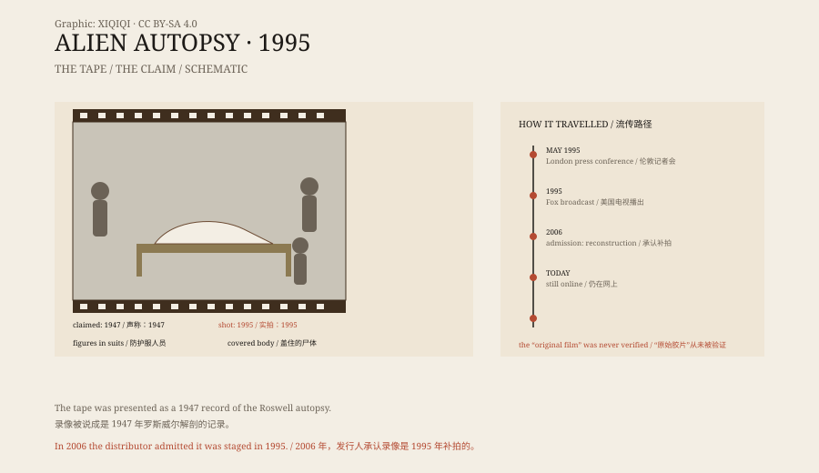

## 1. The film of 1995

May 1995, London.

A music producer named Ray Santilli held a press conference. He said he had a film. It was black and white, silent, and shaky, and it showed the U.S. military dissecting an alien body at Roswell in 1947.

He said he had bought it for £100,000 from an eighty-two-year-old retired military cameraman. The cameraman had been assigned to film the autopsy and had secretly kept a copy.

That year, the footage was broadcast on American television. The ratings were huge.

## 2. What was on the film

The film runs for about a quarter of an hour.

It shows a makeshift examination room. Several figures in protective suits and masks stand around a table. On the table lies a body: a large head, black eyes, a small mouth, and thin limbs.

They cut the skin, remove organs, and place them to one side. The image is blurry, the light flickers, and it looks as if it was shot on an old camera.

That roughness made many people believe it was real.

*Original schematic: how the footage circulated, the key details in the image, and the later admission. Not historical footage. Oddity Archive, CC BY-SA 4.0.*

## 3. The flaws

Sceptics quickly found problems.

The “alien” looked like rubber. The organs were the wrong shape, as if taken from an animal. The examiners' movements were not professional, and the instruments did not look like 1947 military equipment.

More importantly, Santilli could not name the cameraman or produce the original film. He said the film had deteriorated, and that he could only provide a video copy.

In 2006, Santilli finally admitted that the footage was not from 1947. It had been shot in a London flat in 1995. The alien was a model made of latex and animal organs.

He still insisted that he had seen a real film in 1992, that it had deteriorated, and that his footage was a “reconstruction”.

No one has ever seen that “real film”.

## 4. Why people believed it

Roswell was already a reason to believe.

In 1947, the U.S. military recovered a crashed object near Roswell, New Mexico. It first described the object as a flying disc, then changed its account to a weather balloon. That reversal became the seed of decades of conspiracy theories.

The 1995 film fitted the gap perfectly. It offered something visible: not a document, not a testimony, but an image.

Television wanted ratings, the audience wanted an answer, and the tape wanted mystery. Together, they made a fake travel.

## 5. Afterwards

In 2006, a comedy called *Alien Autopsy* turned the affair into a joke.

Santilli was not prosecuted. He continued to work in music and television and occasionally gave interviews, still saying he had not faked anything, only reconstructed it.

The footage can still be found online. The image is worse now, but the alien looks the same.

## 6. Now

No one treats the film as evidence today.

It has become a case study in media history: a blurry image and a big story can fool a great many people very quickly. Later audiences learned to check film stock, ask about provenance, and compare equipment, but the same thing still happens.

The alien was made of latex. It lay on a table, was cut open, and was filmed. It never lived, but it became more famous than many real things.

---

**Sources and licenses**: the factual sources are listed in the source ledger S1–S3 at the bottom of this entry. Text and original diagrams are licensed under CC BY-SA 4.0. This article separates the contents of the film, Santilli's claims, the flaws, and the admission; the 1995 footage was admitted by its distributor to be a reconstruction, and the alleged “original film” has never been independently verified.
