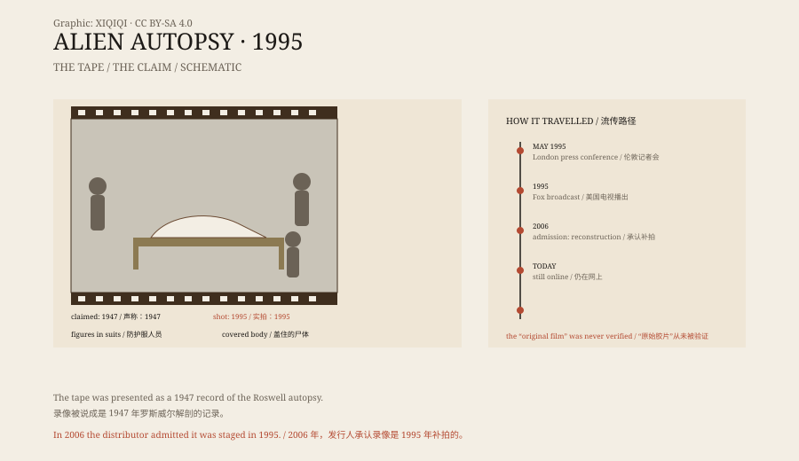

## 一、1995 年的录像

1995 年 5 月，伦敦。

一个叫雷·桑蒂利的音乐制作人召开记者会，说自己手里有一段胶片。胶片是黑白的，没有声音，画面抖动，拍的是 1947 年美国军方在罗斯威尔解剖一具外星人尸体的过程。

他说，胶片是他花十万英镑，从一位八十二岁的退役军方摄影师手里买来的。摄影师当年被派去拍摄解剖，偷偷留下了一份拷贝。

同年，这段录像在美国的电视上播出。收视率很高。

## 二、画面里有什么

录像大约十几分钟。

画面里是一间简陋的解剖室。几个穿着防护服、戴着口罩的人，围着一张桌子。桌上躺着一具身体：头很大，眼睛是黑色的，嘴巴很小，四肢细长。

他们切开皮肤，取出器官，摆在一旁。镜头很模糊，光线忽明忽暗，像是用老式摄影机拍的。

这种粗糙感，反而让很多人相信它是真的。

*原创示意图：录像的流转路径、画面中的关键细节与后来的承认。不是历史影像。稀奇奇编辑部，CC BY-SA 4.0。*

## 三、破绽

怀疑的人很快找出了问题。

录像里的“外星人”看起来像橡胶做的。器官的形状不对，像是从动物身上取来的。解剖者的动作不专业，器械也不像 1947 年的军用装备。

更关键的是，桑蒂利说不出摄影师的名字，也拿不出胶片的原始拷贝。他说胶片已经老化，只能提供翻录的录像带。

2006 年，桑蒂利终于承认：录像不是 1947 年的，而是 1995 年在伦敦的一间公寓里补拍的。“外星人”是乳胶和动物内脏做的模型。

但他仍然坚持，自己 1992 年看过一部真的胶片，只是胶片坏了，他拍的是“重建”。

没有人见过那部“真的胶片”。

## 四、为什么有人信

罗斯威尔本身就是一个相信的起点。

1947 年，美国军方在新墨西哥州罗斯威尔附近回收了一个坠落的物体。军方先说那是飞碟，后来又改口说是气象气球。这个改口，成了几十年的阴谋论源头。

1995 年的录像，正好接上了这个缺口。它给了一个“看得见”的证据：不是文件，不是证词，而是一段画面。

电视需要收视率，观众需要答案，录像带需要神秘感。三方合在一起，假的东西就传开了。

## 五、后来

2006 年，一部叫《外星人解剖》的喜剧电影上映，把这件事拍成了笑话。

桑蒂利没有再被刑事起诉。他继续做音乐和电视，偶尔接受采访，仍然说自己“没有伪造，只是重建”。

那段录像现在还能在网上找到。画质更差了，但“外星人”的样子没有变。

## 六、现在

今天，没有人把这段录像当作证据。

它成了媒体史上的一个案例：一段模糊的影像，配上一个大故事，可以在很短的时间里骗过很多人。后来者学会了检查胶片、追问来源、比对器械，但同样的事情仍然在发生。

那具“外星人”是乳胶做的。它躺在桌子上，被切开，被拍下来。它从来没有活过，却比很多真实的东西更有名。

---

**来源与许可**：本文的事实来源见条目底部来源台账 S1–S3。文字与原创示意图采用 CC BY-SA 4.0。文中把录像内容、桑蒂利的说法、破绽与承认分开叙述；1995 年的录像被发行人承认为补拍，所谓“原始胶片”从未被独立验证。
