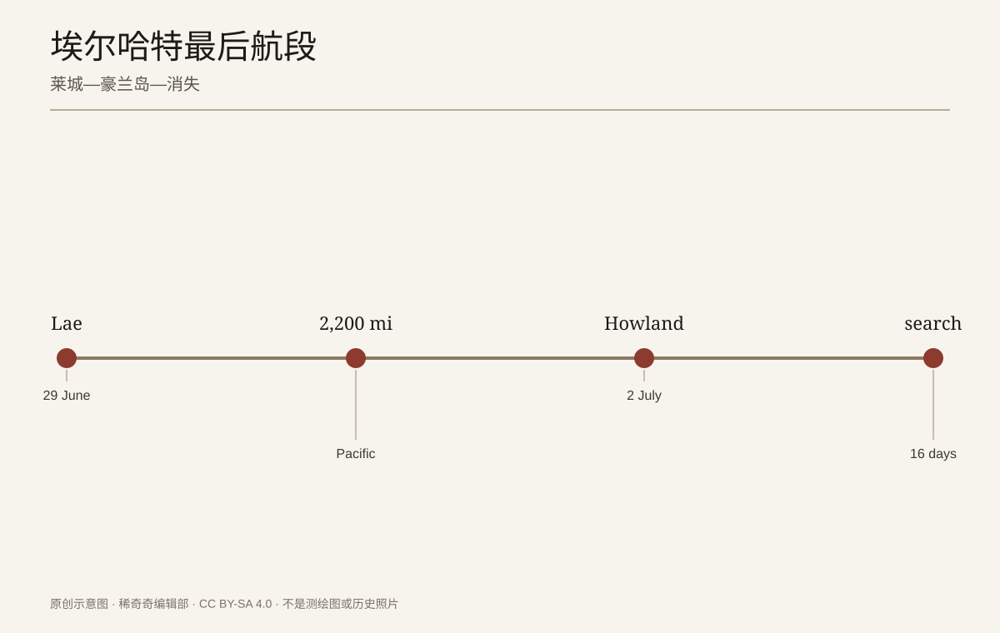

## 1. A flying career

Amelia Earhart was born in Atchison, Kansas, in 1897 and became a pilot in the 1920s. In 1928 she crossed the Atlantic as a passenger, becoming the first woman to fly across the ocean; in 1932 she flew solo from Newfoundland to Northern Ireland, completing a solo transatlantic flight. In 1935 she flew from Hawaii to California, proving a Pacific route. Her fame came not only from flying but from writing, lecturing, and promoting aviation education for women.

## 2. The round-the-world route

In 1937 Earhart attempted a round-the-world flight along an equatorial route. With navigator Fred Noonan she flew a twin-engine Lockheed Electra from Oakland via Hawaii, Howland Island, Lae, Darwin, India, and Africa, then back toward the United States. On 29 June they took off from Lae for Howland Island, 2,200 miles away; on 2 July the aircraft lost contact near Howland. Howland is only a narrow coral island with a short runway and limited navigation aids.

*Original diagram: Earhart's final 1937 leg and search area. Not a survey drawing. XIQIQI Editorial, CC BY-SA 4.0.*

## 3. Vanishing near Howland

The US Navy and Coast Guard mounted one of the largest sea searches of the time, lasting more than two weeks with multiple ships and aircraft over a vast area of the Pacific, without finding wreckage or survivors. The Coast Guard cutter Itasca, near Howland, received radio signals, but the bearings were ambiguous and could not fix a position. The final radio messages, fuel consumption, and weather are the starting point for every later hypothesis.

## 4. The main hypotheses

The most direct explanation is that the aircraft ran out of fuel and crashed into the Pacific, with wreckage sinking or never found. Another hypothesis holds that the plane landed on Nikumaroro reef, now in Kiribati, and the crew survived for a time; supporters cite bones, shoes, and radio signals found in 1940, but the bones were later lost and their identification is disputed. A third hypothesis says the two were captured and held by Japanese forces, resting mainly on oral accounts and inference. Each explains some facts but cannot exclude the others.

*Original diagram: three main hypotheses for Earhart's loss and the strength of their evidence. Not a survey drawing. XIQIQI Editorial, CC BY-SA 4.0.*

## 5. What the archives show

Purdue University's Earhart archive holds flight plans, correspondence, photographs, and clippings; US national archives and Navy logs record the search tracks; international radio monitoring records give signal times. They can confirm departure, route, last contact, and search area, but not the aircraft's final location. Since the 2010s private searches have used sonar, satellite imagery, and underwater photography; a sonar image was published in 2024, but experts generally consider it insufficient to prove it was the Electra. The gap in the archive is exactly where legends grow.

## 6. Legacy and the search continues

Earhart became a symbol of women's aviation, adventure, and celebrity culture. Her disappearance entered books, films, songs, and conspiracy theories, with Nikumaroro, Howland, and Japanese camps becoming narrative locations. For researchers, the priority is to separate symbol from evidence: her flight records can be verified, her final hours cannot. Searches continue, but every new image or document needs the same tests: provenance, chain of custody, and reproducibility.

## Sources and evidence

For “Amelia Earhart: The Last Leg That Never Landed”, the factual trail runs mainly through S1–S3: S1 is “Amelia Earhart” and S2 is “Amelia Earhart Collection”. Dates, places, and names in the text follow the lowest common denominator of those sources; image credits and licences are listed at the foot of the entry.

The cover is an AI-assisted reconstruction of “Amelia Earhart: The Last Leg That Never Landed”, not a site photograph; the two inline figures are original diagrams, not survey drawings. Image types and licences are recorded row by row in research/image-audit.csv.

## Archive location

Earhart's archive has three main lines: Purdue University holds flight plans, correspondence, photographs, and clippings; the US National Archives, Navy, and Coast Guard hold search tracks, radio logs, and official reports; the Smithsonian National Air and Space Museum holds Electra-related material and aviation-history collections. Private investigation groups such as TIGHAR keep separate photographic, sonar, and field records, but their methods, samples, and conclusions need independent assessment. The common gap across all three lines is the absence of wreckage, a confirmed final position, and a complete original record of the last radio messages. This entry therefore states only the confirmed route and search area, and treats no single hypothesis as a conclusion. No single archive can settle the case, and no single theory should be presented as if it had. The absence of a final position is itself the most important archival fact.

## Limits of the record

The final location of Earhart and Noonan has not been confirmed. The crash-and-sink, Nikumaroro strandings, and Japanese capture hypotheses all lack decisive physical evidence; radio signals, photographs, bones, and sonar images each support a part but do not complete a chain. The 1937 search records, US Navy and Coast Guard logs, Purdue archives, and private investigations differ in quality and purpose. This entry separates the confirmed route and loss time from later speculation and does not treat a documentary or a single photograph as closing evidence.

---

**Sources and licenses**: the factual claims above are traced to S1 and S2 in the source ledger; S3 covers the AI-assisted cover and the two original diagrams. Text and original diagrams are licensed CC BY-SA 4.0. This entry separates the documented record from reconstruction and marks remaining uncertainty under 'Limits of the record'. Where the archive is silent, the text says so rather than filling the gap with narrative. Dates and figures follow the cited pages; interpretations are identified as interpretations, and no hypothesis is presented as a settled fact.
