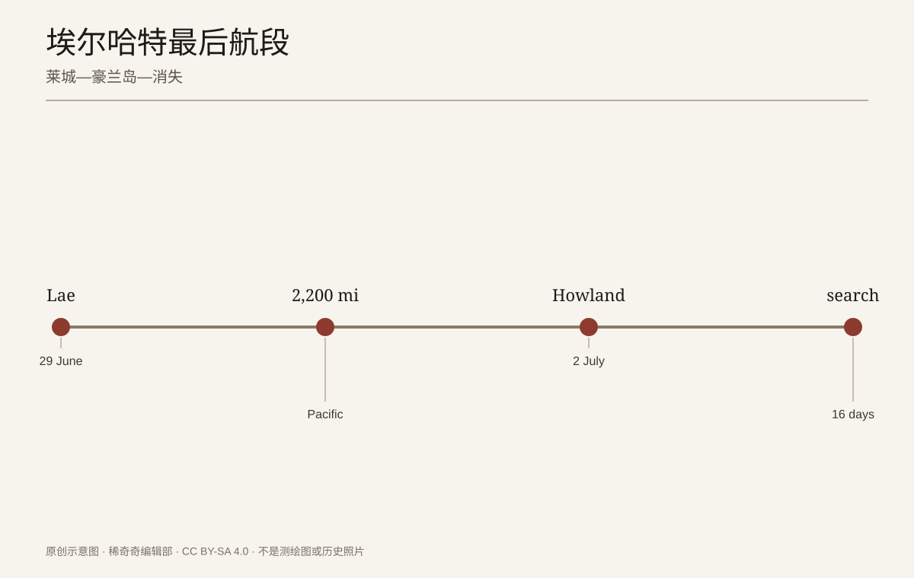
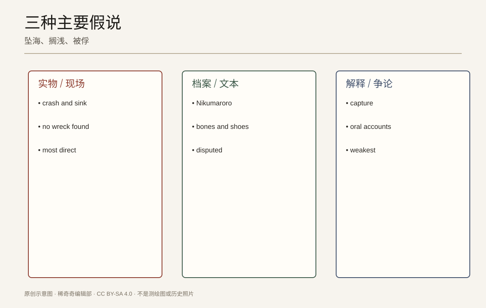

## 一、飞行生涯

阿梅莉亚·埃尔哈特 1897 年生于美国堪萨斯州阿奇森，1920 年代成为飞行员。1928 年，她作为乘客参加跨大西洋飞行，成为第一位飞越大西洋的女性；1932 年，她独自驾机从纽芬兰飞往北爱尔兰，完成单人跨大西洋飞行。1935 年，她从夏威夷飞往加州，证明太平洋航线可行。她的名声不只来自飞行，也来自写作、演讲和推动女性航空教育。

## 二、环球航线

1937 年，埃尔哈特尝试沿赤道方向环球飞行。她与 navigator 弗雷德·努南驾驶一架双引擎洛克希德 Electra，从奥克兰出发，经夏威夷、豪兰岛、莱城、达尔文、印度、非洲，再回到美国。6 月 29 日，他们从莱城起飞，目标是 2,200 英里外的豪兰岛；7 月 2 日，飞机在接近豪兰岛时失去联系。豪兰岛只是一个狭长的珊瑚礁，跑道和导航设施都很有限。

*原创示意图：埃尔哈特 1937 年最后航段与搜索区域。不是测绘图。稀奇奇编辑部，CC BY-SA 4.0。*

## 三、消失与搜索

美国海军与海岸警卫队展开了当时规模最大的海上搜索之一，持续两周多，出动多艘军舰和飞机，覆盖太平洋大片海域，没有找到飞机残骸或 survivors。海岸警卫队的“伊塔斯卡”号在豪兰岛附近接收过无线电信号，但信号方向模糊，无法定位。最后的无线电内容、油量消耗和天气条件，成为后来所有假说的起点。

## 四、主要假说

最直接的解释是飞机在燃油耗尽后坠入太平洋，残骸沉没或未被发现。另一种假说认为，飞机在尼库马罗罗礁（现属基里巴斯）搁浅，机组在岛上生存了一段时间；支持者引用 1940 年发现的骨骼、鞋具和无线电信号，但骨骼后来遗失，鉴定也有争议。第三种假说认为两人被日军俘获并关押，证据多为口述与推测。每种假说都能解释部分事实，却都无法排除其他可能。

*原创示意图：埃尔哈特失踪的三种主要假说与证据强度。不是测绘图。稀奇奇编辑部，CC BY-SA 4.0。*

## 五、档案能证明什么

普渡大学的埃尔哈特档案保存了飞行计划、通信、照片和剪报；美国国家档案与海军日志记录了搜索航迹；国际无线电监听记录提供了信号时间。它们能确认出发时间、航线、最后联络和搜索范围，却不能确认飞机最终位置。2010 年代以后，私人调查使用声呐、卫星图像和水下摄影，2024 年曾公布一张声呐图像，但专家普遍认为不足以证明是 Electra。档案的空白，正是各种传说的生长空间。

## 六、遗产与仍在继续的搜索

埃尔哈特成为女性航空、冒险和名人文化的象征。她的失踪被写进书籍、电影、歌曲和阴谋论，尼库马罗罗礁、豪兰岛和日本拘留营都成了叙事地点。对研究者而言，最重要的是把“象征”与“证据”分开：她的飞行纪录可以核实，最后时刻不能。搜索仍在继续，但每一次新图像或新文件出现，都需要同样的检验：来源、链条、可重复性。

## 来源与证据

本文的可核对材料主要来自 S1《Amelia Earhart》与 S2《Amelia Earhart Collection》；S3 及后续编号为编辑部制作的封面、示意图或补充说明，只用于视觉与背景，不作为史实依据。正文中的年代、数量、地点与归属判断，尽量回到 S1/S2 的具体页面。

封面是「埃尔哈特：最后一段没有降落的航线」的 AI 辅助场景复原，不是现场照片；两张插图为原创示意图，不是测绘图。图片类型与许可逐行记录在 research/image-audit.csv。

## 档案位置

埃尔哈特的档案有三条主线：普渡大学保存飞行计划、通信、照片与剪报；美国国家档案馆、海军与海岸警卫队保存搜索航迹、无线电日志和官方报告；史密森尼国家航空航天博物馆保存 Electra 相关资料与航空史收藏。民间调查组织（如 TIGHAR）另有一套照片、声呐与实地记录，但其方法、样本和结论需要独立评估。三条主线的共同缺口是：没有飞机残骸、没有可确认的最终位置、没有完整的最后无线电原始记录。本文因此只写已确认的航线和搜索范围，不把任何单一假说写成结论。

## 档案空白

埃尔哈特与努南的最终位置没有确认。坠海、在尼库马罗罗礁搁浅、被日方俘获等假说都缺少决定性物证；无线电信号、照片、骨骼和声呐图像各自能支持一部分，却不能拼成完整链条。1937 年的搜索记录、美国海军与海岸警卫队日志、普渡大学档案和民间调查，质量与用途并不相同。本文把“已确认的航线和失踪时间”与“后来的推测”分开，不把纪录片或单张照片当作结案证据。

---

**来源与许可**：本文的事实来源见条目底部来源台账 S1–S3。文字与原创示意图采用 CC BY-SA 4.0。
