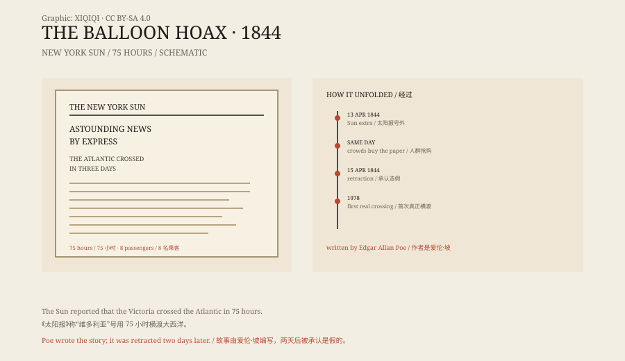

## 1. The morning of 1844

13 April 1844 was a Saturday.

The New York Sun published an extra. The front page said the balloon Victoria had crossed the Atlantic in 75 hours with eight passengers and landed at Sullivan's Island, South Carolina.

In those days, a ship took about two weeks to cross the Atlantic. A 75-hour crossing meant the ocean had become a lake.

New Yorkers crowded the Sun's office to buy the paper. People read it in the street and ran to the docks to ask for news. The paper printed more copies and still sold out.

## 2. The story

The report was detailed.

The balloon was designed by Monck Mason, a real British balloonist. It was filled with gas and carried a lifeboat, food, and instruments. There were eight passengers, including Mason, an engineer, a journalist, and two sailors.

The report described the ascent, the winds, ships seen below, the stars at night, and conversations among the passengers. At one point, a passenger says that from high up the Atlantic looks like “a mere lake”.

These details made it believable. It did not read like a fantasy; it read like a dispatch.

*Original schematic: the extra's layout, the elements of the story, and the timeline of the exposure. Not a historical newspaper. Oddity Archive, CC BY-SA 4.0.*

## 3. Why people believed it

In the 1840s, balloons were a popular technology.

European aeronauts kept setting new records for time aloft and distance. People believed a balloon would eventually cross the ocean. Newspapers liked such stories, and readers loved them.

The Sun itself had form. In 1835 it had serialised a report about life on the moon, and sales had soared. That was the “Moon Hoax”; this was the “Balloon Hoax”.

More importantly, the report used the format of a special correspondent and a dispatch forwarded via Norfolk. Readers saw a chain of apparently reliable sources, not a signed work of fiction.

## 4. The man who wrote it

The story was written by Edgar Allan Poe.

He was living in New York at the time, poor and unsuccessful. He wanted to write a fictional story about a balloon crossing the Atlantic, but he thought no one would read it as fiction. So he wrote it as a news report and gave it to the Sun.

Poe later wrote that he found it amusing to see the paper on the streets and the crowds buying it. He did not come forward at once; he waited for the newspaper to find out.

Two days later, the Sun admitted the report was false. Poe's name was not on the original report, but it was soon linked to him.

## 5. The real crossing

A balloon did not cross the Atlantic until 1978.

That year, Ben Abruzzo, Maxie Anderson, and Larry Newman flew the Double Eagle II from Maine and landed in France. The flight took about 137 hours.

In 1984, Joe Kittinger crossed the Atlantic alone. In 1987, the Virgin Atlantic Flyer made the first commercial balloon crossing.

Poe's story was 134 years early. His 75 hours were faster than the real first crossing.

## 6. Now

The “Balloon Hoax” has become a case study in journalism history.

It shows that a story that looks like news, with the right format and enough detail, can spread very quickly if readers are willing to believe it. New Yorkers in 1844 had no photographs, no live broadcasts, and no fact-checking; they had newspapers and word of mouth.

Poe did not become famous for it. He is remembered for “The Raven” and his detective stories. The balloon was just one of his many hoaxes.

---

**Sources and licenses**: the factual sources are listed in the source ledger S1–S3 at the bottom of this entry. Text and original diagrams are licensed under CC BY-SA 4.0. This article separates the 1844 report, Poe's involvement, the public reaction, and the real crossing records; the Sun admitted the report was false two days later.
