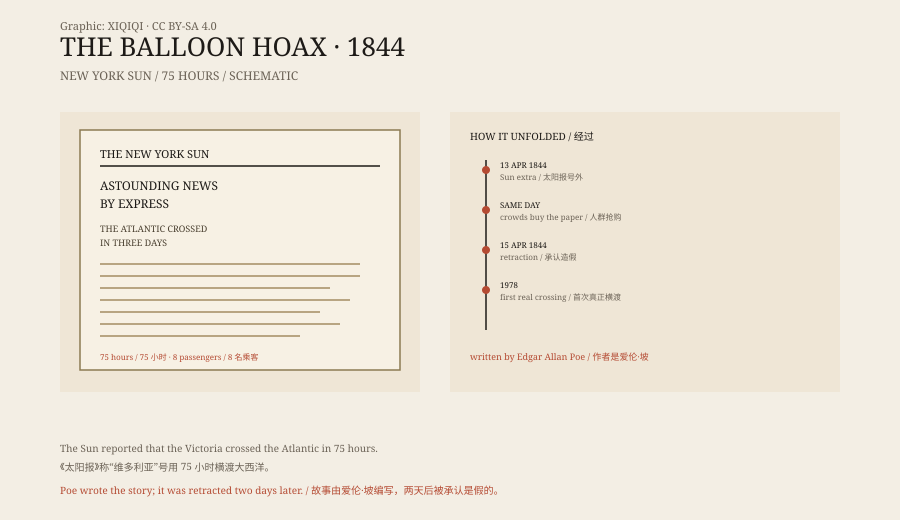

## 1. The morning of 1844

13 April 1844 was a Saturday.

The New York Sun published an extra. The front page said the balloon Victoria had crossed the Atlantic in 75 hours with eight passengers and landed at Sullivan's Island, South Carolina.

In those days, a ship took about two weeks to cross the Atlantic. A 75-hour crossing meant the ocean had become a lake.

New Yorkers crowded the Sun's office to buy the paper. People read it in the street and ran to the docks to ask for news. The paper printed more copies and still sold out.

## 2. The story

The report was detailed.

The balloon was designed by Monck Mason, a real British balloonist. It was filled with gas and carried a lifeboat, food, and instruments. There were eight passengers, including Mason, an engineer, a journalist, and two sailors.

The report described the ascent, the winds, ships seen below, the stars at night, and conversations among the passengers. At one point, a passenger says that from high up the Atlantic looks like “a mere lake”.

These details made it believable. It did not read like a fantasy; it read like a dispatch.

*Original schematic: the extra's layout, the elements of the story, and the timeline of the exposure. Not a historical newspaper. Oddity Archive, CC BY-SA 4.0.*

## 3. Why people believed it

In the 1840s, balloons were a popular technology.

European aeronauts kept setting new records for time aloft and distance. People believed a balloon would eventually cross the ocean. Newspapers liked such stories, and readers loved them.

The Sun itself had form. In 1835 it had serialised a report about life on the moon, and sales had soared. That was the “Moon Hoax”; this was the “Balloon Hoax”.

More importantly, the report used the format of a special correspondent and a dispatch forwarded via Norfolk. Readers saw a chain of apparently reliable sources, not a signed work of fiction.

## 4. The man who wrote it

The story was written by Edgar Allan Poe.

He was living in New York at the time, poor and unsuccessful. He wanted to write a fictional story about a balloon crossing the Atlantic, but he thought no one would read it as fiction. So he wrote it as a news report and gave it to the Sun.

Poe later wrote that he found it amusing to see the paper on the streets and the crowds buying it. He did not come forward at once; he waited for the newspaper to find out.

Two days later, the Sun admitted the report was false. Poe's name was not on the original report, but it was soon linked to him.

## 5. The real crossing

A balloon did not cross the Atlantic until 1978.

That year, Ben Abruzzo, Maxie Anderson, and Larry Newman flew the Double Eagle II from Maine and landed in France. The flight took about 137 hours.

In 1984, Joe Kittinger crossed the Atlantic alone. In 1987, the Virgin Atlantic Flyer made the first commercial balloon crossing.

Poe's story was 134 years early. His 75 hours were faster than the real first crossing.

## 6. Now

The “Balloon Hoax” has become a case study in journalism history.

It shows that a story that looks like news, with the right format and enough detail, can spread very quickly if readers are willing to believe it. New Yorkers in 1844 had no photographs, no live broadcasts, and no fact-checking; they had newspapers and word of mouth.

Poe did not become famous for it. He is remembered for “The Raven” and his detective stories. The balloon was just one of his many hoaxes.

## 1844

April 1844, New York.

The New York Sun published a story about a man travelling across the Atlantic Ocean in balloons.

## The story

It was reported that balloons took off from the United Kingdom and took three days to arrive in the United States.

It describes the construction of balloons, the altitude of the flight, the direction of the wind and the passengers. The details are great, and they look real.

The story travels further than balloons.

## Why would anyone believe that?

At that time, balloon flights were a hot topic.

It is believed that technology will soon allow people to fly across the Atlantic. The coverage is in line with that expectation.

## A storyteller

The author of the story is Edgar Ellen Poe.

He's a writer, he likes to lie, he likes to experiment. He thinks of this story as a "news experiment."

## A real crossing

Real balloons across the Atlantic Ocean, until 1978.

Two British, flying from the United States to France with the Twin Eagle Five balloon.

## Now

This story is a classic story in the history of news.

It shows that the reader believes not in facts, but in “reasonable stories”.

## New York

New York, 1844, is the city of newspapers.

The Sun Herald, The Tribune, is competitive. The newspapers need stories and readers need surprises.

## Sun

The Sun is a pence newspaper.

It's low price, it's widely distributed, it's like a story. The balloons across the Atlantic, it's just the way it tastes.

## The slope

Edgar Ellen Poe, then editor of The Sun.

He writes novels, poems and reviews. He likes to lie and to be exposed.

## Balloons

In 1844, balloon flights were hot.

It is believed that technology will soon allow people to fly across the Atlantic. The coverage is in line with that expectation.

## Uncover it

After the reports were published, other newspapers began to question them.

The Sun later admitted that the story was false. Poe said he was just doing experiments.

After the reports were published, other newspapers began to question them.

The Sun later admitted that the story was false.

## Newspapers

In 1844, in New York, newspapers were competitive.

The Sun is a pence newspaper and likes to hear things.

## Memory

Balloon con, it's a story about news.

Poe knew the readers would believe because the story was in line with expectations.

Today's news, too. People believe that what they want is not the truth, but what they want.

## And finally

Balloon scam, not over the Atlantic.

It only flew through the front page of the newspaper.

The story travels further than balloons.

## Remember

Balloon con, it's a story about news.

Poe knows that readers will believe, because the story meets expectations. The news today, too. People believe that what they want is not the truth, but what they want to do.

The story goes over the Atlantic, and the balloons don't. The news sometimes goes faster than technology.

## Archives

In 1844, the New York newspaper reported three people crossing the Atlantic Ocean in balloons. The story was a series of days, and it was finally revealed as a trick by the slope.

The hill wrote this story under a false name. He didn't think that the readers would be serious.

The newspaper later apologized, but sales have increased.

This story was later taken into the book of the slopes.

The slope didn't admit it until after death.

When the scam was uncovered, the slopes were not explained.

---

**Sources and licenses**: the factual sources are listed in the source ledger S1–S3 at the bottom of this entry. Text and original diagrams are licensed under CC BY-SA 4.0. This article separates the 1844 report, Poe's involvement, the public reaction, and the real crossing records; the Sun admitted the report was false two days later.
