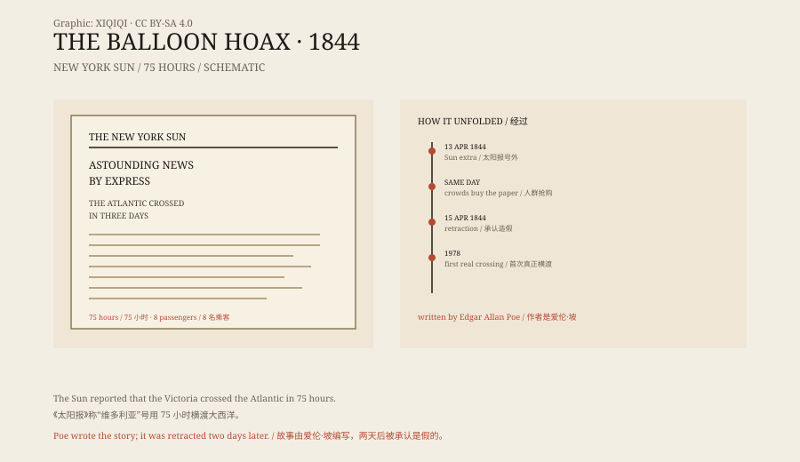

## 一、1844 年的早晨

1844 年 4 月 13 日，星期六。

《纽约太阳报》出了一张号外。头版写着：气球“维多利亚”号横渡大西洋，75 小时，八名乘客，降落在南卡罗来纳的沙利文岛。

在那个年代，坐船横渡大西洋要两个星期。75 小时的消息，等于说大西洋变成了一座湖。

纽约人涌到报社门口买报纸。有人拿着报纸在街上读，有人跑去码头打听消息。报纸加印，还是不够卖。

## 二、故事

报道写得很细。

气球由蒙克·梅森设计，他是一个真实的英国气球飞行家。气球里充的是煤气，下面挂着救生艇、食物和仪器。乘客有八个人，包括梅森、工程师、记者和两名水手。

报道描述了升空、风向、海面上的船只、夜里的星星，还有乘客之间的谈话。有一段说，从高空看，大西洋“只是一片蓝色的桌面”。

这些细节让故事显得可信。它不像幻想小说，更像一篇通讯。

*原创示意图：号外版面、故事要素与揭穿时间线。不是历史报纸。稀奇奇编辑部，CC BY-SA 4.0。*

## 三、为什么有人信

1840 年代，气球是热门技术。

欧洲的飞行家不断刷新滞空时间和飞行距离。人们相信，气球迟早能飞越大洋。报纸也喜欢这类消息，读者爱看。

《纽约太阳报》本身就有前科。1835 年，它连载过“月球上发现生命”的报道，销量大涨。那次是“月亮骗局”，这次是“气球骗局”。

更重要的是，报道用了“本报特派记者”和“诺福克转发”的格式。读者看到的是一连串看起来可靠的消息来源，而不是一个署名的虚构故事。

## 四、写故事的人

故事是埃德加·爱伦·坡写的。

他当时住在纽约，穷，作品不受欢迎。他想写一篇关于气球飞越大西洋的虚构故事，但觉得没人会当小说读。于是他把故事写成新闻报道，投给了《太阳报》。

坡后来写道，他看到报纸上街、人群抢购时，觉得很滑稽。他没有马上站出来承认，而是等报社自己发现。

两天后，《太阳报》承认报道不实。坡的名字没有出现在最初的报道里，但后来还是被查了出来。

## 五、真正的横渡

气球真正飞越大西洋，要等到 1978 年。

那一年，本·阿布鲁佐、马克西·安德森和拉里·纽曼乘坐“双鹰二号”从美国缅因州起飞，降落在法国。飞行时间约 137 小时。

1984 年，乔·基廷格独自飞越大西洋。1987 年，“维珍大西洋飞行者”号完成了第一次气球跨大西洋的商业飞行。

坡的故事比现实早了 134 年。他写的 75 小时，比真正的第一次横渡还快。

## 六、现在

“气球骗局”成了新闻史上的一个案例。

它说明，一篇看起来像新闻的故事，只要格式对、细节足、读者愿意相信，就能在很短的时间里传开。1844 年的纽约人没有照片、没有直播、没有事实核查，他们有的是报纸和口口相传。

坡没有因此出名。他后来靠《乌鸦》和侦探小说被人记住。气球的故事，只是他众多恶作剧中的一个。

---

**来源与许可**：本文的事实来源见条目底部来源台账 S1–S3。文字与原创示意图采用 CC BY-SA 4.0。文中把 1844 年的报道、爱伦·坡的参与、读者反应与真正的横渡记录分开叙述；《纽约太阳报》在两天后承认报道不实。
