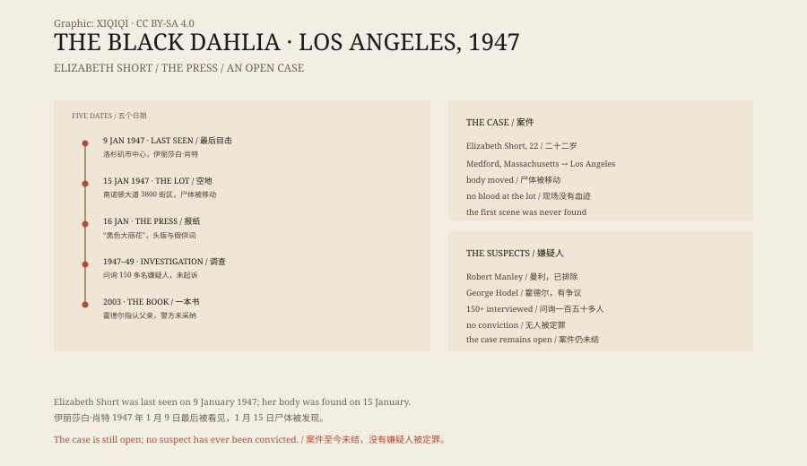

## 1. January 1947

Elizabeth Short was born in Medford, Massachusetts, in 1924, one of five children.

She wanted to go to Hollywood. In the 1940s she travelled back and forth between California and the East Coast, working as a waitress and a clerk and posing for photographs. She wanted to act, but never got a real role.

On 9 January 1947 she was seen in downtown Los Angeles. After that, she disappeared.

## 2. The vacant lot

On the morning of 15 January, a mother was walking with her three-year-old daughter on South Norton Avenue.

In the 3800 block, in a vacant lot, they saw something white. It was the body of a woman.

The body had been cut in half at the waist, drained of blood, and mutilated. It had been posed deliberately, legs apart, arms above the head.

There was no blood at the scene. She had not been killed there. The killer had brought the body, laid it down and left.

## 3. The newspapers

The Los Angeles papers seized on the story.

The name “Black Dahlia” was coined by newspaper editors. It borrowed from the 1946 film The Blue Dahlia and echoed Short's black hair and the black clothes she often wore.

Front pages, extra editions, rumours and false confessions followed. For several weeks the Los Angeles papers sold better than they ever had. People wrote to newsrooms claiming to be the killer; others walked into police stations and confessed, and were eliminated.

## 4. The investigation

The LAPD set up a task force.

They interviewed Short's landlord, friends and former boyfriends, and the people who had last seen her. One of them, a man named Robert Manley, had driven her to a hotel. He was treated as a suspect and later eliminated.

The police received thousands of tips and formally interviewed more than 150 suspects. In 1949 a grand jury heard the case, but no one was indicted.

## 5. The suspects

For more than seventy years the theories have not stopped.

Some named Manley. Some named Dr George Hodel, after the writer Steve Hodel published a book in 2003 accusing his own father. Others linked the killing to a serial offender and to other cases.

All of these theories have problems: no physical evidence, no reliable witness, no timeline that holds. The Hodel claim in particular is disputed, and the police did not adopt it.

## 6. Why it was never solved

The case had several built-in difficulties.

First, the body had been moved, and the original crime scene was never found. Second, the body had been washed and cut, destroying much of the evidence. Third, there was too much media, too many leads, and the false confessions pulled attention in every direction. Fourth, too much time has passed, and the witnesses and suspects have died.

There is also the period: forensic science and databases in 1947 were not what they are today. Even with DNA, there would have to be a sample to compare it with.

## 7. Now

The Black Dahlia case remains open at the LAPD.

The police have never formally closed it, and have never announced a solution. Every few years a new book, a documentary or a new suspect appears.

Elizabeth Short was twenty-two when she died. She wanted to be an actress. What remains is a set of black-and-white photographs and a name invented by a newspaper.

*Original schematic: the timeline of January 1947, the newspaper coverage and the main suspects. Not a photograph of the scene. Oddity Archive, CC BY-SA 4.0.*

---

**Sources and licenses**: the factual sources are listed in the source ledger S1–S3 at the bottom of this entry. Text and original diagrams are licensed under CC BY-SA 4.0. This article separates the confirmed timeline, the newspaper coverage and the various suspect theories; the case remains unsolved, and no accusation has been confirmed in court. The illustration is a scene reconstruction, not a photograph of the scene.
