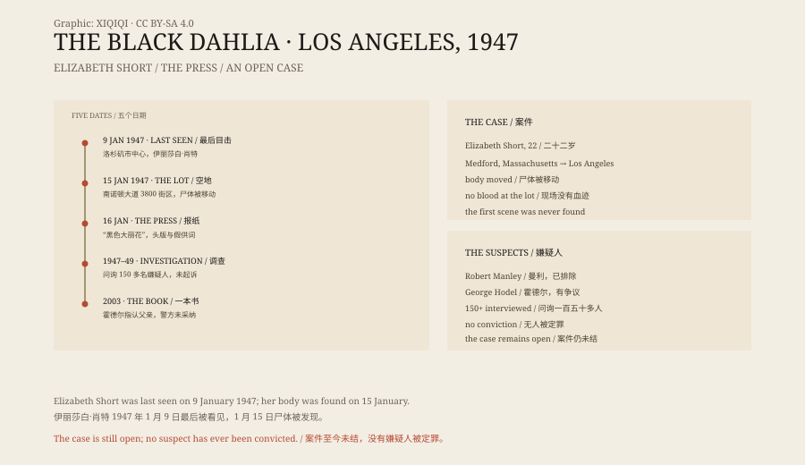

## 一、1947 年 1 月

伊丽莎白·肖特 1924 年出生在马萨诸塞州梅德福，家里有五个孩子。

她想去好莱坞。1940 年代，她多次往返加州和东海岸，做过服务员、店员，也拍过一些照片。她想当演员，但一直没有真正的角色。

1947 年 1 月 9 日，有人在洛杉矶市中心见过她。之后，她消失了。

## 二、空地上

1 月 15 日上午，一位母亲带着三岁的女儿在南诺顿大道散步。

她们在 3800 号街区的一块空地上，看见了一个白色的东西。那是一具女尸。

尸体被从腰部切成两半，血液已经流干，身上有割伤。尸体被摆成一种刻意的姿势，双腿分开，双手举过头顶。

现场没有血迹。这说明她不是在这里被杀的。凶手把尸体运到这里，放下，然后离开。

## 三、报纸

洛杉矶的报纸立刻扑了上去。

“黑色大丽花”这个名字，是报纸编辑起的。它借用了 1946 年的电影《蓝大丽花》，也呼应了肖特的黑发和常穿的黑衣服。

头版、号外、谣言、假自首，接下来的几个星期，洛杉矶的报纸卖得比任何时候都好。有人冒充凶手给报社写信，有人跑到警局说自己杀了人，最后都被排除。

## 四、调查

洛杉矶警方成立了专案组。

他们问过肖特的房东、朋友、前男友，也问过她最后见到的几个人。其中一个叫罗伯特·曼利的男人，曾开车送她去酒店，被列为嫌疑人，后来排除了。

警方收到的线索有几千条，正式问询的嫌疑人超过一百五十人。1949 年，大陪审团听证，但没有起诉任何人。

## 五、嫌疑人

七十多年里，关于凶手的说法一直没有停过。

有人说是曼利；有人说是医生乔治·霍德尔，作家史蒂夫·霍德尔在 2003 年出书，指认自己的父亲；有人说是连环杀手，和另外几起案子有关。

这些说法都有问题：没有物证，没有目击者，没有能站住脚的时间线。霍德尔的说法尤其有争议，警方没有采纳。

## 六、为什么没破

这个案子有几个天然的难点。

第一，尸体被移动过，第一现场没有找到。第二，尸体被清洗和切割，很多痕迹被破坏。第三，媒体太多，线索太杂，假自首和假供词把警方的注意力分散了。第四，时间太久，证人和嫌疑人陆续去世。

还有一点：1947 年的洛杉矶，法医技术和数据库都不如今天。即使有 DNA，也要有一个可以比对的样本。

## 七、现在

黑色大丽花案在洛杉矶警局仍然是“未结案”。

警方没有正式关闭它，也没有宣布破案。每隔几年，就会有一本新书、一部纪录片、一个新的嫌疑人出现。

伊丽莎白·肖特死的时候二十二岁。她想成为演员，最后留下的，是一张张黑白照片和一个报纸起的名字。

*原创示意图：1947 年 1 月的时间线、报纸报道与主要嫌疑人。不是现场照片。稀奇奇编辑部，CC BY-SA 4.0。*

## 时间线

- **1924 年**：伊丽莎白·肖特 1924 年出生在马萨诸塞州梅德福，家里有五个孩子
- **1940 年**：1940 年代，她多次往返加州和东海岸，做过服务员、店员，也拍过一些照片
- **1947 年 1 月 9 日**：1947 年 1 月 9 日，有人在洛杉矶市中心见过她
- **1946 年**：它借用了 1946 年的电影《蓝大丽花》，也呼应了肖特的黑发和常穿的黑衣服
- **1949 年**：1949 年，大陪审团听证，但没有起诉任何人
- **2003 年**：有人说是曼利；有人说是医生乔治·霍德尔，作家史蒂夫·霍德尔在 2003 年出书，指认自己的父亲；有人说是连环杀手，和另外几起案子有关

## 来源与证据

本条目的事实底座以 1 条独立来源为主。S2（HISTORY）覆盖案件背景、媒体反应与未解状态。
原创插图只提供场景复原、结构示意或地图，不作为历史照片使用。正文把可核对记录、后来解释与传说分开叙述；同一件事在不同来源中的版本差异，保留在行文中，不强行合并。

## 档案空白

案件或事件的官方记录、当事人证词与后来叙述之间，常有利害关系和记忆偏差；越著名的故事，越容易把后来添加的细节当成原始事实。
这条档案把记录与未答的问题并排放置，不替读者做出超出证据的结论。
就可信度而言，本条目标为“disputed”。这个标签描述的是当前证据状态，不是对传说真伪的终审；新档案出现时，标签应随之调整。

## 档案补记

以下补记保留正文没有展开的档案侧面：来源、技术细节与后续影响。
**余记**。 黑色大丽花，是一个媒体名字。

肖特的生活，被报纸简化成一个道德故事。 她的死亡，被写成一场表演。 案件没有破，名字却留了下来。

案件没有破。名字却留了下来。
**报纸**。 报纸叫她“黑色大丽花”。

这个名字来自一部电影和她的黑发。报纸喜欢这个名字，因为它短、刺激、容易记住。

报纸把她的死亡，写成“黑色大丽花”。

名字来自她的黑发和黑衣。 报纸用这个名字，卖了很多份。

报纸叫她“黑色大丽花”。
**档案**。 案件档案，部分公开。

照片、证词、线索，都在档案里。档案没有给出答案。

伊丽莎白·肖特 1947 年 1 月被发现死在洛杉矶。她被称为“黑色大丽花”。案件至今没有破。报纸把她写成“堕落的女人”，把案件写成道德故事。

她死前最后一次被人看到，是在好莱坞的一家酒店。

---

**来源与许可**：本文的事实来源见条目底部来源台账 S1–S3。文字与原创示意图采用 CC BY-SA 4.0。文中把已确认的时间线、报纸报道与各种嫌疑人说法分开叙述；案件至今未破，所有关于凶手的指认都没有被法庭确认。插图是场景复原，不是现场照片。

本条目的部分细节在不同来源中存在异文，正文优先采用可核对且能互相印证的版本；具体出处见文末 S1–S3。
