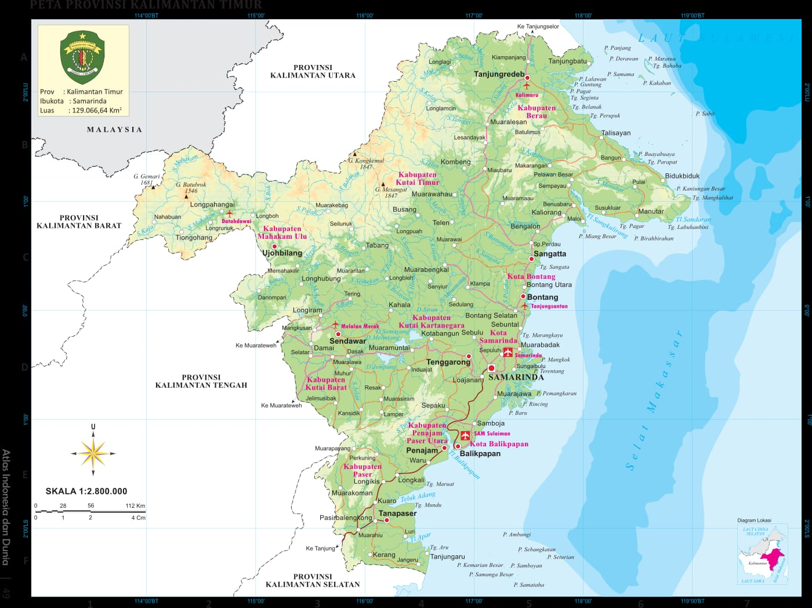
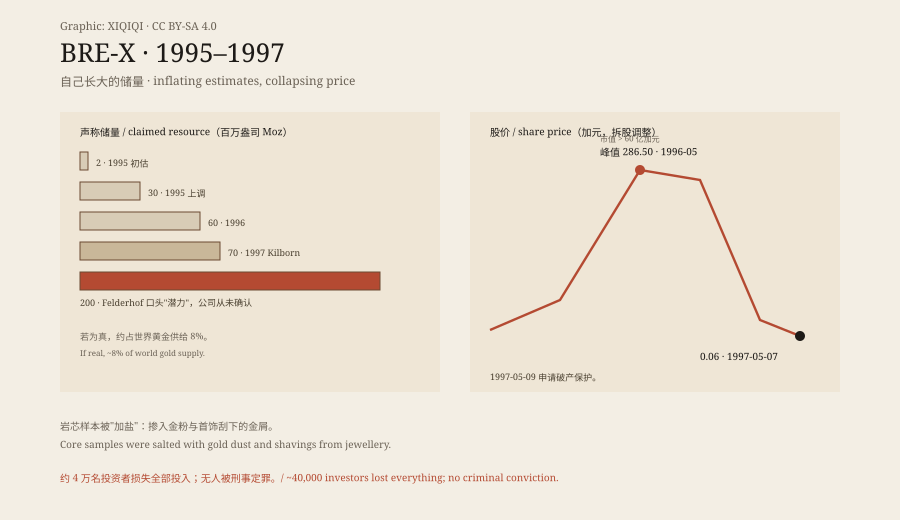
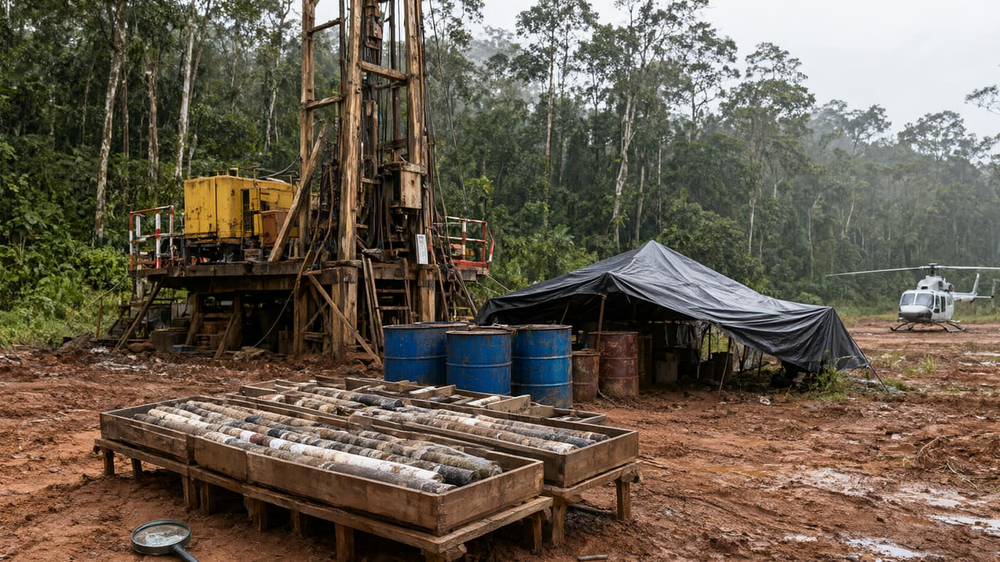

## 1. A company that always lost money

In 1989 David Walsh founded Bre-X Minerals in Calgary. The name came from Bresea, stitched from the first syllables of his sons Brett and Sean. The company listed on the Alberta Stock Exchange and then lost money, consistently.

In March 1993, on the advice of geologist John Felderhof, it bought a claim in the jungle of Kalimantan, Indonesia, beside the Busang River. Felderhof was not a novice: he had co-discovered the Ok Tedi mine in Papua New Guinea — later declared an environmental disaster.

*Official map: Geospatial Information Agency of Indonesia (BIG), Provincial Map of East Kalimantan, 2022, public domain (Wikimedia Commons). Bre-X's Busang claim lay in this province's interior jungle.*

## 2. A drill spot from a dream

Early tests showed no gold at the site. In December 1993, days before the licence was due to expire, chief geologist Michael de Guzman told Walsh he knew the precise spot to drill at Busang I — the location had come to him in a dream.

In May 1995 drilling began at Busang II, with positive results. In October the company announced significant gold. The stock began to fly.

## 3. Numbers that grow by themselves

The resource estimate inflated at an unnatural rate: about 2 million ounces in early 1995; raised to 30 million that same year; 60 million in 1996; 70 million ounces in 1997, estimated by Kilborn Engineering, a division of SNC-Lavalin of Montreal. Felderhof said the potential reached 200 million ounces — a figure the company itself never confirmed. Had it all been real, Bre-X would have held roughly 8% of the world's gold supply.

The share price went from penny stock to a split-adjusted C$286.50 in May 1996, a market capitalisation above C$6 billion. April 1996 it listed on the Toronto Stock Exchange, opening at $187.50; in August it added the Montreal Exchange and NASDAQ.

*Original schematic: the stepwise inflation of claimed resource and the share price from peak to six cents. Oddity Archive, CC BY-SA 4.0.*

## 4. A camp in the jungle

The site sat in lowland rainforest: a drill derrick, core boxes, red laterite, a helicopter strip. A small company could not develop a deposit this size alone, so politics entered: President Suharto first suggested Bre-X share the site with Barrick, in association with his daughter; Bre-X hired Suharto's son Sigit; the businessman Bob Hasan negotiated a structure — Bre-X 45%, Freeport-McMoRan operating, Hasan taking a cut. Announced on 17 February 1997, with Freeport beginning due diligence.

*Reconstruction: an imagined 1995 view of the Busang rainforest drill camp, core boxes and helicopter strip. Not a historical photograph. Oddity Archive, CC BY-SA 4.0.*

On 21 February Placer Dome cancelled its takeover offer. On 10 March Freeport's due diligence came back: the mine contained an insignificant amount of gold.

## 5. Twenty minutes into the helicopter ride

On 19 March 1997, at the Freeport team's request, de Guzman flew to the site by helicopter to discuss the negative results. Twenty minutes into the flight he fell from the helicopter and died — reported as suicide by jumping. Trading in the stock was halted.

He left a few hastily scrawled notes and a Rolex. Four days later a body was found in the jungle, mostly eaten by animals, missing hands and feet with cuts "surgically removed"; it showed evidence of strangulation and lacked de Guzman's dentures, inconsistent with the suicide account. The remains lay 400 metres from a logging road and could have been planted; a body had gone missing from the morgue of the town the helicopter flew from; no one saw the body except another Filipino geologist; it was cremated without DNA or dental confirmation. Hence two speculations: he faked his death and took his money to South America, or he was silenced.

## 6. Salt

Bre-X demanded more reviews. The independent firm Strathcona Minerals reported on 4 May 1997 that the crushed core samples submitted for testing had been falsified by salting with gold dust. In one hole the gold had been shaved off jewellery; the ratios were made realistic so as not to raise alarm. Over two and a half years de Guzman bought an estimated $61,000 of panned gold from locals to salt the samples.

On 7 May the shares fell to six cents, on record volume at the Toronto Stock Exchange — some buyers wanted the certificates as collectibles. On 9 May Bre-X and its sister companies Bresea and Bro-X filed for bankruptcy protection.

## 7. Nobody was convicted

The loss list is long: the Ontario Municipal Employees Retirement Board C$45 million, the Quebec public-sector pension fund C$70 million, the Ontario Teachers' Pension Plan C$100 million; around 40,000 investors lost their entire stakes.

In May 1999 the RCMP closed its investigation without charging anyone. The Ontario Securities Commission charged only Felderhof, with insider trading — he had sold C$84 million of stock in 1996 — but there was no evidence he took part in or knew of the fraud. The trial was suspended in 2001, resumed in 2005, and on 9 August 2007 returned not guilty. Walsh died of a brain aneurysm in the Bahamas on 4 June 1998, aged 52. The class action ended in early 2014: lawyers took C$850,000 and the remaining C$3.5 million was donated to a law foundation and a university — too little to distribute meaningfully among 40,000 people.

The case produced Canada's securities rule NI 43-101, in force 1 February 2001: mineral disclosure requires qualified persons and standardised reporting. The rule is the real legacy; the gold was not.

---

**Sources and licenses**: factual sources are in the ledger S1–S3 below. Text and original schematics are CC BY-SA 4.0. The province map is an official Indonesian public-domain map; the reconstruction is not a historical photograph. Resource and price figures are as reported by the company or third parties at the time; the salting rests on the Strathcona report and subsequent investigations; the cause of de Guzman's death remains disputed and is presented here in parallel.