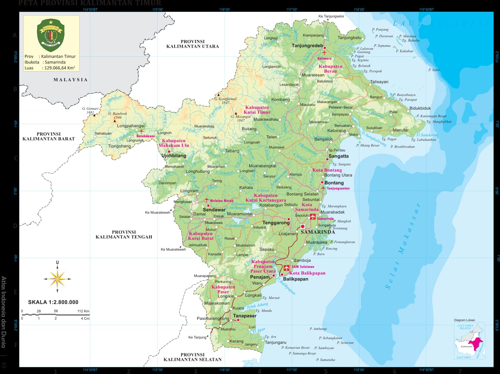
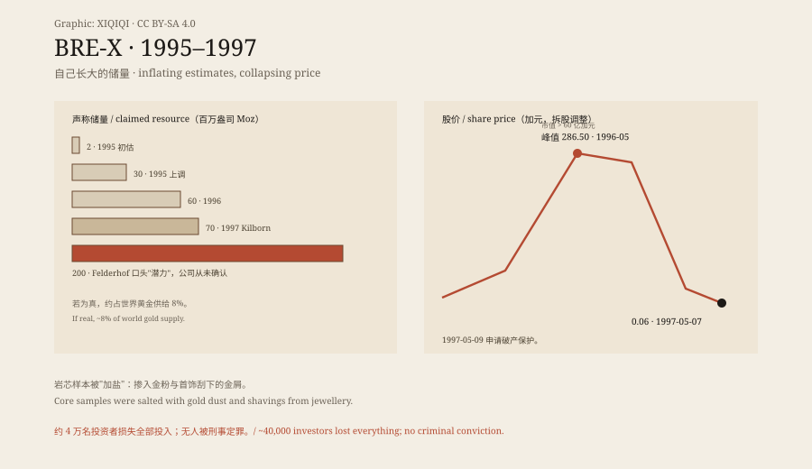
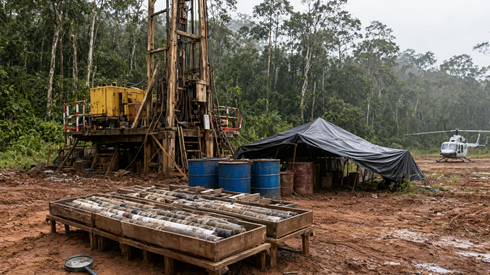

## 一、一家永远亏钱的公司

1989 年，戴维·沃尔什在卡尔加里创立 Bre-X Minerals。名字来自他两个儿子 Brett 和 Sean 的首音节拼成的 Bresea。公司在阿尔伯塔交易所挂牌，然后一直亏钱。沃尔什是个推广者，不是矿主：Bresea、Bre-X、后来的 Bro-X，是一串壳公司名字，核心资产始终是"下一个发现"的故事。

1993 年 3 月，按地质学家约翰·费尔德霍夫的建议，公司买下印度尼西亚加里曼丹丛林里、布桑河旁的一块矿地。费尔德霍夫不是新人：他曾在巴布亚新几内亚共同发现 Ok Tedi 矿——后来被宣布为一场环境灾难。

*官方地图：印度尼西亚地理空间信息局（BIG）2022 年《东加里曼丹省图》，公有领域（Wikimedia Commons）。Bre-X 的 Busang 矿址位于该省内陆丛林。*

## 二、梦里来的钻孔

早期化验显示矿址没有金。1993 年 12 月，许可证即将到期前几天，首席地质学家迈克尔·德·古兹曼告诉沃尔什：他知道该在 Busang I 的哪个精确位置下钻——那个位置是梦里来的。许可证的倒计时与一个梦，构成了这个故事的第一组矛盾：没有数据的时候，叙事先到了。

1995 年 5 月，Busang II 开钻，结果阳性。10 月，公司宣布发现大量金。股价开始起飞。注意时间顺序：先有"阳性结果"的新闻稿，后有独立复核；而独立复核要等到两年后才真正发生。在这两年里，市场的定价依据是公司自己宣布的数字。

## 三、数字自己长大

储量估计以一种不自然的速度膨胀：1995 年初约 200 万盎司；同年上调到 3000 万；1996 年 6000 万；1997 年由蒙特利尔 SNC-Lavalin 旗下的 Kilborn Engineering 估到 7000 万盎司。费尔德霍夫还说潜力可达 2 亿盎司——公司自己从未确认这个数字。若全部为真，Bre-X 将握有约 8% 的世界黄金供给。

股价从便士股冲到 1996 年 5 月的拆股调整后 286.50 加元，市值超过 60 亿加元。1996 年 4 月多伦多交易所挂牌，开盘 187.50 加元；8 月又上蒙特利尔交易所与纳斯达克。每一次新闻稿都把储量往上抬一格，分析师再把那一格写成目标价；数字不是被测量出来的，是被宣布出来的。

*原创示意图：声称储量的逐级上调与股价从峰值到 6 分钱的曲线。稀奇奇编辑部，CC BY-SA 4.0。*

## 四、丛林里的营地

矿址在低地雨林里：钻塔、岩芯箱、红土、直升机坪。小公司吃不下这么大的矿，于是政治进场：印尼总统苏哈托先建议 Bre-X 与 Barrick 分享矿址，合作方包括他的女儿西蒂·哈迪扬蒂·鲁克马纳；Bre-X 雇了苏哈托的儿子 Sigit；商人 Bob Hasan 谈成一笔结构——Bre-X 占 45%，Freeport-McMoRan 运营，Hasan 拿一份，土地权 30 年。1997 年 2 月 17 日宣布，Freeport 开始尽职调查。

*场景复原：1995 年 Busang 雨林钻探营地、岩芯箱与直升机坪的想象画面。不是历史照片。稀奇奇编辑部，CC BY-SA 4.0。*

2 月 21 日，Placer Dome 取消收购要约。3 月 10 日，Freeport 的尽职调查结果回来：矿里的金"微不足道"。消息传出后股票停牌；但即便如此，仍有几位股票分析师坚持认为公司真的拥有世界最大金矿——否定证据已经到场，信念却还没退场。

## 五、直升机上的二十分钟

1997 年 3 月 19 日，应 Freeport 团队要求，德·古兹曼乘直升机去矿址面谈负面结果。起飞二十分钟后，他从直升机上坠亡——报告说是自杀跳机。股票停牌。

他留下几页潦草的遗书和一只劳力士。四天后丛林里找到一具尸体，大半被动物吃掉，手脚缺失且切口"像外科切除"；尸体有勒痕、没有德·古兹曼的假牙，与自杀说法不符。遗体距一条伐木路 400 米，可能被放置；起飞城镇的停尸房曾丢过一具尸体；除另一名菲律宾地质学家外无人见过遗体；未经 DNA 或牙科记录确认即火化。另有五名女子自称是他的妻子，其中一人称在他"死后"多年仍收到他的汇款，但未提供证据。于是有了两种猜测：他假死带钱去了南美，或被灭口。

## 六、盐

Bre-X 要求复核。独立公司 Strathcona Minerals 在 1997 年 5 月 4 日报告：被送检的破碎岩芯样本被"加盐"——掺了金粉。其中一个孔的金是从首饰上刮下来的；掺入比例做得逼真，不引起怀疑。两年半里，德·古兹曼向当地人买了约 6.1 万美元的砂金用于加盐。金是在哪个环节被加进去的，始终没有被证明——但样本里的金与矿体里的金，成分对不上。

5 月 7 日，股价跌到 6 分钱，成交量创多伦多交易所纪录——有人买它是想把股票证书当收藏品。一张印着"世界最大金矿"的纸，从投资凭证变成纪念品，只用了不到两年。5 月 9 日，Bre-X 与姐妹公司 Bresea、Bro-X 申请破产保护。

## 七、没有人被定罪

损失清单很长：安大略市政雇员退休委员会 4500 万加元、魁北克公共部门养老基金 7000 万、安大略教师养老计划 1 亿；约四万名投资者损失全部投入。Barrick 的彼得·蒙克与时任多伦多交易所总裁同样难堪——后者到 1999 年被赶下台。养老基金的钱是普通人的退休钱；这是骗局最具体的代价。

1999 年 5 月，加拿大皇家骑警结束调查，不起诉任何人。安大略证券委员会只起诉了费尔德霍夫内幕交易——他 1996 年卖出 8400 万加元股票；但没有证据表明他参与或知晓造假。审判 2001 年暂停、2005 年恢复，2007 年 8 月 9 日判无罪。沃尔什 1998 年 6 月 4 日在巴哈马死于脑动脉瘤，52 岁。集体诉讼 2014 年初终止：律师拿走 85 万加元，剩余 350 万捐给法律基金会与大学——因为钱太少，分给四万人没有意义。

此案催生了加拿大证券规范 NI 43-101，2001 年 2 月 1 日生效：矿产披露必须有合格人士签字、标准化报告、明确"能说什么、不能说什么"的边界。它把"梦里来的钻孔"挡在披露门外——至少在法律文本上。规则是真实的遗产；金不是。

---

**来源与许可**：事实来源见台账 S1–S3。文字与原创示意图 CC BY-SA 4.0。省图为印度尼西亚官方公有领域地图；场景复原不是历史照片。储量与股价数字均为当年公司或第三方报告所述；造假环节以 Strathcona 报告与后续调查为准；德·古兹曼之死因仍有争议，本文并列呈现。