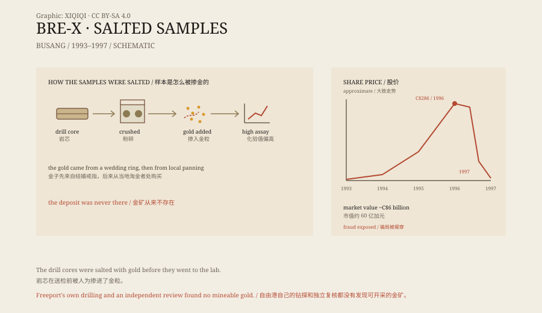

## 一、丛林里的岩芯

布桑在东加里曼丹的丛林深处，离最近的城市也很远。

1993 年，一家叫布雷-X 的加拿大公司拿到了这里的勘探权。公司很小，总部在卡尔加里，名气不大。他们请来地质学家迈克尔·德古兹曼，负责钻探和取样。

钻机把岩芯从地下取出来，切成段，编号，送到实验室化验。如果化验结果里有金，就说明地下可能有金矿。

1993 年到 1996 年，布雷-X 公布了一批又一批结果。数字很好，好得不像真的。

*原创示意图：岩芯样本的掺金流程与布雷-X 股价的大致走势。不是审计报告。稀奇奇编辑部，CC BY-SA 4.0。*

## 二、股价

消息传到加拿大，股价开始涨。

布雷-X 的股票从几毛钱一股，涨到几十块，再涨到两百多加元。公司的市值一度达到六十亿加元。投资者包括普通散户、基金经理和矿业公司。

新闻里说，布桑可能是几十年来发现的最大金矿之一。印尼政府也介入了，要求持有股份。几家国际矿业公司前来谈判，其中就有美国的自由港麦克莫兰公司。

## 三、金子从哪来

问题出在样本上。

德古兹曼负责的岩芯，在送去化验之前，被人为掺进了金粒。最初，他用的是自己结婚戒指上的金子；戒指上的金子用完了，就从当地淘金的人手里买。

岩芯被粉碎后，金粒混进粉末里，化验结果自然很高。这个过程持续了两年多，样本一批批送出，数字一批批公布。

从外面看，这是一座金矿。实际上，金子是被人带进去的。

## 四、不对劲

1997 年，自由港麦克莫兰在做尽职调查时，发现了异常。

他们自己打钻、自己取样，化验结果和布雷-X 公布的数字差得很远。印尼政府也派了人。独立顾问公司斯特拉斯科纳受委托复核，负责人是地质学家格雷厄姆·法夸尔森。

复核的结论很直接：样本被掺了金，布桑没有可开采的金矿。

## 五、直升机

1997 年 3 月，德古兹曼在前往布桑的途中，从直升机上坠落，死在丛林里。

他的死因没有定论，通常被认为是自杀。他死后，布雷-X 的股价彻底崩溃，公司进入破产程序。投资者损失了大部分积蓄，有人把退休金投了进去。

没有其他人被刑事起诉。骗局的核心人物死了，公司垮了，钱也没有了。

## 六、现在

布桑没有建成金矿。

那片丛林恢复了安静，钻机被拆走，营地荒废。布雷-X 这个名字成了加拿大金融史上的一个案例，被写进商学院教材和监管报告。

这个故事里最容易被记住的是数字：六十亿加元、两百多加元的股价、几年的钻探。但真正让骗局成立的，是一小撮金子，和一群愿意相信的人。

---

**来源与许可**：本文的事实来源见条目底部来源台账 S1–S3。文字与原创示意图采用 CC BY-SA 4.0。文中把勘探经过、股价、掺金手法与调查结论分开叙述；德古兹曼的死亡方式没有定论，相关刑事指控也未成立。
