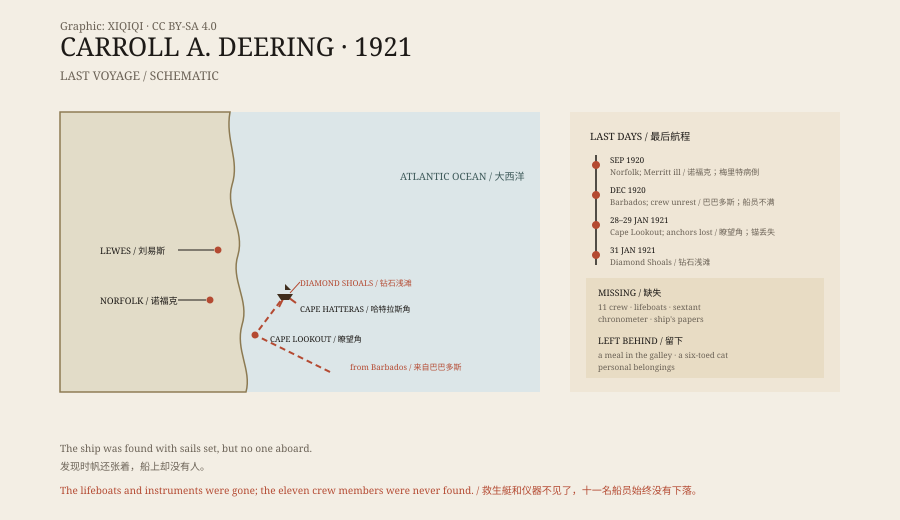

## 1. A ship on Diamond Shoals

On 31 January 1921, off Cape Hatteras, North Carolina.

A storm had been blowing for days. The Coast Guard received a report: a large schooner had grounded on Diamond Shoals, her masts still standing, her sails still set.

The next day, the rescue party got aboard through the surf. The ship was the Carroll A. Deering, a five-masted wooden schooner. Her hull showed no obvious damage.

There was no one on deck. There was no one below.

## 2. What was left aboard

The state of the ship was strange.

The lifeboats were gone. The navigation instruments, the sextant, and the chronometer were gone. Most of the crew's personal belongings were still in their bunks. In the galley, a meal had been prepared, as if someone had been about to eat.

The bunks were disordered, but there were no signs of a fight. The only living thing aboard was a cat with six toes.

The Coast Guard tried to pull the ship off the shoal, but she was stuck fast. On 4 March, to remove a hazard to other vessels, they dynamited the wreck.

*Original schematic: the Deering's last voyage, the grounding site, and the items missing from the ship. Not a nautical chart. Oddity Archive, CC BY-SA 4.0.*

## 3. Where she came from

The Deering was launched in 1919, a coastal freighter built to carry timber and coal.

In September 1920 she left Norfolk, Virginia, for Lewes, Delaware, and then headed south. Her master, Captain William Merritt, fell ill at Lewes and left the ship with his son. The owners brought in a retired captain, Willis Wormell, and a new first mate, Charles McLellan.

The ship went on to Barbados. In December she loaded a cargo of coal and prepared to return to the United States.

In Barbados, people had seen the crew arguing with the captain. One sailor told someone in port that the atmosphere aboard was bad and that he wanted to leave. These reports only surfaced during the later investigation, and their reliability is uncertain.

## 4. The last leg

In January 1921, the Deering headed north along the U.S. coast.

On 28 or 29 January, she passed the Cape Lookout lightship. The men on the lightship remembered someone on deck shouting that the ship had lost her anchors and asking them to notify the owners. The voice sounded urgent.

The Deering continued north. She was seen passing offshore, and there were reports of a large ship with no lights at night, with a small boat nearby.

Then came Diamond Shoals.

## 5. The investigation

The Coast Guard, the Shipping Board, and later the FBI all looked into the case.

They found clues. Papers had been removed from the ship. The lifeboats had been launched, which suggested the crew left deliberately rather than being swept away. But why they left, and where they went, no one could say.

Some proposed mutiny: the crew might have overpowered the captain and abandoned the ship. Others suggested pirates, or a rum-running vessel during Prohibition. Another theory tied the Deering to the Bermuda Triangle, though the shoals lie outside most definitions of it.

The investigation reached no conclusion. Eleven men, and the ship, became one of the most famous disappearances in American maritime history.

## 6. Now

The Deering's wreck is long gone. After the dynamiting, the fragments were scattered by the sea.

Books and articles about the case keep appearing. The theories multiply; the evidence does not. The crew's families waited for years and finally accepted that there was no answer.

When the ship was towed off the shoal, the lifeboats, the instruments, and the eleven men were all missing. What remained was a meal in the galley and a cat with six toes.

## Boat

The Carol A. Dilling is a dhow.

It started in Virginia in 1921, carrying wood to New York.

## Diamond beach

The ship was stranded near the diamond beach.

Diamonds are on the outer beaches of North Carolina, windy and violent.

## The crew

The crew is missing.

There's no one on board, no bodies, no lifeboats. Just cats, and some personal effects.

## Where did it come from?

Where the boat comes from, nobody knows.

It could come from South America, it could come from the Caribbean. The food on the ship came from different places.

## Investigations

Coast Guard investigated it.

No conclusion. Some say it's pirates; others say it's storms; others say it's crews who abandon ships.

## Now

The Carol A. Dilling is a classic of the Ghost Boat.

It's a story that's still on the beach.

## Outer beach

Outside beach, North Carolina.

It's a narrow sandy, windy, stormy place. A lot of boats are stranded here.

## The sailboat

The Carol A. Dilling is a dhow.

It transports timber from Virginia to New York.

## Lifeboats

The lifeboat's gone.

The crew may have been on a lifeboat, or they may have been swept away by the waves.

## Supplementary Notes

The Carol A. Dilling is a dhow.

It transports timber from Virginia to New York. There are crews, food and cats on board.

## Remember that

The Carol A. Dilling is a dhow.

It transports timber from Virginia to New York. There are crews, food and cats on board.

The lifeboat is missing. The crew may be on the lifeboat or they may be swept away by the waves.

## Last

The cats on the ship are the only living thing. They were rescued and later adopted. The ship was dragged back to the port, but no one could explain why the crew left.

Things on the boat are still there, people are gone. The wind on the beach, it's been blowing the story for 100 years.

The boat was dragged back to the port, the story was left on the surface. People were gone and cats were still there.

## Archives

In 1921, the dhow Carol A. Dilling was found on the beach off North Carolina. The lifeboat on board was missing and 10 crew members were missing. The boat was towed back to the port, but no one could explain why the crew left.

The cargo on board is wood. The hull is not broken, the anchor is still in place. The crew's stuff is in the cabin.

When the ship was found, the sails were down, the wheels were intact. There was no storm record at sea.

There was no distress call from the crew before they disappeared. There were no names in the port records.

No one knows the answer.

None of the ten men on the boat left a last message. The search ship was searched for 10 days and nothing was found.

The ship's name came from its first owner. It was a rich businessman. It was dragged back to the port and it was used as an exhibition. It was later dismantled.

The crew members waited for years. No result.

No one explained why the boat was not sinking.

The boat was later dismantled into wood, with only photographs left.

The story of the boat has no ending.

---

**Sources and licenses**: the factual sources are listed in the source ledger S1–S3 at the bottom of this entry. Text and original diagrams are licensed under CC BY-SA 4.0. This article separates the voyage record, the condition of the ship, and the various theories; the fate of the crew is unresolved, and mutiny, piracy, and smuggling remain hypotheses.
