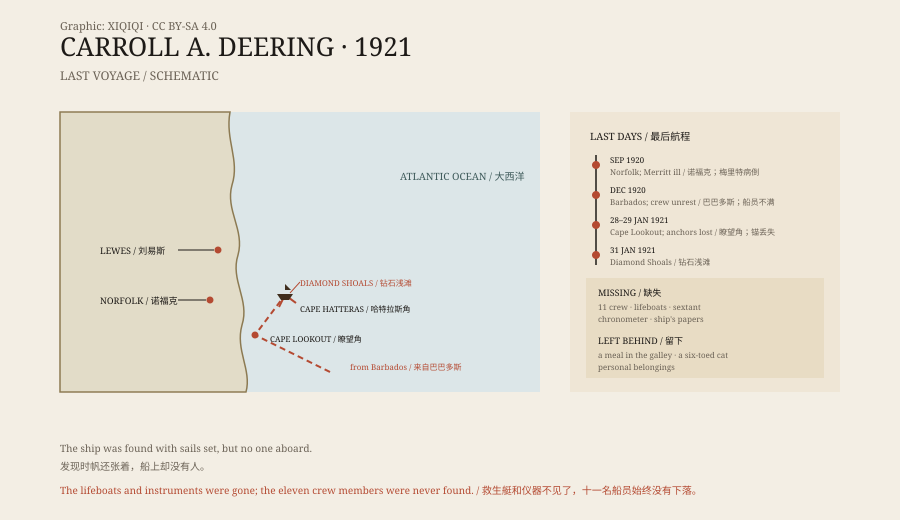

## 一、钻石浅滩上的船

1921 年 1 月 31 日，北卡罗来纳外海，哈特拉斯角。

风暴已经刮了几天。海岸警卫队接到报告：钻石浅滩上搁浅了一艘大帆船，桅杆还立着，帆没有收。

第二天，救援人员冒着浪登上船。船是卡罗尔·A·迪林号，一艘五桅木帆船，船身没有明显破损。

甲板上没有人。舱里也没有人。

## 二、船上留下了什么

船上的状态很奇怪。

救生艇不见了，航海仪器、六分仪和天文钟也不见了。船员的个人物品大多留在舱里。厨房的炉子上有做好的食物，像是有人正准备吃饭。

船员的床铺是乱的，但不像经过搏斗。船上唯一活着的，是一只长着六个脚趾的猫。

海岸警卫队把船拖离浅滩，但它陷得太深。3 月 4 日，为了避免它妨碍其他船只，海岸警卫队把它炸毁了。

*原创示意图：迪林号的最后航段、搁浅位置与船上缺失的物品。不是航海图。稀奇奇编辑部，CC BY-SA 4.0。*

## 三、它从哪里来

迪林号 1919 年下水，是一艘装载木材和煤炭的沿海货船。

1920 年 9 月，它从弗吉尼亚的诺福克出发，先到特拉华州的刘易斯，然后南下。船长威廉·梅里特在刘易斯病倒，带着儿子离开了船。船公司临时请来已经退休的威利斯·沃梅尔当船长，又换了一名大副查尔斯·麦克莱伦。

船继续南下，到了巴巴多斯。12 月，它装满一船煤炭，准备返回美国。

在巴巴多斯，有人看见船员和船长争吵。一个船员对港口的人说，船上气氛不对，他想离开。这些说法是后来调查时才被提起的，真假难辨。

## 四、最后一段航程

1921 年 1 月，迪林号沿美国东海岸北上。

1 月 28 日或 29 日，它经过瞭望角灯船。灯船上的船员记得，甲板上有人喊话，说船的锚丢了，请求通知船公司。喊话的人声音很急。

之后，迪林号继续向北。有人看见它从海岸外经过，也有人说在夜里看到过一艘没有灯的大船，旁边还有一艘小船。

再之后，就是钻石浅滩。

## 五、调查

海岸警卫队、海运局和后来的联邦调查局都查过这件事。

他们找到了一些线索：船上的文件被拿走了，救生艇被放下过，说明船员是主动离开的，而不是被海浪卷走。但为什么离开，去了哪里，没有人能回答。

有人提出是哗变。船员可能制服了船长，弃船逃走。也有人说是海盗，或者是禁酒时期的走私船劫持了它。还有一种说法把它和百慕大三角联系在一起，但迪林号搁浅的位置在百慕大三角之外。

调查没有结论。十一名船员，连同那艘船，成了美国海事史上最著名的失踪案之一。

## 六、现在

迪林号的残骸早就不在了。它被炸毁后，碎片被海浪冲散。

关于它的书和文章不断出现，说法越来越多，证据却没有增加。船员的家属等了几年，最后接受了没有答案的结果。

那艘船被拖走时，救生艇、航海仪器和十一个人都不见了。留下的只有厨房里的饭，和一只六趾的猫。

---

**来源与许可**：本文的事实来源见条目底部来源台账 S1–S3。文字与原创示意图采用 CC BY-SA 4.0。文中把航海记录、现场状况与各种推测分开叙述；船员失踪的原因没有定论，哗变、海盗和走私都只是假设。
