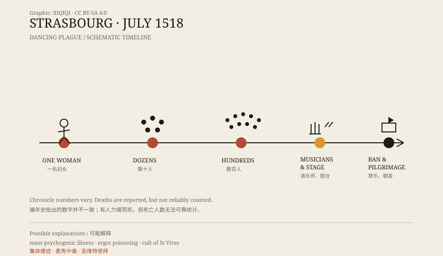

## 1. Strasbourg in July

July 1518, Strasbourg. It was a free city then, with churches, guilds, markets, and narrow streets inside its walls.

According to the chronicles, a woman named Frau Troffea stepped into the street and began to dance.

She was not drunk, and it was not a festival. She danced for a long time, her movements growing larger, until she collapsed. People carried her home. When she recovered, she started again.

## 2. From one person to a crowd

It did not stay with one woman.

Within days, more people were dancing in the streets. Some accounts say dozens; some say more than a hundred. After about a month, the chronicles give a figure of around four hundred.

They were not dancing for pleasure. Some danced until their shoes wore through, some until their legs swelled, some while weeping. Onlookers gathered, and the dancers found it harder and harder to stop.

*Original schematic: the timeline of the 1518 Strasbourg episode and the city's response. Not a historical painting. Oddity Archive, CC BY-SA 4.0.*

## 3. The city's response

At first, the authorities thought the dancers needed to dance it out.

They hired musicians and built a stage in the market square so the dancers would have room. It sounds strange today, but it had a logic at the time: if this was a kind of dancing sickness, perhaps it would end when the dancing was finished.

It did not improve. More people danced, and some began to collapse.

The city changed course. Music was banned, crowds were dispersed, and the dancers were loaded onto carts and sent to a shrine of St Vitus nearby. St Vitus was the saint then associated with curing the “dancing sickness.”

## 4. The numbers in the chronicles

Accounts differ on how many died.

Some chronicles say people died of exhaustion after dancing continuously, from heart attacks or strokes. Others say most eventually stopped and showed no lasting effects.

The figures are hard to verify. Sixteenth-century chronicles were not modern statistics; their authors could exaggerate or leave people out. What is clear is that the episode lasted for weeks, involved far more than a handful of people, and prompted an official response.

## 5. Explanations

The most common modern explanation is mass psychogenic illness.

Strasbourg in 1518 was under strain: famine, disease, syphilis, and poor harvests. In that atmosphere, one person's uncontrollable movements could spread through suggestion and imitation.

Another explanation is ergot poisoning. Rye infected with ergot can produce toxins that cause convulsions, hallucinations, and a burning sensation. But ergot poisoning does not usually produce organised dancing, and it does not explain why the behaviour spread through a crowd.

Some researchers link the episode to the cult of St Vitus. The dancing may not have been a loss of control but a ritual act, with participants entering a trance-like state.

Each explanation has supporters. None fully reconstructs the scene in 1518.

## 6. Afterwards

1518 was not unique. Similar “dancing manias” appeared occasionally in medieval and early modern Europe. Strasbourg's episode became the most cited because it was well recorded and large.

What it leaves is not just a horror story but a window: when a group shares the same fear, the same belief, and the same physical language, what can happen?

---

**Sources and licenses**: the factual sources are listed in the source ledger S1–S3 at the bottom of this entry. Text and original diagrams are licensed under CC BY-SA 4.0. This article separates the chronicle accounts, the city's response, and modern explanations; both the death toll and the number of participants vary between sources.
