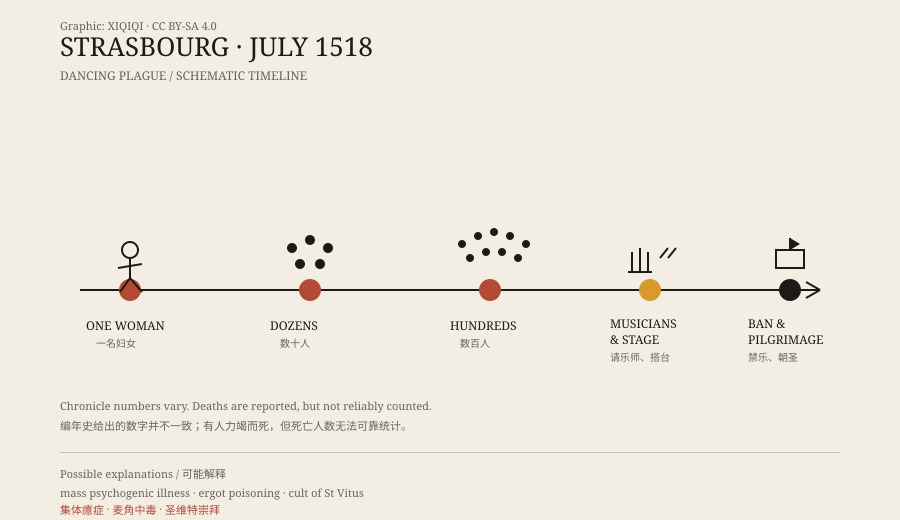

## 一、七月的斯特拉斯堡

1518 年 7 月，斯特拉斯堡。那是一座自由城市，城墙内有教堂、行会、市场和狭窄的街道。

据当时的编年史记载，一名叫特罗菲娅的妇女走上街头，开始跳舞。

她不是喝醉了，也不是在过节。她跳得很久，动作越来越大，最后倒在地上。有人把她扶回家，她恢复后又开始跳。

## 二、从一个人到一群人

事情没有停在她一个人身上。

几天之内，街上有更多的人开始跳。有人说几十个，有人说上百个。到一个多月后，编年史给出的数字是四百人左右。

他们不是在跳舞取乐。有人跳到鞋子磨破，有人跳到腿肿，有人一边哭一边跳。围观的人越来越多，跳舞的人也越来越难停下。

*原创示意图：1518 年斯特拉斯堡事件的时间线与城市应对。不是历史画作。稀奇奇编辑部，CC BY-SA 4.0。*

## 三、城市的选择

一开始，城市当局认为这些人需要把舞跳完。

他们请来乐师，在市场上搭起台子，让跳舞的人有地方跳。这个做法在今天听起来很奇怪，但在当时有它的逻辑：如果这是某种“舞蹈病”，也许跳够了就会好。

结果没有好转。跳舞的人越来越多，有人开始倒下。

城市随后改变策略：禁止音乐，禁止围观，把跳舞的人抬上车，送往附近圣维特的神龛朝圣。圣维特是当时被认为能治疗“舞蹈病”的圣人。

## 四、编年史里的数字

关于死了多少人，说法不一。

有的编年史说，有人在连续跳舞后力竭而死，死于心脏病或中风。也有记载说，大多数人最后停了下来，没有留下后遗症。

这些数字很难核实。16 世纪的编年史不是现代统计，作者可能夸大，也可能漏记。能确认的是：事件持续了数周，涉及的人数远超“几个人”，城市为此采取了正式行动。

## 五、解释

最常见的现代解释是“集体癔症”，也叫群体性心因性疾病。

1518 年的斯特拉斯堡并不好过：饥荒、疾病、梅毒、收成不稳，人们长期处在压力中。在这样的环境里，一个人出现无法控制的动作，周围的人可能通过暗示和模仿，出现类似症状。

另一种解释是麦角中毒。黑麦被麦角菌污染后，会产生类似致幻剂的毒素，导致抽搐、幻觉和灼烧感。但麦角中毒通常不会表现为整齐的跳舞，也无法解释为什么症状会在人群中传播。

还有研究者认为，这可能与圣维特的崇拜有关。跳舞不是失控，而是一种仪式性的行为，参与者进入了某种恍惚状态。

这些解释各有支持者，没有一种能完全还原 1518 年的现场。

## 六、后来

1518 年不是孤例。欧洲中世纪和近代早期，零星出现过类似的“跳舞热”。斯特拉斯堡这一次，因为记录详细、规模大，成了最常被引用的一例。

它留下的不是一个恐怖故事，而是一个观察窗口：当一群人共享同一种恐惧、同一种信仰和同一种身体语言时，会发生什么。

---

**来源与许可**：本文的事实来源见条目底部来源台账 S1–S3。文字与原创示意图采用 CC BY-SA 4.0。文中把编年史记载、城市应对和现代解释分开叙述；死亡人数与参与者数量均存在史料差异。
