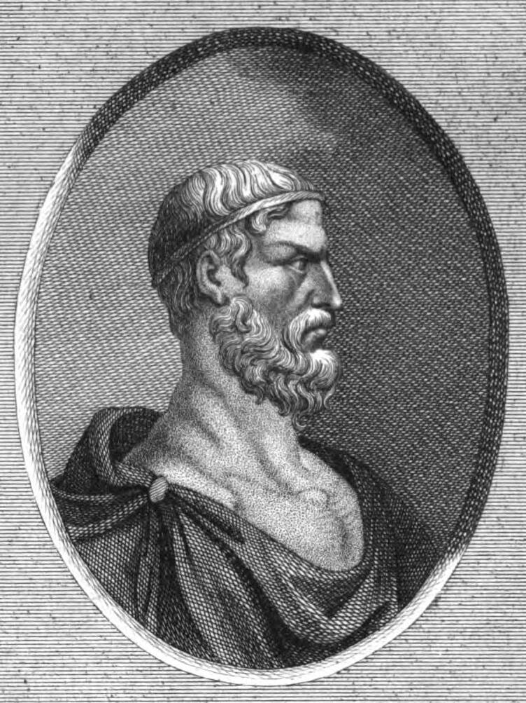
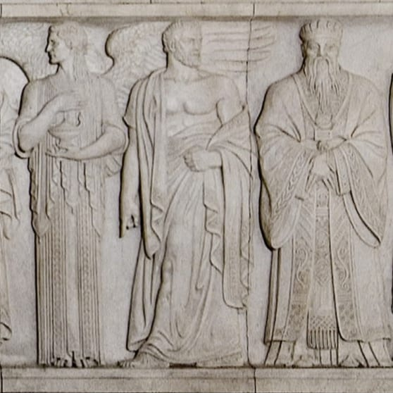
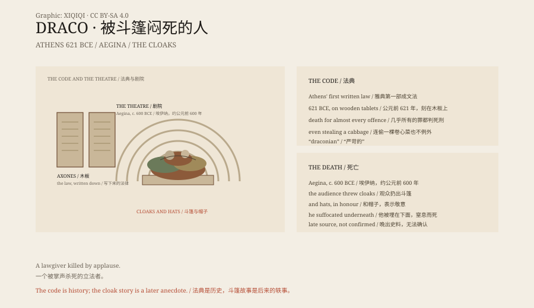

## 1. 621 BCE

Athens had no written law. The laws were spoken by aristocrats and interpreted by them. When a commoner and a noble quarrelled, the answer usually came from the noble.

In 621 BCE, during the archonship of Aristaechmus, a man called Draco was commissioned to write the laws down. It was the first time in Athenian history.

Almost nothing survives about Draco the man. No birth, no death, no family, no writings. There is one year, one code, and one manner of dying.

## 2. The Tablets

The laws were cut into wooden tablets and set up in public, where anyone who could read might read them. The tablets were called axones; they may have been mounted so that they could be pivoted, one face after another. Later they were kept on four-sided pyramid-shaped stones called kyrbeis, and preserved for nearly two centuries.

Before this, law was the knowledge of a few. After it, law was something visible from the square. That change mattered more than any single statute. It meant a man could point at the tablet and say: you have judged wrongly, it does not say that.

## 3. The Statutes

Draco's code was known for its severity.

Stealing: death. Idleness: death. Impiety: death. Stealing a cabbage: death. A debtor whose status was lower than his creditor's could be forced into slavery; the penalty was lighter for a man who owed money to someone of lower rank.

Plutarch preserved a question and answer. Someone asked Draco why he had made death the penalty for most offences. He replied that, in his opinion, the lesser crimes deserved it, and for the greater ones no heavier penalty could be found.

The answer is reported at second hand and may not be his. It does explain the logic of the code: no gradations, only one cut.

There was something new in it. For the first time the law distinguished intentional murder from involuntary homicide. That was not a simple distinction in that age. A killing stopped being only a blood feud between families; it became a matter of intent, to be heard in a court.

## 4. The Inscription of 409/8

Draco's code does not survive whole. What survives is part of a law re-inscribed on stone in 409/8 BCE: the homicide law.

The text says that the right to prosecute a killer belongs to the relatives of the dead. Involuntary homicide carried exile. The penalty for intentional homicide is missing from the fragment; in 409 BCE it was death.

Why would Athens re-inscribe a law two hundred years old? Because the city was revising its laws and republishing what could still be used. The men who cut the stone left the words "the law of Draco about homicide" on it. It is the last appearance of his name in an official law.

## 5. Solon

At the beginning of the sixth century BCE Solon was given the task of reform. He repealed Draco's code, keeping only the homicide law.

Everything else was replaced. Debts, political rights, court procedure — Solon built another system. Later Athenians usually mentioned Draco as a warning: law may be strict, but not so strict that it loses all sense of degree.

## 6. The Death

There is only one source for how Draco died: the Suda, a Byzantine encyclopedia of the tenth century.

It says he went to Aegina to give the island laws. He entered the theatre, and the audience, to show their respect, threw hats and cloaks at him. Too many were thrown. He was buried under them and suffocated.

Several things do not fit. Aegina was on bad terms with Athens at the time; an Athenian lawgiver travelling there to legislate for his city's rivals is hard to believe. Throwing clothes at a man was not a normal mark of honour in a Greek theatre. More likely the story was invented later: a man who punished everything with death should die of an excessively warm welcome.

But it was copied into the encyclopedia, and copied again by later writers. Two thousand years on, the Draco people remember is not the tablet. It is the pile of cloaks.

## 7. The Serpent

Since the eighteenth century some scholars have doubted that Draco existed at all.

Karl Julius Beloch offered an explanation. Drakon means "serpent" in Greek. A sacred serpent was kept and worshipped on the Acropolis. The "laws of Draco" might have been laws issued in the name of the sacred serpent by its priests; in time the origin was forgotten and Draco was remembered as a lawgiver.

The hypothesis explains one puzzle: why a homicide law that developed over a long period came to be attached to a single name. Most scholars do not accept it. The inscription of 409 BCE says "the law of Draco about homicide" in plain words. If the name were only a serpent, the stonecutters would not have written it that way.

## 8. The Name

The adjective draconian has described harsh laws in English since 1777. It outlived Athens, Rome, and every code that ever used it. The word has lasted longer than any statute.

On the south frieze of the United States Supreme Court Building, the sculptor Adolph Alexander Weinman placed Draco in a procession of the great lawgivers of history. The Atlantic has questioned the inclusion: does a man who punished cabbage theft with death belong in that company?

Nobody sentences anyone under Draco's laws now. People use his name for punishments that are too heavy, and use it easily, rarely remembering what the code actually said.

The stone of 409 BCE is still there. It has the homicide law, exile, the right of relatives to prosecute. It does not have a cabbage.

*Historical print: Draco, an 1833 engraving by Max Karl Baldamus. Public domain (Wikimedia Commons). A later imagined portrait, not an ancient object.*

*Site photograph: the relief of Draco on the south frieze of the United States Supreme Court Building, 2023. Supreme Court of the United States (SCOTUS), public domain (Wikimedia Commons). In this group he stands beside Confucius.*

*Original schematic: the written code of 621 BCE, the harsh penalties and the theatre death around 600 BCE. Not a site photograph. XIQIQI Editorial, CC BY-SA 4.0.*

---

**Sources and licenses**: sources are listed in the ledger S1–S5 at the foot of this entry. Text and original diagrams are CC BY-SA 4.0. The article keeps apart the legislation of 621 BCE, the statutes, the re-inscription of 409 BCE, Solon's reform and the death story in the Suda; the death story rests on late testimony and cannot be verified, and Draco's existence is itself disputed. The engraving and the frieze photograph are historical and site images; the schematic is not.
