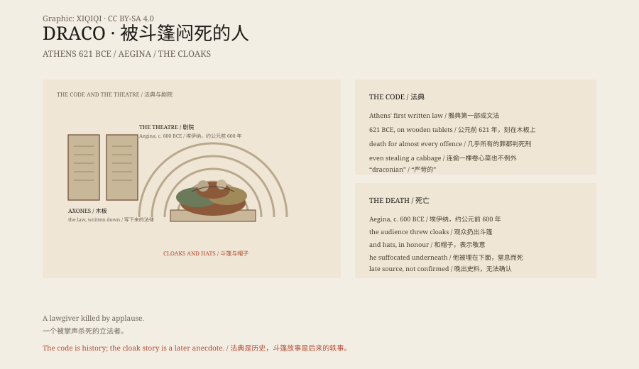

## 1. 621 BCE

Athens had no written law. Law was spoken and interpreted by aristocrats, and disputes between commoners and nobles were often settled by the nobles.

In 621 BCE a man named Draco was commissioned to write the law down.

## 2. The Code

He had the laws carved on wooden tablets and set up in public. It was Athens' first written code.

But the code was famous for its severity. Almost every offence carried the death penalty: theft, idleness, sacrilege, even stealing a cabbage.

Plutarch later wrote that Draco thought small crimes deserved death, and that for great crimes there was no heavier punishment, so they too got death.

The word "draconian" comes from his name.

## 3. The Death

Around 600 BCE Draco was in the theatre on the island of Aegina.

To show their respect, the audience threw their cloaks and hats at him. So many were thrown that he was buried underneath and suffocated.

## 4. Is It True?

The story comes from later writers, not from contemporary records.

Some have even doubted that Draco existed. "Drakon" means serpent in Greek, and the Athenians worshipped a sacred snake; some suggest the name was attached to the code later.

## 5. After the Code

Draco's code was not entirely abolished. Solon later reformed it, keeping the laws on homicide and replacing most of the rest.

"Draconian" survived, used to describe harsh laws.

## 6. The Cloaks

A man who wrote death into the law was finally suffocated by an audience's cloaks.

The ending is too neat, as if a later writer had arranged it.

But it has been told for more than two thousand years. History is sometimes like this: a real institution, with a death that may not be real.

*Original schematic: the 621 BCE written code, the harsh penalties and the theatre death around 600 BCE. Not a photograph of a site. Oddity Archive, CC BY-SA 4.0.*

---

**Sources and licenses**: the factual sources are listed in the source ledger S1–S3 at the bottom of this entry. Text and original diagrams are licensed under CC BY-SA 4.0. This article separates the 621 BCE legislation, the content of the code and the later death anecdote; the death story comes from late sources and cannot be confirmed. The illustration is a scene reconstruction, not a photograph of a site.
