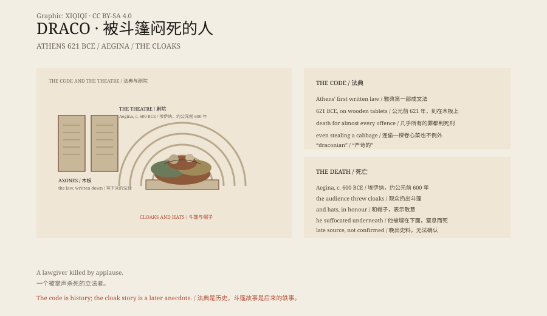

## 一、公元前 621 年

雅典还没有成文法。法律由贵族口传、解释。平民和贵族之间的纠纷，常常由贵族说了算。

公元前 621 年，一个叫德拉古的人受命把法律写下来。

## 二、法典

他把法律刻在木板上，放在公共场所。这是雅典第一部成文法。

但这部法典以严酷出名。几乎所有的罪都判死刑：偷东西、懒惰、亵渎，甚至偷一棵卷心菜。

普鲁塔克后来写道：德拉古认为小罪该判死刑，大罪没有更重的刑罚，所以也只能死刑。

“draconian”这个词，就是从他的名字来的。

## 三、死

约公元前 600 年，德拉古在埃伊纳岛的剧院里。

观众为了表示敬意，把斗篷和帽子扔向他。扔得太多，他被埋在下面，窒息而死。

## 四、可信吗

这个故事来自后来的作者，不是当时的记录。

德拉古本人是否真的存在，也有人怀疑。“drakon”在希腊语里是蛇，雅典人又崇拜一条圣蛇，有人猜这个名字是后来附会上去的。

## 五、法典之后

德拉古的法典没有被完全废除。梭伦后来改革，保留了其中关于谋杀的部分，其余大多改掉。

“draconian”留了下来，用来形容严苛的法律。

## 六、斗篷

一个制定死刑法律的人，最后被观众的斗篷闷死。

这个结局太整齐了，像是一个后来的人替他写的。

但它被讲了两千多年。历史有时候就是这样：一个真实的制度，配上一个不一定真实的死法。

*原创示意图：公元前 621 年成文法、严苛刑罚与约公元前 600 年的剧院之死。不是现场照片。稀奇奇编辑部，CC BY-SA 4.0。*

---

**来源与许可**：本文的事实来源见条目底部来源台账 S1–S3。文字与原创示意图采用 CC BY-SA 4.0。文中把公元前 621 年的立法、法典内容与后来的死亡轶事分开叙述；死亡故事来自晚出史料，无法确认。插图是场景复原，不是现场照片。
