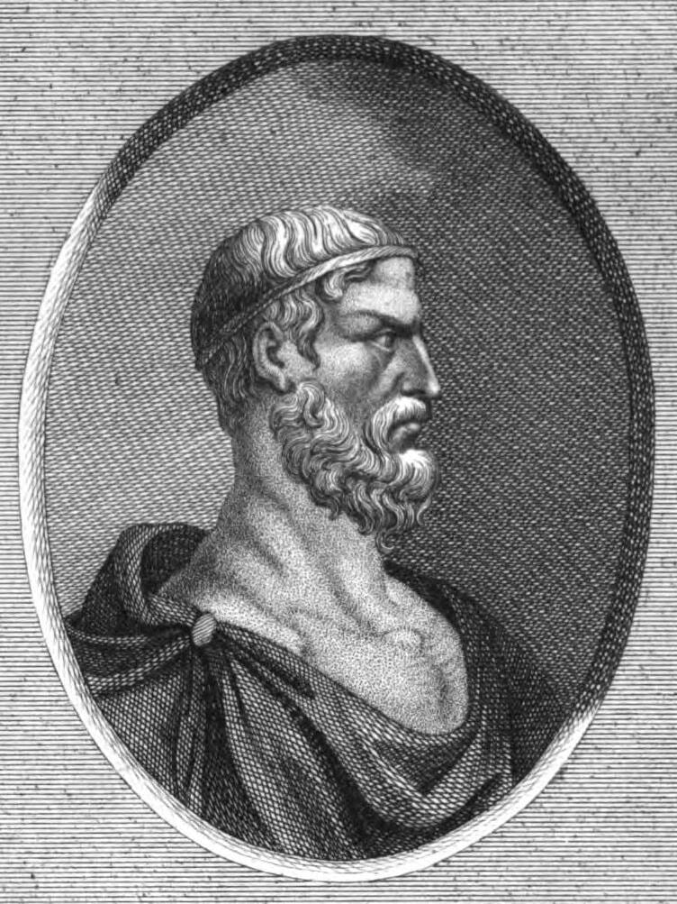
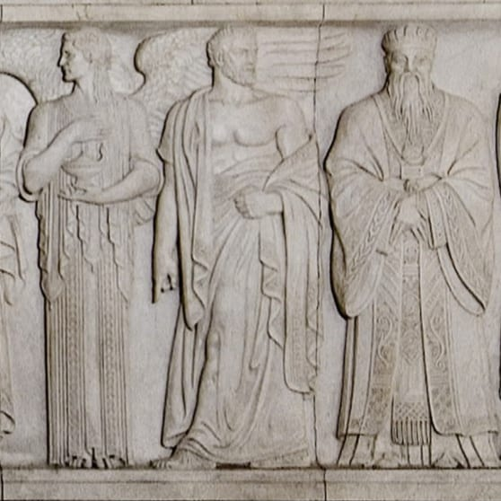
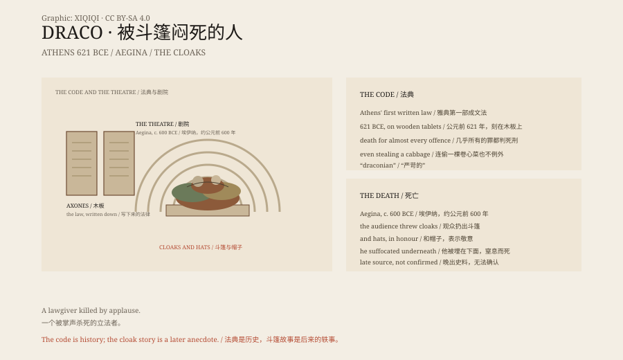

## 一、公元前 621 年

雅典还没有成文法。法律由贵族口传，由他们解释。平民和贵族起了纠纷，谁对谁错，常常由贵族一句话决定。

公元前 621 年，执政官阿里斯泰克穆斯（Aristaechmus）任内，一个叫德拉古（Draco）的人受命把法律写下来。这是雅典历史上第一次。

关于德拉古本人，留下的记载少得可怜。没有生年，没有卒年，没有家庭，没有著作。只有一个年份，一部法典，和一个死法。

## 二、木板

法律刻在木板上，立在公共场所，让识字的人都能读。这些木板叫“axones”，据说可以绕着轴转动，读完一面再转一面。后来它们被保存在一种四棱金字塔形的石碑上，叫“kyrbeis”，保存了将近两百年。

在此之前，法律是少数人的知识。在此之后，法律是站在广场上就能看见的东西。这个变化比条文本身更重要：它意味着，一个人可以指着木板说，你判错了，上面不是这么写的。

## 三、条文

德拉古的法典以严酷出名。

偷东西，死刑。懒惰，死刑。亵渎神明，死刑。偷一棵卷心菜，也是死刑。欠债的人，如果身份比债主低，会被罚为奴隶；反过来，欠了地位更低的人的钱，处罚会轻一些。

普鲁塔克后来记下了一段问答。有人问德拉古，为什么对大多数罪行都判死刑。他回答说，在他看来，小罪配得上死刑，而大罪，找不到比死刑更重的刑罚了。

这句话是后人转述的，未必是原话。但它把这部法典的逻辑说清楚了：没有轻重，只有一刀。

法典里也有新的东西。它第一次把“故意杀人”和“过失杀人”分开。在那个时代，这是不简单的区分：杀人案不再只是家族之间的血仇，而要看动机，要走法庭。

## 四、公元前 409 年

德拉古的法典没有完整留到今天。保存下来的，是一块公元前 409/8 年重刻的碑铭，上面是杀人法的部分条文。

碑文说，起诉凶手的权利属于死者的亲属。过失杀人，判流放。故意杀人的刑罚，碑文残缺，看不清楚；而重刻这条法律的公元前 409 年，故意杀人是死刑。

雅典人为什么要重刻一部两百年前的法律？因为城邦要整理旧法，把还能用的部分重新公布。刻石的人把“德拉古的杀人法”几个字留在了碑上。这是他的名字最后一次出现在官方法律里。

## 五、梭伦

公元前 6 世纪初，梭伦受命改革。他废除了德拉古的法典，只留下杀人法。

其余的都改了。债务、政治权利、法庭程序，梭伦另起一套。雅典人后来提起德拉古，多半是把他当作一个反面例子：法律可以严，但不能严到没有区别。

## 六、死

德拉古怎么死的，只有一个来源：十世纪拜占庭的《苏达》辞典。

辞典里说，他去了埃伊纳岛，替那里的人立法。进了剧场，观众为了表示敬意，把帽子和斗篷扔向他。扔得太多，他被埋在下面，窒息而死。

这个故事有几个地方对不上。埃伊纳岛当时和雅典关系紧张，一个雅典立法者跑去替敌人立法，未必合情理。剧场里向人扔衣服表示敬意，也不像常规礼节。更可能的情况是，这是一个后来编出来的故事：让一个用死刑惩罚一切的人，死于一场过于热烈的欢迎。

但它被抄进了辞典，又被后人一遍遍转述。两千多年后，人们记住的德拉古，不是那块碑，而是那堆斗篷。

## 七、蛇

十八世纪以来，一直有学者怀疑德拉古是否真有其人。

卡尔·尤利乌斯·贝洛赫（Karl Julius Beloch）提出过一个解释：“drakon”在希腊语里是蛇。雅典卫城上养着一条圣蛇，受人崇拜。所谓“德拉古的法律”，也许是祭司以圣蛇之名发布的法律；后来这层来历被忘了，德拉古就被当成一个立法者。

这个假说能解释一件事：雅典的杀人法发展了很久，为什么会被记在一个人名下。但大多数研究者不接受它。公元前 409 年的碑铭上明明白白写着“德拉古的杀人法”，如果这个名字只是蛇，碑刻的人不会这么写。

## 八、名字

“draconian”这个词，英语里从 1777 年开始用来形容严苛的法律。它活过了雅典，活过了罗马，活过了所有曾经使用它的法典。这个词的寿命，比任何一部成文法都长。

在美国最高法院大楼的南面门楣上，雕刻家阿道夫·亚历山大·温曼（Adolph Alexander Weinman）把德拉古排进了“历史上的伟大立法者”行列。《大西洋月刊》曾发文质疑：一个以死刑惩罚偷菜的人，配不配站在这个位置。

没有人再按德拉古的法律判案。人们用他的名字形容过重的刑罚，用得很顺手，很少有人想起那部法典到底写了什么。

那块公元前 409 年的碑还在。上面有杀人法，有流放，有亲属的起诉权。没有卷心菜。

*历史画作：德拉古像，1833 年版画，马克斯·卡尔·巴尔达穆斯（Max Karl Baldamus）作。公有领域（Wikimedia Commons）。这是后人想象的肖像，不是古代实物。*

*现场照片：美国最高法院大楼南面门楣上的德拉古浮雕，2023 年。美国最高法院（SCOTUS），公有领域（Wikimedia Commons）。这一组浮雕中，他与孔子并列。*

*原创示意图：公元前 621 年成文法、严苛刑罚与约公元前 600 年的剧场之死。不是现场照片。稀奇奇编辑部，CC BY-SA 4.0。*

---

**来源与许可**：事实来源见条目底部来源台账 S1–S4。文字与原创示意图采用 CC BY-SA 4.0。文中把公元前 621 年的立法、法典条文、公元前 409 年的重刻、梭伦改革与《苏达》里的死亡故事分开叙述；死亡故事来自晚出史料，无法确认，德拉古其人的真实性也有争议。版画与浮雕照片为历史图像与现场拍摄，示意图不是。
