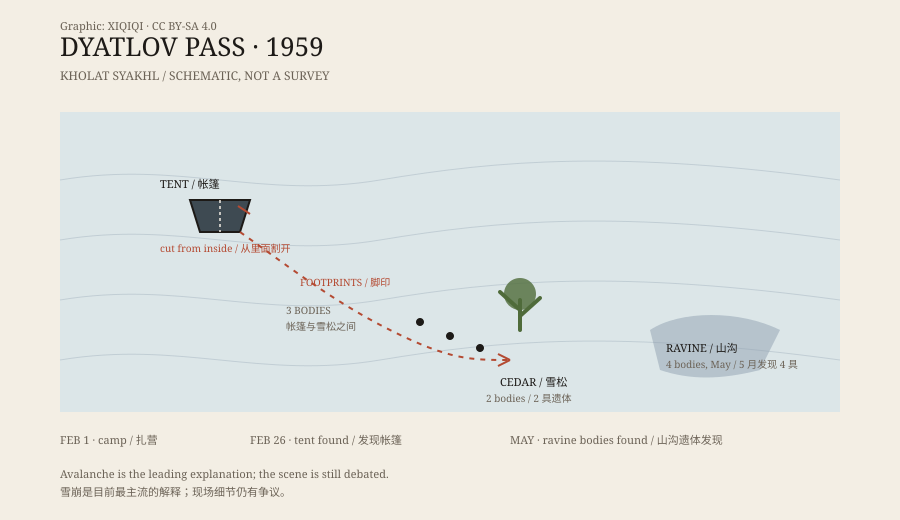

## 1. February 1959

At the end of January 1959, a group of nine set out from a village in the northern Ural Mountains.

Most were students or staff of the Ural Polytechnic Institute. Their leader was Igor Dyatlov. The group included experienced skiers, some of whom had done harder routes. Their goal was to cross a pass and reach the area around Mount Otorten.

On 1 February they pitched camp on the slope of Kholat Syakhl. The name is often translated as “Mountain of the Dead.”

They did not send the messages they had agreed to send.

## 2. The tent

On 26 February, searchers found the tent.

It stood on the slope, partly buried in snow. The outer fabric was damaged, but the strangest detail was this: the opening had been cut from the inside. Not torn by wind, not bitten open from outside — someone had slashed the tent cloth with a knife from within.

Inside the tent were shoes, food, and some coats. Outside, a line of footprints led downhill. Some were barefoot; some were in socks.

*Original schematic: the camp, the direction of the footprints, and the locations where the bodies were found near Kholat Syakhl. Not a precise map. Oddity Archive, CC BY-SA 4.0.*

## 3. The search

The searchers followed the footprints down.

Beside a cedar tree lower on the slope, they found the remains of a fire and two bodies, wearing only underwear. Higher up, between the tent and the cedar, they found three more, positioned as if they had been trying to climb back.

The remaining four were not found until May, after the snow melted, in a ravine. They were more clothed than the others, but had the most severe injuries.

## 4. The injuries

The nine did not all die the same way.

Some died of hypothermia. Others had severe fractures of the chest or skull. Forensic records noted major internal injuries in several of the dead, without matching external wounds.

Some details were repeated later: one woman was missing her tongue and part of the soft tissue of her face. This is often told as something “taken,” but the more common explanation is decomposition and animal activity in the snow and water.

## 5. Explanations

The most common explanation is an avalanche.

In 2021, a study published in Communications Earth & Environment used computer modelling of the terrain to argue that a slab avalanche could have struck while the group slept, forcing them to cut their way out of the tent. Hypothermia, darkness, and haste would explain why some had no coats and why the footprints did not all point the same way.

The explanation is not perfect. The cut tent, the positions of some bodies, and the pattern of injuries still leave details unaccounted for. Other theories followed: katabatic winds, infrasound-induced panic, military tests, secret weapons, even UFOs.

The official Russian investigation concluded in 2020 that an avalanche was responsible. For the families and many researchers, that explains most of the facts but not every question.

## 6. Now

Dyatlov Pass is now a marked route, and hikers still pass through every year. A memorial stands at the site, with the names of the dead carved in stone.

The case is discussed not only because of the deaths but because the scene left such an improbable combination: a tent cut from inside, barefoot people, bodies without coats, severe internal injuries, and a night with no witnesses.

---

**Sources and licenses**: the factual sources are listed in the source ledger S1–S3 at the bottom of this entry. Text and original diagrams are licensed under CC BY-SA 4.0. This article separates the recorded scene, the forensic findings, and the various explanations; details such as the missing tongue are conditions of the remains, not direct evidence of homicide.
