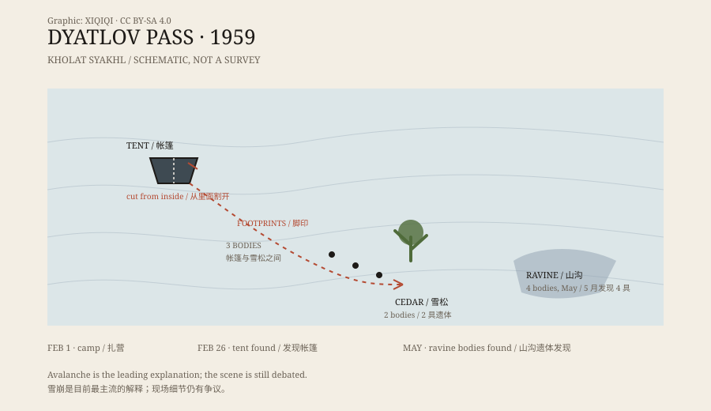

## 一、1959 年 2 月

1959 年 1 月底，一支九人队伍从乌拉尔山脉北部的村庄出发。

他们大多是乌拉尔理工学院的师生，队长叫伊戈尔·迪亚特洛夫。队伍里有滑雪好手，也有人参加过更难的路线。这次的目标是翻越山口，到达奥托尔滕山一带。

2 月 1 日，他们在霍拉特-萨赫尔山的斜坡上扎营。这座山的名字在当地语言里，常被译作“死山”。

之后，他们没有按计划发出消息。

## 二、帐篷

2 月 26 日，搜救队找到了帐篷。

帐篷扎在斜坡上，一部分被雪埋住。外表面有破损，但最奇怪的是：开口是从里面割开的。不是被风撕开，也不是被外面的东西咬开，而是有人用刀从内部划开了帐篷布。

帐篷里面，鞋子、食物、部分外套都还在。帐篷外，有一串脚印向坡下延伸。脚印里有赤脚的，也有只穿袜子的。

*原创示意图：霍拉特-萨赫尔山附近的营地、脚印方向与遗体发现位置。不是精确地图。稀奇奇编辑部，CC BY-SA 4.0。*

## 三、搜索

搜救队沿着脚印往下走。

在坡下的一棵雪松旁，他们找到了火堆的痕迹和两具遗体，只穿着内衣。再往上，在帐篷和雪松之间，又找到了三具遗体，姿势像是想往回爬。

剩下四个人，直到五月雪化后才在一条山沟里被发现。他们穿得比其他人多一些，但伤得最重。

## 四、伤

九个人的死因并不相同。

有的人死于低体温症，有的人有严重的胸部或头部骨折。法医记录里，几名遇难者的内部损伤很重，但体表没有对应的外伤。

还有一些后来被反复提起的细节：一名女性遇难者缺少舌头和部分面部软组织。这个细节常被写成“被取走了”，但更常见的解释是遗体在雪水和动物活动的作用下发生了腐败和缺失。

## 五、解释

最常见的解释是雪崩。

2021 年，一项发表在《Communications Earth & Environment》上的研究用计算机模拟了该地形的雪崩条件，认为一次板状雪崩可能在人们熟睡时发生，迫使他们割开帐篷逃生。低体温、黑暗和匆忙，能解释为什么有人没穿外套、为什么脚印方向不一致。

但这个解释并不完美。帐篷被割开、部分遗体位置、伤情分布，仍有细节对不上。于是还有别的说法：下降风、次声波引发的恐慌、军事试验、秘密武器，甚至不明飞行物。

俄罗斯官方在 2020 年给出的结论是雪崩。对遇难者家属和许多研究者来说，这个结论能解释大部分事实，但不足以让所有疑问消失。

## 六、现在

迪亚特洛夫山口现在是一条有标记的路线，每年仍有登山者经过。事故地点立着纪念物，遇难者的名字被刻在石头上。

这个事件之所以一直被人谈论，不只是因为死亡，而是因为现场留下的组合太不合常理：从里面割开的帐篷、赤脚的人、没有外套的遗体、严重的内部损伤，以及一个没有目击者的夜晚。

---

**来源与许可**：本文的事实来源见条目底部来源台账 S1–S3。文字与原创示意图采用 CC BY-SA 4.0。文中把已记录的现场事实、法医结论与各种解释分开叙述；“缺少舌头”等细节属于遗体状况，不应直接当作他杀证据。
