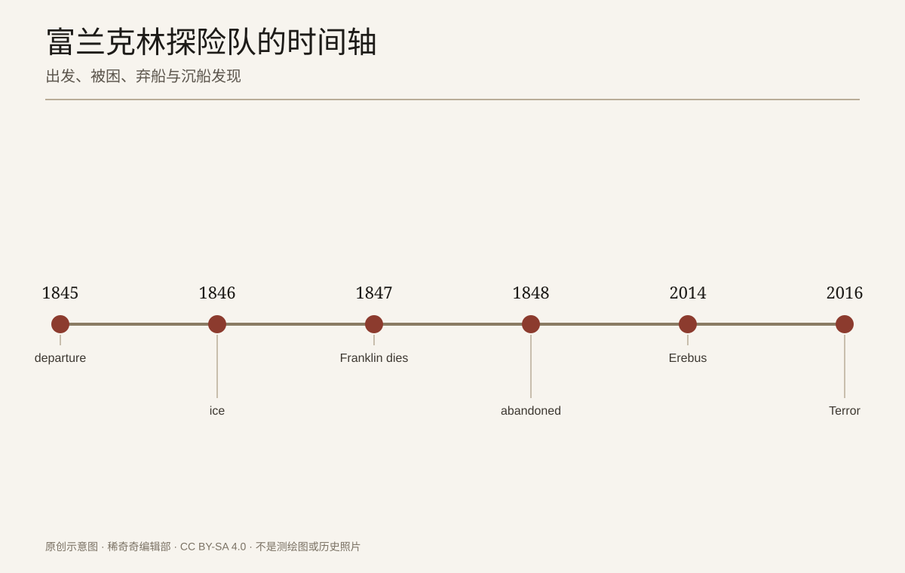
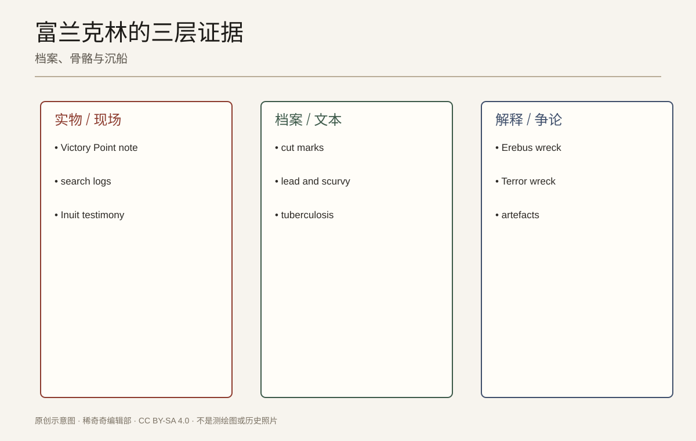

## 1. Departure and mission

In May 1845 the Royal Navy ships HMS Erebus and HMS Terror left Kent for the Arctic to search for the Northwest Passage. The expedition was commanded by Sir John Franklin and numbered 129 men, with steam engines, propellers, large supplies of tinned food, a library, and scientific instruments. The aim was to cross the ice-choked channels of the Canadian Arctic Archipelago and open a route from the Atlantic to the Pacific. After resupplying in Greenland and entering Baffin Bay, the ships left no reliable European record.

## 2. Ice, death, and the loss

In July 1845 whaling ships saw the two vessels for the last time in Baffin Bay. The expedition then entered Lancaster Sound and turned west into the ice. In September 1846 the ships were trapped by pack ice near King William Island; on 11 June 1847 Franklin is believed to have died. In April 1848 the survivors abandoned the ships and tried to walk south toward Back River. The written 'Victory Point note' records these decisions, but its handwriting and content indicate that the man who wrote it never reached safety either.

*Original diagram: the Franklin expedition from departure in 1845 to the wreck discoveries in 2016. Not a survey drawing. XIQIQI Editorial, CC BY-SA 4.0.*

## 3. Search and Inuit testimony

After 1848 the Royal Navy and private search parties entered the Arctic repeatedly. In the 1850s they found three graves on Beechey Island and relics and bones on King William Island; in 1854 John Rae heard from Inuit people the expedition's last news. Inuit testimony recorded 'Aglooka' (possibly Franklin or Crozier) and the crew's southward route, and mentioned disturbing scenes. Early searchers often dismissed this testimony as 'native rumour', but later archaeology has repeatedly confirmed its geographical detail.

## 4. The wrecks found

In 2014 a Parks Canada search team found the wreck of Erebus near King William Island; in 2016 Inuit guides and the search team found Terror. Both lie in shallow, ice-covered water, and their hull structures, cabins, and some contents are remarkably well preserved. The discovery resolved a long-standing question and made underwater archaeology a new evidence source: doors, drawers, instruments, and clothing can show what the crew were doing in their final months, but the wrecks are not the whole truth.

*Original diagram: written records, bone analysis, and wreck archaeology for the Franklin expedition. Not a survey drawing. XIQIQI Editorial, CC BY-SA 4.0.*

## 5. What killed them

Cut marks on bones, lead in pots, the sealing of tinned food, dental evidence of scurvy, and tuberculosis lesions together form a complex picture of death. The lead-poisoning hypothesis holds that lead solder in tins and pipes caused chronic poisoning and weakened the crews; but not every sample shows high lead, and the source of the lead is still disputed. Starvation, cold, and disease were more immediate; under extreme conditions, survivors may have resorted to cannibalism. No single factor explains the fate of all 129 men.

## 6. Heritage and a warming Arctic

The two Franklin wrecks were designated Canadian National Historic Sites around 2015 and are protected under underwater heritage law. Climate change is transforming the Arctic: less sea ice, stronger storms, and warmer water make searching and archaeology easier but also accelerate the decay of wooden hulls and artefacts. Inuit communities are demanding a larger voice in research, naming, and tourism revenue. The 'heroic' Franklin narrative is being rewritten: it is no longer only an imperial exploration story but also a story of Inuit knowledge, colonial violence, and environmental change.

The cover is an AI-assisted reconstruction of “The Franklin Expedition: 129 Men and the Northwest Passage”, not a site photograph; the two inline figures are original diagrams, not survey drawings. Image types and licences are recorded row by row in research/image-audit.csv.

## Archive location

The Franklin archive is distributed across Canada, Britain, and Inuit communities: Parks Canada holds wreck surveys, underwater archaeology, and site-management records; Library and Archives Canada holds search-party logs, maps, and government correspondence; Royal Museums Greenwich holds objects and naval records from the nineteenth-century searches; Inuit Heritage Trust and local communities hold oral histories, place names, and sightings. Early searchers often recorded Inuit testimony as 'rumour', while modern archaeology treats it as checkable geographical information. This entry treats wreck positions, dates, and published bone analyses as verifiable fact; the share of each cause of death, the number of survivors, and the extent of cannibalism still depend on cross-reading those archives.

## Limits of the record

No single cause explains the deaths of the Franklin expedition. Lead poisoning, tuberculosis, scurvy, starvation, cold, and cannibalism all appear in the evidence, but their relative weight is still argued; early searchers' records, Inuit testimony, and bone analysis do not always align. The discovery of the wrecks answered 'where are the ships' but not 'how did the men die'. This entry treats the timeline supported by artefacts and archives as fact, sets out cause models as competing hypotheses, and marks the place of Inuit testimony in the narrative.

---

**Sources and licenses**: for “The Franklin Expedition: 129 Men and the Northwest Passage”, the factual claims above are traced to S1 and S2 in the source ledger; S3 covers the AI-assisted cover and the two original diagrams. Text and original diagrams are licensed CC BY-SA 4.0. This entry separates the documented record from reconstruction and marks remaining uncertainty under 'Limits of the record'. Where the archive is silent, the text says so rather than filling the gap with narrative. Dates and figures follow the cited pages; interpretations are identified as interpretations, and no hypothesis is presented as a settled fact.
