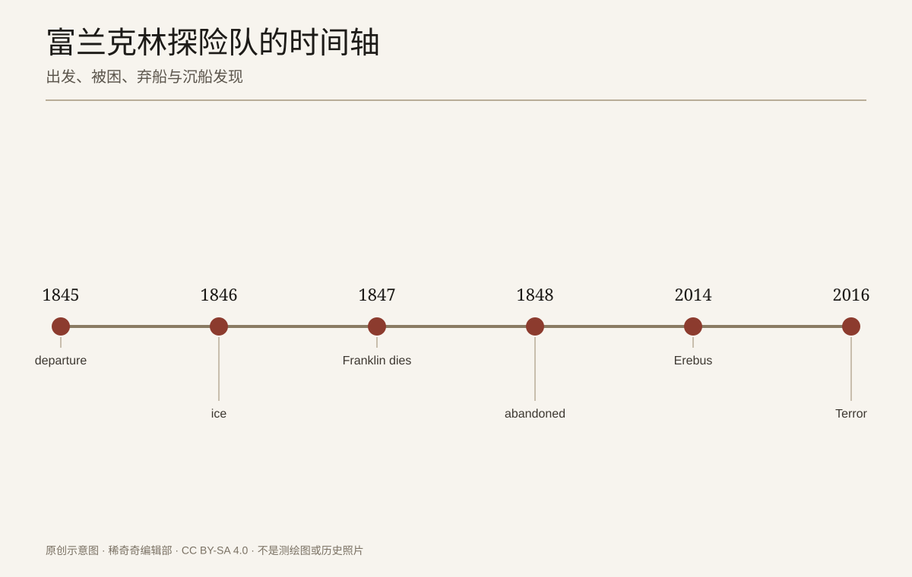
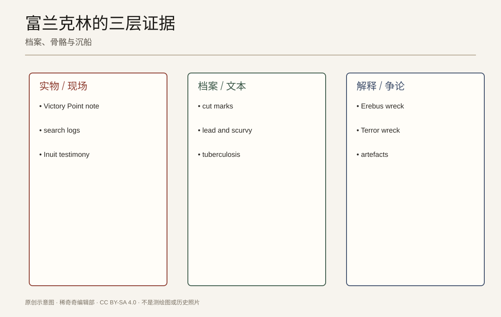

## 一、出发与目标

1845 年 5 月，英国皇家海军的“幽冥号”（HMS Erebus）与“恐怖号”（HMS Terror）从肯特郡出发，前往北极寻找西北航道。船队由约翰·富兰克林爵士指挥，共 129 人，配备蒸汽机、螺旋桨、大量罐头食品、图书馆和科学仪器。目标是穿过加拿大北极群岛的冰海，打通从大西洋到太平洋的航线。两艘船在格陵兰补给后进入巴芬湾，此后再没有可信的欧洲记录。

## 二、冰、死亡与失踪

1845 年 7 月，捕鲸船在巴芬湾最后一次看到两艘船。此后船队进入兰开斯特海峡，向西进入冰区。1846 年 9 月，船只在威廉王岛附近被浮冰困住；1847 年 6 月 11 日，富兰克林据信去世。1848 年 4 月，幸存者弃船，试图向南步行前往巴克河。写在纸上的“胜利点笔记”记录了这些决定，但笔迹和内容表明，写笔记的人后来也没有到达安全地点。

*原创示意图：富兰克林探险队从 1845 年出发到 2016 年发现沉船的时间轴。不是测绘图。稀奇奇编辑部，CC BY-SA 4.0。*

## 三、搜索与因纽特证词

1848 年以后，英国海军和私人搜索队多次进入北极。1850 年代，搜索队在比奇岛发现三名船员墓地，在威廉王岛发现遗物和骨骼；1854 年，约翰·雷从因纽特人那里听到船队最后的消息。因纽特口述记录了“ Aglooka ”（可能指富兰克林或克罗泽）和船员南行的路线，也提到一些令人不安的场景。早期搜索者常把这些证词当作“土著传闻”，但后来的考古发现反复证明其地理细节可靠。

## 四、沉船发现

2014 年，加拿大公园管理局的搜索队在威廉王岛附近发现“幽冥号”残骸；2016 年，因纽特向导与搜索队又发现“恐怖号”。两艘船都位于浅水、冰层覆盖的海域，船体结构、舱室和部分器物保存得异常完整。发现解决了长期悬案，也让水下考古成为新的证据来源：舱门、抽屉、仪器和衣物可以显示船员最后时刻的活动，但沉船不等于全部真相。

*原创示意图：富兰克林探险队的文字档案、骨骼分析与沉船考古三层证据。不是测绘图。稀奇奇编辑部，CC BY-SA 4.0。*

## 五、什么杀死了他们

骨骼上的切割痕迹、锅中的铅、罐头食品的密封工艺、坏血病的牙齿证据和肺结核的病灶，共同构成一幅复杂的死亡图景。铅中毒说认为，罐头食品的铅封和管道中的铅导致慢性中毒，削弱了船员；但并非所有样本都显示高铅，且铅的来源仍有争议。饥饿、寒冻和疾病更直接；在极端条件下，幸存者可能采取同类相食。没有一种因素能单独解释 129 人的结局。

## 六、遗产与变暖的北极

富兰克林探险队的两艘沉船在 2015 年前后被列为加拿大国家历史遗址，受水下遗产法规保护。气候变化正在改变北极：海冰减少、风暴增强、海水温度上升，既让搜索和考古更容易，也加速木船与遗物的降解。因纽特社区要求在研究、命名和旅游收益中拥有更大发言权。富兰克林的“英雄叙事”正在被重写：它不再只是帝国探险的故事，也是因纽特知识、殖民暴力和环境变化的故事。

## 来源与证据

本文的可核对材料主要来自 S1《Franklin Expedition》与 S2《The Franklin Expedition》；S3 及后续编号为编辑部制作的封面、示意图或补充说明，只用于视觉与背景，不作为史实依据。正文中的年代、数量、地点与归属判断，尽量回到 S1/S2 的具体页面。

封面是「富兰克林探险队：西北航道上的 129 人」的 AI 辅助场景复原，不是现场照片；两张插图为原创示意图，不是测绘图。图片类型与许可逐行记录在 research/image-audit.csv。

## 档案位置

富兰克林的档案分布在加拿大、英国和因纽特社区：加拿大公园管理局保存沉船调查、水下考古和遗址管理记录；加拿大国家图书档案馆保存搜索队日志、地图与政府通信；皇家博物馆格林尼治保存 19 世纪搜索队的器物与航海档案；因纽特遗产信托与当地社区保存口述史、地名和目击记录。早期搜索者常把因纽特证词写成“传闻”，现代考古则把它当作可核对的地理信息。本文把沉船位置、日期与已发表的骨骼分析作为可核对事实；死因比例、幸存者人数和同类相食的范围，仍依赖各档案的交叉解释。

## 档案空白

富兰克林探险队的死亡原因没有单一结论。铅中毒、肺结核、坏血病、饥饿、寒冻和同类相食都出现在证据中，但各自的权重仍有争论；早期搜索者的记录、因纽特口述和骨骼分析之间并不总能对齐。沉船发现解决了“船在哪里”，却没有解决“人怎样死”。本文把有物证与档案支撑的时间线写成事实，把死因模型写成并列假说，并注明因纽特证词在叙事中的位置。

---

**来源与许可**：本文的事实来源见条目底部来源台账 S1–S3。文字与原创示意图采用 CC BY-SA 4.0。
