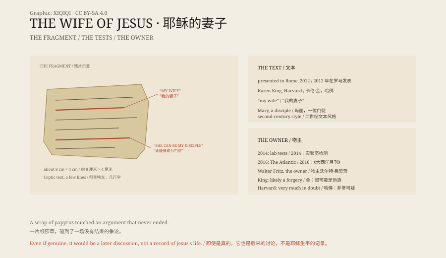

## 1. A Small Piece of Paper

In September 2012 Karen King, a professor at Harvard Divinity School, presented a papyrus fragment at an academic conference in Rome.

The fragment is small, about eight centimetres by four, and carries a few lines of Coptic text.

The most striking lines read: "Jesus said to them, 'My wife...'" and "she will be able to be my disciple."

If genuine, it would be the first ancient text to state plainly that Jesus had a wife.

## 2. What It Says

The fragment is not a complete gospel, only a scrap. Very little can be read: Jesus refers to "my wife", mentions someone named Mary, and says that she can be a disciple.

The grammar and vocabulary resemble Coptic texts of the second century. But resemblance is not authenticity.

Even if the fragment were genuine, it would not prove that Jesus was married. It would more likely show that a century or two after his death, some Christians were discussing whether he had a wife. That is a later argument, not a contemporary record.

## 3. The Argument

Karen King did not declare it authentic. She published it as a text that needed study, and invited other scholars to test it.

Criticism came quickly. Some noted that the edges were too neat, as if cut from a larger sheet; some noted that the Coptic handwriting showed signs of modern imitation; the Vatican newspaper called it a fake outright.

In 2014 King and her colleagues published laboratory results saying that the papyrus and ink were consistent with antiquity and showed no evidence of modern fabrication.

The controversy did not end.

## 4. The Owner

In 2016 the journalist Ariel Sabar published an investigation in The Atlantic.

He traced the owner: Walter Fritz, a German living in Florida who had once worked at a German museum and left after objects were stolen.

Fritz first denied owning the fragment, then admitted it. He was also shown to have used phrases on the fragment that closely resembled things he had written online years earlier.

In June 2016 Karen King issued a statement saying the new information "tips the balance towards forgery".

Harvard Divinity School then said the fragment's authenticity was "very much in doubt".

## 5. Why It Matters

Even as a forgery, the affair shows something: how much people want to recover the parts of early Christianity that were left out.

Whether Jesus married is a theological question and a historical one. The four gospels do not mention a wife. Later church tradition held that he had none.

An eight-centimetre scrap made headlines around the world because it touched an argument that is still running.

## 6. Now

The fragment was kept at Harvard Divinity School.

It is now used as a teaching case: how to authenticate an ancient text, how to trace provenance, and how to stay cautious when the evidence is thin.

It may be a fragment of a genuine ancient text, or a twentieth-century forgery. Either way, it has done its work: it made people argue about an old question again.

*Original schematic: the text, the 2012 announcement, the 2014 tests and the 2016 provenance investigation. Not a photograph of an artefact. Oddity Archive, CC BY-SA 4.0.*

---

**Sources and licenses**: the factual sources are listed in the source ledger S1–S4 at the bottom of this entry. Text and original diagrams are licensed under CC BY-SA 4.0. This article separates the fragment's text, its 2012 publication, the 2014 laboratory tests, the 2016 provenance investigation and the theological debate; the fragment's authenticity remains disputed, and most later reporting leans towards forgery. The illustration is a scene reconstruction, not a photograph of an artefact.
