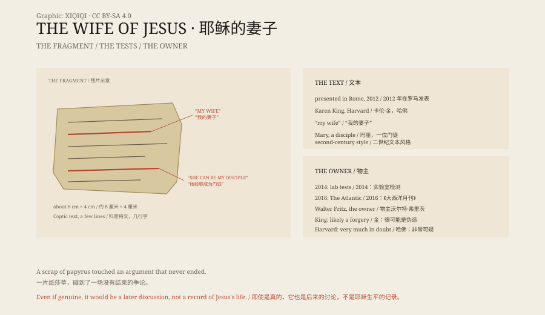

## 一、一小片纸

2012 年 9 月，哈佛神学院的教授卡伦·金在罗马的一个学术会议上展示了一片纸莎草。

纸片很小，大约 8 厘米长、4 厘米宽，上面写着几行科普特文。

最引人注目的两句是：“耶稣对他们说，我的妻子……”和“她能够成为我的门徒”。

如果这是真的，它将是第一份明确说耶稣有妻子的古代文本。

## 二、它说了什么

纸片不是完整的福音书，只是一段残片。它能读出的内容很少：耶稣提到“我的妻子”，提到一个叫“玛丽”的人，说她能够成为门徒。

文本的语法和词汇，与公元二世纪的一些科普特文文本相似。但相似不等于真实。

即使纸片是真的，它也不等于“耶稣结过婚”。它更可能说明，在耶稣死后一两百年，有一些基督徒在讨论他是否有妻子。那是后来的争论，不是当时的记录。

## 三、争论

卡伦·金没有说它就是真品。她把它作为一个“需要研究”的文本发表，希望同行来检验。

批评很快就来了。有人指出，纸片的边缘太整齐，像是从一块更大的纸上剪下来的；有人指出，科普特文的写法有现代人模仿的痕迹；梵蒂冈的报纸直接称它为假货。

2014 年，金和同事发表了实验室检测结果，称纸莎草和墨水的年代与古代相符，没有发现现代造假的证据。

但争议没有结束。

## 四、物主

2016 年，记者阿里尔·萨巴尔在《大西洋月刊》上发表了一篇调查。

他追踪到纸片的物主：一个叫沃尔特·弗里茨的德国人，住在佛罗里达，曾经在德国的一家博物馆工作，后来因为偷窃展品离开。

弗里茨最初否认自己是物主，后来又承认了。他还被指出，纸片上的某些语句，与他多年前在网上的发言高度相似。

2016 年 6 月，卡伦·金发表声明，说新的信息“让天平倒向伪造这一边”。

哈佛神学院随后表示，纸片的真实性“非常可疑”。

## 五、它为什么重要

即使它是假的，这个事件也说明了一件事：人们多么希望找到早期基督教里被删掉的部分。

耶稣有没有结婚，是一个神学问题，也是一个历史问题。四部福音书没有提到他有妻子。后来的教会传统也认为他没有。

一片 8 厘米的纸，之所以能上全世界的头条，是因为它碰到了一个还没有结束的争论。

## 六、现在

纸片曾保存在哈佛神学院。

它现在被当作一个教学案例：如何鉴定古代文本，如何追踪来源，如何在证据不足时保持谨慎。

它可能是一段真实古代文本的残片，也可能是一个 20 世纪的伪造品。无论哪一种，它都已经完成了它的工作：让人重新讨论一个老问题。

*原创示意图：纸片文本、2012 年发表、2014 年检测与 2016 年来源调查的时间线。不是文物照片。稀奇奇编辑部，CC BY-SA 4.0。*

---

**来源与许可**：本文的事实来源见条目底部来源台账 S1–S4。文字与原创示意图采用 CC BY-SA 4.0。文中把纸片内容、2012 年发表、2014 年实验室检测、2016 年来源调查与神学争论分开叙述；纸片的真实性仍有争议，多数后续报道倾向认为它是伪造品。插图是场景复原，不是文物照片。
