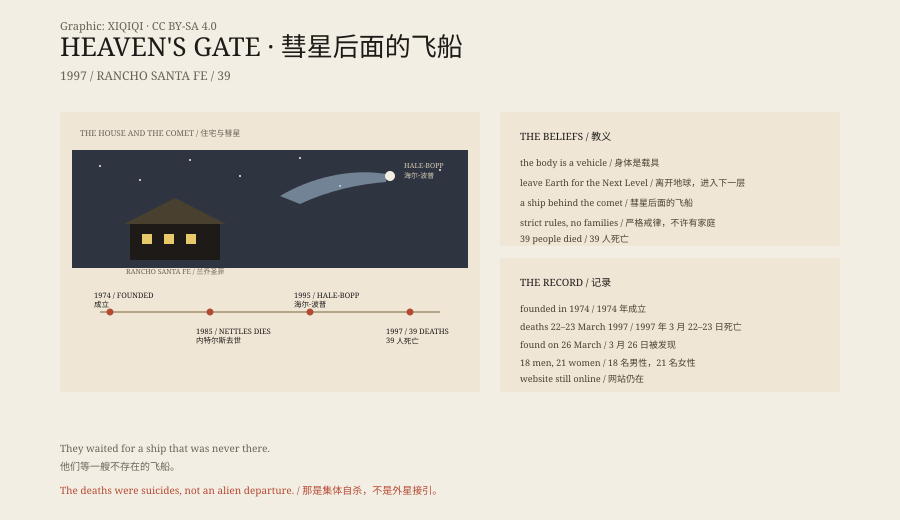

## 1. A House

On 26 March 1997, police in Rancho Santa Fe, California, found 39 bodies in a rented mansion.

They wore black tracksuits and black Nike shoes, with patches reading "Heaven's Gate Away Team" on their sleeves. Most lay on beds under purple cloths.

The deaths had occurred around 22–23 March. The members took the poison in three groups, each group cleaning up after the one before.

The poison was phenobarbital, mixed with applesauce or pudding and followed by a sip of vodka. Some had plastic bags over their heads.

They believed that after death they would leave Earth and board a spacecraft hidden behind Comet Hale-Bopp.

## 2. Two People

The group was called Heaven's Gate.

Its leader was Marshall Applewhite, born in 1931, a former music teacher who had also taught in prison. His partner was Bonnie Nettles, a nurse.

In the 1970s the two began teaching a mixture of Christianity, UFO lore and New Age ideas. They identified themselves with the two witnesses in the Book of Revelation and were later known as "Bo" and "Peep".

Nettles died of cancer in 1985. Applewhite continued to lead the group.

## 3. The Beliefs

The core idea of Heaven's Gate was that a human being is only a container, and that the real self is the soul.

Earth was a polluted place due for recycling. To be saved, one had to leave Earth and enter the "Next Level".

They believed in UFOs, in extraterrestrial life, and that Applewhite came from outside the planet. They lived under strict rules: short hair, uniform clothing, no sexual relationships, no families.

They called themselves "monks" and referred to the body as a "vehicle".

## 4. The Comet

Comet Hale-Bopp was discovered in 1995. It became very bright and made global news.

Heaven's Gate decided it was the sign they had been waiting for. A spacecraft was behind the comet, coming for them.

In March 1997 they posted a "Red Alert" statement on their website: "Our purpose is simple: to leave this world."

Then they began.

## 5. The Deaths

Thirty-nine people died, eighteen men and twenty-one women, aged from 26 to 72.

They left videotapes explaining their choice. They sorted their money, documents and belongings. They even left a warning on the website: "If you cannot accept this, please do not follow us."

It was not impulsive. They had prepared for months, rehearsed the steps, and arranged who would go first and who would clean up.

Police found no sign of coercion. Each person took the poison voluntarily.

## 6. After

The Heaven's Gate website was not taken down. It is still there, a strange archive of statements, videos, doctrines and FAQs.

A few members did not take part in the deaths. Later some left, and some continued to believe.

Applewhite was 65 when he died. He and his group became one of the best-known cult cases in 1990s America.

## 7. The Comet

Comet Hale-Bopp reached perihelion in April 1997 and then left the solar system.

It had no spacecraft. It was only a comet: ice, dust and gas, trailing a tail in the solar wind.

What those 39 people believed in did not return. Their story remains as a reminder of what the people on the ground pay when someone puts all hope in the sky.

*Original schematic: the timeline from the 1970s to 1997 and the relation between the comet and the group's beliefs. Not a photograph of the site. Oddity Archive, CC BY-SA 4.0.*

## The house

Heaven's Gate is a religious group.

In the 1970s, they lived in various parts of the United States and moved to a house in Santa Fe, Rancho, California. The house was large, with swimming pools, gardens and rooms.

## Two people

The group was founded by Marshall Apurwhite and Bonnie Knightner.

April White was a music teacher and Knightner was a nurse. They believed that they represented aliens.

## Pedagogic

The teachings mix Christian, UFO and New Age thinking.

They believe that the Earth is about to be destroyed and that only by leaving it can they be saved. They believe that UFOs will come to pick them up.

The teachings of the gates of heaven blend Christian, UFO and new-age ideas.

They believe that the planet is about to be destroyed and that only by leaving it can it be saved.

## Comet

In 1997, the Heir-Porp comet appeared.

The group believes that there is a ship behind the comet. They decide to leave when the comet is brightest.

Comet's gone.

The people in the house, they didn't come back.

Hale-Pop comet, came in 1997.

It's bright and visible. The group believes there's a ship behind the comet.

In 1997, the Heir-Porp comet appeared.

The group believes that there is a ship behind the comet.

## Death

In March 1997, 39 members committed suicide in the house.

They were dressed in the same clothes and laid on the same bed. They believed that they could leave the Earth.

39 members, commit suicide in the house.

They were wearing sports clothes, covered in purple cloth, with luggage. They believed that it was "leave."

39 members, commit suicide in the house.

They were dressed in the same clothes, lying on the same bed.

## After

Death shocked the United States.

Media discussions on “Brainwashing” by “the cult” and “UFO” by the group's websites, videos and letters were made public.

The group disappeared.

The website is still there, the video is still there. The story is still there.

The group disappeared.

The website is still there, the video is still there.

## UFO

The teachings of the gates of heaven, mixed with UFO culture.

They believe that aliens exist and that the Earth will be cleared. They believe that they are the next level.

## Media

The media have written death as “a cult suicide”.

Journalists, writers, documentary directors, all come. Pictures of the house, news images.

The media have written death as “a cult suicide”.

Journalists, writers, documentary directors, all come.

## The story

The story's still there.

## Memory

The door of heaven is a story about expectations.

They look forward to the ship, to leaving, to a new world.

The comet's here, he's gone. The ship's not here.

## And finally

Heaven's Gate, not waiting for the ship.

39 people, dead in the house.

The comet's gone, the story stays.

## Remember

The door of heaven is a story about expectations.

They look forward to the ship, to leaving, to a new world. Comets come and go. The ship doesn't come.

The comet's gone, the ship's not coming. 39 people, stay in the house.

They believe the ship will come, they believe the comet is the door. The door didn't open, but the story stayed on the news.

The door didn't open, the story didn't matter.

## Final

The door didn't open.

39 individuals, stay in the house.

Comet's gone.

## Archives

In March 1997, 39 members of the Gate of Heaven died in San Diego, California. They believed that there was a ship behind the comet.

---

**Sources and licenses**: the factual sources are listed in the source ledger S1–S3 at the bottom of this entry. Text and original diagrams are licensed under CC BY-SA 4.0. This article separates the group's history, its beliefs, the 1997 deaths and the aftermath; the death toll, dates and location are a matter of public record, while the beliefs are the group's faith, not facts. The illustration is a scene reconstruction, not a photograph of the site.
