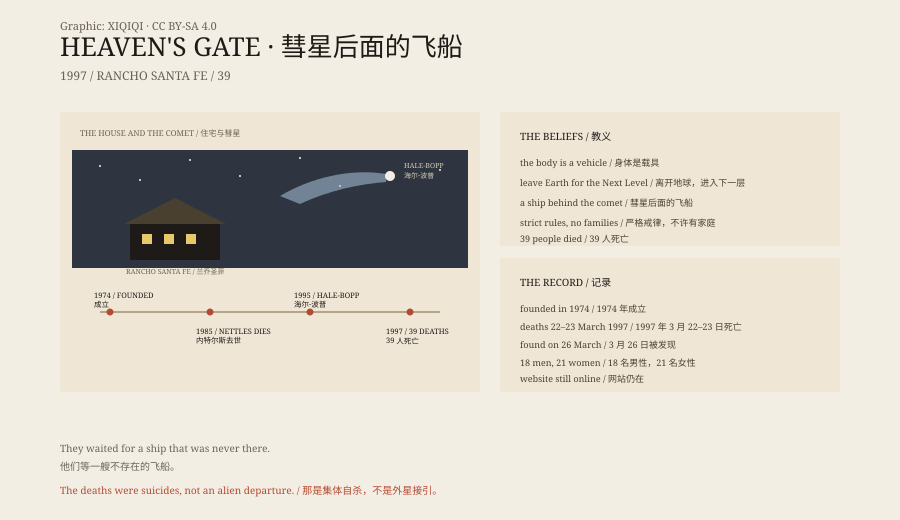

## 1. A House

On 26 March 1997, police in Rancho Santa Fe, California, found 39 bodies in a rented mansion.

They wore black tracksuits and black Nike shoes, with patches reading "Heaven's Gate Away Team" on their sleeves. Most lay on beds under purple cloths.

The deaths had occurred around 22–23 March. The members took the poison in three groups, each group cleaning up after the one before.

The poison was phenobarbital, mixed with applesauce or pudding and followed by a sip of vodka. Some had plastic bags over their heads.

They believed that after death they would leave Earth and board a spacecraft hidden behind Comet Hale-Bopp.

## 2. Two People

The group was called Heaven's Gate.

Its leader was Marshall Applewhite, born in 1931, a former music teacher who had also taught in prison. His partner was Bonnie Nettles, a nurse.

In the 1970s the two began teaching a mixture of Christianity, UFO lore and New Age ideas. They identified themselves with the two witnesses in the Book of Revelation and were later known as "Bo" and "Peep".

Nettles died of cancer in 1985. Applewhite continued to lead the group.

## 3. The Beliefs

The core idea of Heaven's Gate was that a human being is only a container, and that the real self is the soul.

Earth was a polluted place due for recycling. To be saved, one had to leave Earth and enter the "Next Level".

They believed in UFOs, in extraterrestrial life, and that Applewhite came from outside the planet. They lived under strict rules: short hair, uniform clothing, no sexual relationships, no families.

They called themselves "monks" and referred to the body as a "vehicle".

## 4. The Comet

Comet Hale-Bopp was discovered in 1995. It became very bright and made global news.

Heaven's Gate decided it was the sign they had been waiting for. A spacecraft was behind the comet, coming for them.

In March 1997 they posted a "Red Alert" statement on their website: "Our purpose is simple: to leave this world."

Then they began.

## 5. The Deaths

Thirty-nine people died, eighteen men and twenty-one women, aged from 26 to 72.

They left videotapes explaining their choice. They sorted their money, documents and belongings. They even left a warning on the website: "If you cannot accept this, please do not follow us."

It was not impulsive. They had prepared for months, rehearsed the steps, and arranged who would go first and who would clean up.

Police found no sign of coercion. Each person took the poison voluntarily.

## 6. After

The Heaven's Gate website was not taken down. It is still there, a strange archive of statements, videos, doctrines and FAQs.

A few members did not take part in the deaths. Later some left, and some continued to believe.

Applewhite was 65 when he died. He and his group became one of the best-known cult cases in 1990s America.

## 7. The Comet

Comet Hale-Bopp reached perihelion in April 1997 and then left the solar system.

It had no spacecraft. It was only a comet: ice, dust and gas, trailing a tail in the solar wind.

What those 39 people believed in did not return. Their story remains as a reminder of what the people on the ground pay when someone puts all hope in the sky.

*Original schematic: the timeline from the 1970s to 1997 and the relation between the comet and the group's beliefs. Not a photograph of the site. Oddity Archive, CC BY-SA 4.0.*

---

**Sources and licenses**: the factual sources are listed in the source ledger S1–S3 at the bottom of this entry. Text and original diagrams are licensed under CC BY-SA 4.0. This article separates the group's history, its beliefs, the 1997 deaths and the aftermath; the death toll, dates and location are a matter of public record, while the beliefs are the group's faith, not facts. The illustration is a scene reconstruction, not a photograph of the site.
