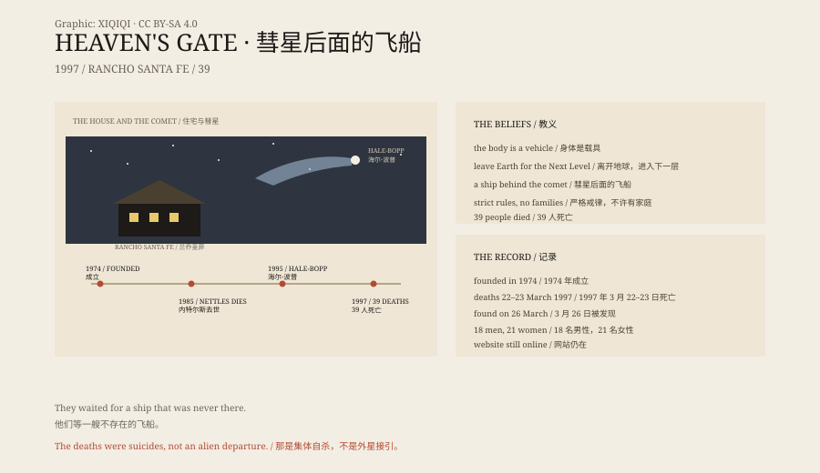

## 一、一栋房子

1997 年 3 月 26 日，加州兰乔圣菲。一栋租来的别墅里，警方发现了 39 具遗体。

他们穿着黑色的运动服、黑色的耐克鞋，手臂上别着“Heaven's Gate Away Team”的布标。大多数人躺在床上，身上盖着紫色的布。

死亡时间大约在 3 月 22 日到 23 日。他们分三组，轮流服毒、清理现场。

毒物是苯巴比妥，混在苹果酱或布丁里，再喝一口伏特加。有人头上套着塑料袋。

他们相信，死后会离开地球，登上一艘藏在海尔-波普彗星后面的飞船。

## 二、两个人

这个团体叫“天堂之门”。

它的领导者是马歇尔·阿普尔怀特，1931 年出生，曾经是音乐教师，也曾在监狱里教过书。他的搭档是邦妮·内特尔斯，一名护士。

1970 年代，两人开始传播一套混合了基督教、UFO 和新时代思想的教义。他们自称是《启示录》里的两位见证人，后来被称为“Bo”和“Peep”。

内特尔斯在 1985 年因癌症去世。阿普尔怀特继续带领团体。

## 三、教义

天堂之门的核心想法是：人只是一个“容器”，真正的自我是灵魂。

地球是一个被污染、即将被清理的地方。要得救，必须离开地球，进入“下一个层次”。

他们相信 UFO，相信外星生命，相信阿普尔怀特是从外星来的。他们过着严格的生活：短发、统一的衣服、不许有性关系、不许有家庭。

他们管自己叫“修士”，把身体叫“载具”（vehicle）。

## 四、彗星

1995 年，海尔-波普彗星被发现。它变得很亮，成了全球新闻。

天堂之门认为，这是他们等待的信号。彗星后面有一艘飞船，来接他们。

1997 年 3 月，他们在网站上发布了一份“红色警报”声明，说“我们的目的很简单：离开这个世界”。

然后，他们开始执行。

## 五、死亡

39 人死亡，18 名男性，21 名女性，年龄从 26 岁到 72 岁。

他们留下录像带，解释自己的选择。他们把钱、证件和遗物整理好。他们甚至在网站上留下了警告：“如果你不能接受，请不要跟着我们。”

这不是一次冲动。他们准备了几个月，排练了步骤，安排了谁先走、谁清理。

警方说，没有强迫的迹象。每个人都自愿服毒。

## 六、之后

天堂之门的网站没有关闭。它还在，作为一个奇怪的档案：声明、视频、教义、常见问题。

有几名成员没有参加那次死亡。后来，有人离开，有人继续相信。

阿普尔怀特死时 65 岁。他和他的团体，成了 1990 年代美国最著名的邪教事件之一。

## 七、彗星

海尔-波普彗星在 1997 年 4 月到达近日点，然后离开太阳系。

它没有飞船。它只是一颗彗星：冰、尘埃和气体，在太阳风里拖出一条尾巴。

那 39 个人相信的东西，没有回来。他们的故事留了下来，作为一个提醒：当一个人把全部希望放在天上，地上的人会付出什么代价。

*原创示意图：天堂之门从 1970 年代到 1997 年的时间线、彗星与教义的关系。不是现场照片。稀奇奇编辑部，CC BY-SA 4.0。*

---

**来源与许可**：本文的事实来源见条目底部来源台账 S1–S3。文字与原创示意图采用 CC BY-SA 4.0。文中把组织历史、教义、1997 年死亡事件与后续分开叙述；死亡人数、日期和地点有公开记录，教义属于该团体的信仰，不是事实。插图是场景复原，不是现场照片。
