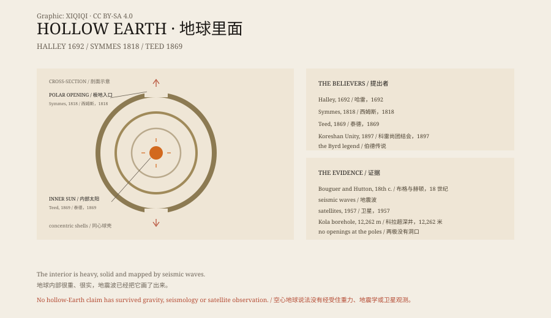

## 1. Halley

In 1692 the English astronomer Edmond Halley presented a paper to the Royal Society.

Halley is best known for calculating the orbit of a comet. He also studied the Earth's magnetic field. Sailors had noticed that compass variation changed with position, and Halley wanted to explain it.

His answer was that the Earth was not solid. It consisted of several concentric shells, with atmospheres between them, possibly light, possibly inhabitants. The motion of the inner shells affected the magnetic field.

This was not a myth. It was a seventeenth-century scientific hypothesis, proposed to explain observations. It was later shown to be wrong, but it was serious.

## 2. Symmes

In 1818 the American John Cleves Symmes Jr. offered a more specific version.

He published a circular declaring that the Earth was hollow, with enormous openings at the poles, mild climates and navigable seas inside. He asked the United States government to send an expedition to the North Pole to find the entrance.

Symmes lectured, wrote to congressmen, and even got Congress to debate the idea. He never got his expedition. He died in poverty in 1829.

But the idea survived. Some said there was another world beneath the Arctic ice; some said there was a hole at the South Pole leading to the interior.

## 3. Teed

In 1869 the American physician Cyrus Teed said he had received a revelation.

His conclusion went further than Symmes: the Earth was not hollow, but we live on its inner surface. The universe was a giant sphere, with the sun and stars near the centre. He called it "cellular cosmogony".

Teed founded a religious community in New York, then moved to Estero, Florida, and established the Koreshan Unity. In 1897 his followers used a device called a "rectilineator" to measure a four-mile line along the beach at Naples, and declared that the sea curved upward, proving the Earth was concave.

Today the measurement looks full of error. But it shows that these people were not merely talking; they went out and measured.

## 4. Byrd

In the twentieth century the hollow Earth story became entangled with polar exploration.

The American admiral Richard E. Byrd flew over both poles in the 1920s and 1950s. Later articles claimed that he had flown into an opening at the pole and seen mammoths and another civilisation.

There is no reliable primary record of this. Byrd's flight reports, diaries and military files contain nothing of the kind. The stories look like a mixture of exploration, science fiction and Cold War fantasy.

## 5. Science

The hollow Earth does not stand up to science.

In the eighteenth century the French mathematician Bouguer and the British scientist Hutton used mountain gravity to estimate the density of the Earth. Their results showed that the interior is far heavier than rock.

In the twentieth century seismic waves provided more direct evidence. As they pass through the planet, they refract and reflect at certain depths, marking the crust, mantle, outer core and inner core. If the Earth were hollow, the waves would travel very differently.

In 1957 satellites began photographing the Earth from orbit. There are no openings at the poles.

In the 1970s the Soviet Union drilled the Kola Superdeep Borehole to 12,262 metres. It did not break through the crust, let alone into an empty interior.

## 6. Why It Persists

The hollow Earth satisfies several wishes.

It turns the planet back into a place with an unknown. The map is full, satellites photograph everything, but the interior could still hide something.

It also gives conspiracy theories a perfect stage: a world that cannot be entered, seen or falsified.

Halley, Symmes and Teed were not frauds. They drew wrong conclusions from the evidence available to them. Later storytellers turned their errors into legend.

*Original schematic: Halley's concentric shells, Symmes's polar openings, Teed's concave Earth and the seismic evidence. Not a photograph of a site. Oddity Archive, CC BY-SA 4.0.*

---

**Sources and licenses**: the factual sources are listed in the source ledger S1–S3 at the bottom of this entry. Text and original diagrams are licensed under CC BY-SA 4.0. This article separates the historical hypotheses of Halley, Symmes and Teed, the Byrd legend and the scientific evidence; the hollow Earth has been ruled out by seismology, gravity and satellite observation. The illustration is a scene reconstruction, not a photograph of a site.
