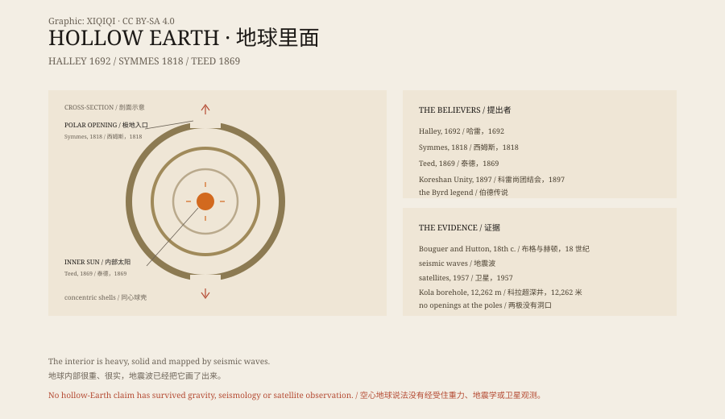

## 一、哈雷

1692 年，英国天文学家埃德蒙·哈雷向皇家学会提交了一篇论文。

哈雷最出名的是计算彗星轨道。但他也研究地球磁场。当时的水手发现，指南针的偏角会随着位置变化，哈雷想解释这件事。

他的答案是：地球不是实心的。它由几个同心球壳套在一起，壳与壳之间有空气，可能有光，甚至可能有人。内层球壳的运动，影响了地球的磁场。

这不是一个神话。这是一个 17 世纪科学家提出的、可以用来解释观测的假说。它后来被证明是错的，但它当时很认真。

## 二、西姆斯

1818 年，美国人约翰·克利夫斯·西姆斯提出了一个更具体的版本。

他发表了一份公告，说地球是空心的，两极有巨大的开口，开口处有温和的气候和可以航行的海。他请求美国政府派一支探险队去北极，寻找入口。

西姆斯到处演讲，写信给议员，甚至让国会辩论过这件事。他没有等到探险队。1829 年，他在贫困中去世。

但他的想法传了下去。有人说，北极的冰层下面有另一个世界；有人说，南极有一个洞，通向地心。

## 三、泰德

1869 年，美国医生赛勒斯·泰德说他经历了一次“启示”。

他得到的结论比西姆斯更彻底：地球不是空心的，而是我们住在它的内壁上。宇宙是一个巨大的球体，太阳和星星都在球心附近。他管这叫“细胞宇宙论”。

泰德在纽约州建立了自己的宗教团体，后来搬到佛罗里达州的埃斯特罗，建立了“科雷尚团结会”。1897 年，他的追随者用一台叫“直线仪”的装置，沿着那不勒斯的海岸测量了四英里，宣称海面向上弯曲，证明地球是凹的。

今天看，这个测量充满误差。但它说明了一件事：这些人不是随便说说，他们真的去量了。

## 四、伯德

20 世纪，空心地球的故事和极地探险缠在了一起。

美国海军上将理查德·伯德在 1920 年代和 1950 年代多次飞越两极。后来出现了一些文章，说他飞进了地心的入口，看见了猛犸象和另一个文明。

这些说法没有可靠的原始记录。伯德的飞行报告、日记和军方档案，都没有这样的内容。它们更像是把探险故事、科幻小说和冷战想象混在了一起。

## 五、科学

空心地球在科学上站不住脚。

18 世纪，法国数学家布格和英国科学家赫顿通过测量山体的引力，推算了地球的密度。结果说明，地球内部比岩石重得多。

20 世纪，地震波给了更直接的证据。地震波穿过地球时，会在某些深度发生折射和反射，这些界面对应着地壳、地幔、外核和内核。如果地球是空心的，波会以完全不同的方式传播。

1957 年，人造卫星开始从轨道上拍摄地球。两极没有洞口。

1970 年代，苏联在科拉半岛钻了一口超深井，深达 12,262 米。它没有钻穿地壳，更没有进入空地。

## 六、为什么还在传

空心地球的想法，满足了几个愿望。

它把地球变成一个还有未知的地方。地图已经画满，卫星每天都在拍照，但地心还可以藏东西。

它也给阴谋论提供了一个完美的舞台：一个进不去、看不见、无法证伪的世界。

哈雷、西姆斯和泰德都不是骗子。他们只是用当时的证据，推出了一个错误的结论。后来的故事，把他们的错误变成了传说。

*原创示意图：哈雷的同心球壳、西姆斯的极地入口、泰德的凹地球与地震波证据。不是现场照片。稀奇奇编辑部，CC BY-SA 4.0。*

---

**来源与许可**：本文的事实来源见条目底部来源台账 S1–S3。文字与原创示意图采用 CC BY-SA 4.0。文中把哈雷、西姆斯、泰德的历史假说、伯德传说与科学证据分开叙述；空心地球已被地震学、重力和卫星观测否定。插图是场景复原，不是现场照片。
