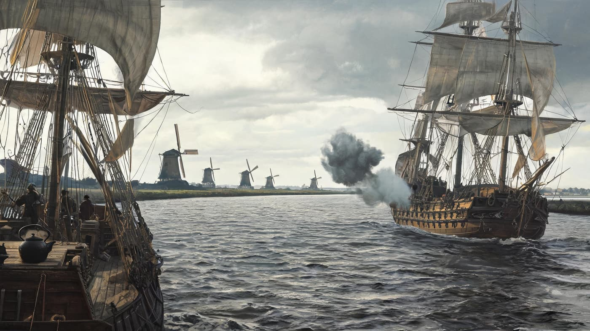
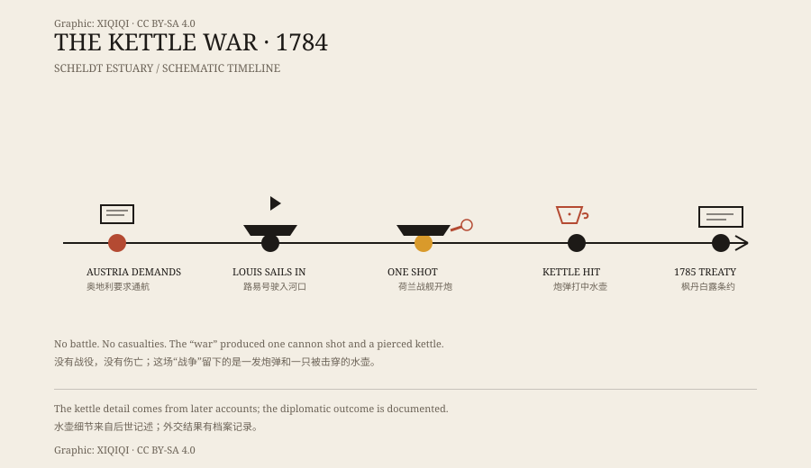

## 1. A locked river

The Scheldt runs from northern France through Belgium and reaches the sea in the southwest of the Netherlands.

The estuary was in Dutch hands. The Dutch made money from the waterway and collected tolls on it. For the Austrian territories upstream, the river was locked, and goods had to take longer, more expensive routes.

In 1784, Emperor Joseph II decided to test the arrangement. He demanded that the Dutch open the Scheldt to navigation.

The estuary was wide, the water grey. The banks were low and flat, with windmills turning in the distance. The merchant ship and the warship lay within sight of each other. Neither moved first.

The Dutch refused.

## 2. The ship of 1784

The Austrian side sent a ship, the Louis, toward the estuary from the direction of Antwerp.

It was not a fleet, and not a full-scale invasion. It was a probe: sail in and see whether the Dutch would actually stop it.

The Dutch sent the warship De Dolfijn. The two met in the estuary.

*Reconstruction: the Austrian ship and the Dutch warship at the Scheldt estuary in 1784. Not a historical painting. Oddity Archive, CC BY-SA 4.0.*

*Original schematic: the timeline of the 1784 Scheldt estuary incident, from the single shot to the kettle and the treaty. Not a historical painting. Oddity Archive, CC BY-SA 4.0.*

## 3. One shot

The Dutch warship fired once.

The shot did not sink the Louis, and no one was killed. It hit a kettle on board — at least, that is how the story is told.

The kettle might have been on deck, or in the galley. The story does not say. It was remembered because it was the only thing the shot hit.

The Louis then lowered its flag and submitted to inspection. The “war” was over.

There was no second shot. Both sides understood that the first one was a statement, not the start of a battle.

## 4. The kettle

The name “Kettle War” comes from that moment.

A kettle pierced by a cannonball became the most famous trophy of the conflict. It sounds like a joke, but at the time the matter was not entirely a joke: it involved control of a river, trade interests, and national pride.

It was only the scale of the fighting that did not match the word “war.” No armies advanced, no battle was fought, no casualty list was drawn up. There was one shot, one kettle, and a great deal of diplomacy.

## 5. The treaty

In 1785, the two sides signed the Treaty of Fontainebleau.

Austria gave up its demand for free navigation on the Scheldt. The Dutch paid compensation and made arrangements for managing the river. For Austria, the probe had produced no real gain; for the Dutch, the estuary had been held.

The Kettle War did not change the map of Europe. It compressed a dispute between powers into a single cannon shot.

## 6. Afterwards

The episode reappeared in cartoons, prints, and popular histories. The kettle became a convenient symbol: a conflict that looked like a war but amounted to one shot.

It does not belong in the great-battles chapter of military history. It belongs in a footnote about how diplomacy avoids wars. Both sides got an acceptable result. The price was a kettle.

---

**Sources and licenses**: the factual sources are listed in the source ledger S1–S3 at the bottom of this entry. Text and original diagrams are licensed under CC BY-SA 4.0. This article separates the documented diplomatic and military course from the widely repeated kettle detail; the exact manner in which the kettle was hit comes from later accounts.
