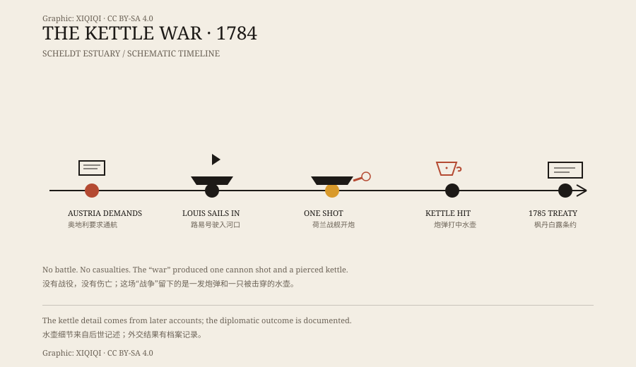

## 一、一条被锁住的河

斯海尔德河从法国北部流过比利时，最后在荷兰西南部入海。

河的入海口在荷兰手里。荷兰人靠着这条水道做生意，也靠着它收税。对上游的奥地利属地来说，这条河被锁住，货物就得绕路，成本高得多。

1784 年，奥地利皇帝约瑟夫二世决定试一试。他要求荷兰开放斯海尔德河的航运。

荷兰拒绝了。

## 二、1784 年的船

奥地利方面派了一艘船，叫“路易号”，从安特卫普方向驶向河口。

这不是一支舰队，也不是一次大规模入侵。它更像一次试探：船开过去，看荷兰人会不会真的拦。

荷兰方面派出了战舰“海豚号”。两边在河口相遇。

*原创示意图：1784 年斯海尔德河口事件的时间线与“一炮—水壶—条约”的经过。不是历史画作。稀奇奇编辑部，CC BY-SA 4.0。*

## 三、一炮

荷兰战舰开了一炮。

这一炮没有击沉路易号，也没有造成人员死亡。它打中了船上的一个水壶——至少，后来的故事是这么讲的。

路易号随后降下旗帜，接受了检查。整场“战争”到此结束。

## 四、水壶

“水壶战争”这个名字，就是从这里来的。

一个被炮弹打穿的水壶，成了这场冲突最著名的战利品。它听起来像个笑话，但在当时，这件事并不完全是笑话：它背后是河道控制权、贸易利益和国家面子。

只是冲突的规模，和“战争”这个词实在不匹配。没有军队推进，没有战役，没有伤亡名单。只有一炮，一个水壶，和一整套外交交涉。

## 五、条约

1785 年，双方签订《枫丹白露条约》。

奥地利放弃了对斯海尔德河自由通航的要求。荷兰则付出补偿，并对河道管理作出安排。对奥地利来说，这是一次没有拿到实质成果的试探；对荷兰来说，这是一次守住了河口的结果。

水壶战争没有改变欧洲的格局。它只是把一场大国之间的争执，压缩成了一发炮弹。

## 六、后来

这件事在后来的漫画、版画和通俗历史里反复出现。水壶成了一个方便的象征：一场看起来像战争、实际上只打了一炮的冲突。

它不适合放进军事史的重大战役章节，更适合放在“外交如何避免战争”的脚注里。两国都拿到了可以接受的结果，代价是一只水壶。

---

**来源与许可**：本文的事实来源见条目底部来源台账 S1–S3。文字与原创示意图采用 CC BY-SA 4.0。文中把有记录的外交与军事经过，与“水壶”这一广为流传的细节分开叙述；水壶被击中的具体情形来自后世记述。
