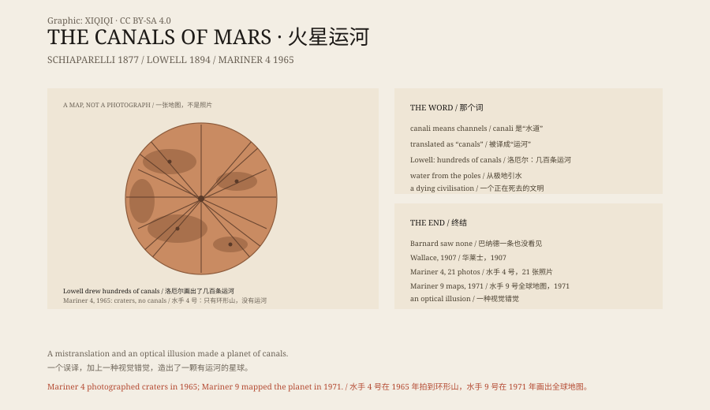

## 一、1877 年

1877 年，火星离地球很近。

意大利天文学家乔瓦尼·斯基亚帕雷利在米兰用一台望远镜观察火星。他画下火星表面的明暗，看到一些细长的线，穿过浅色的区域，把深色的斑块连起来。

他给这些线起名叫“canali”。意大利语里，这个词是“水道”“沟渠”的意思，不是“人工运河”。

但在英文报纸上，canali 被翻译成了 canals——运河。

一个词的差别，改变了接下来八十年的火星故事。

## 二、洛厄尔

1894 年，美国商人珀西瓦尔·洛厄尔在亚利桑那州的旗杆镇建了一座天文台。

洛厄尔有钱，也有兴趣。他相信火星上住着人，相信那些直线是火星人挖的运河。他用了十几年时间画火星地图，越画越多，最后画出了几百条运河。

在他的图里，运河从极地出发，穿过沙漠，在深色区域交汇。他提出，火星是一个正在干涸的星球，火星人挖运河，把极地的水引到赤道附近的农田。

这个说法很有吸引力。它把火星从一个光点，变成了一个有历史、有工程、有危机的世界。

## 三、运河热

洛厄尔的书卖得很好。报纸、杂志、小说都开始写火星人。

1898 年，H. G. 威尔斯出版了《世界大战》，火星人坐着圆柱形的飞行器入侵英国。1912 年，埃德加·赖斯·巴勒斯的《火星公主》出版，火星成了一个有公主、有飞艇、有战争的奇幻世界。

运河也进入了地图册和教科书。有些天文学家说自己也看见了运河；有些说看不见。争论持续了几十年。

## 四、反对者

不是所有人都相信。

美国天文学家爱德华·巴纳德用当时最大的望远镜之一观察火星，说他没有看到一条运河。英国博物学家阿尔弗雷德·拉塞尔·华莱士在 1907 年写了一本书，叫《火星适合居住吗？》，逐条反驳洛厄尔。

光谱分析也没有找到火星大气里的水蒸气。火星的空气太薄，温度太低，即使有运河，也不可能有液态水在表面流动。

但反对的声音不够响。运河的故事已经走出了天文台，进入了大众文化。

## 五、探测器

1965 年 7 月，美国的“水手 4 号”飞过火星，拍下了二十一张照片。

照片传回来，是一张布满环形山的、像月球一样荒凉的地表。没有运河，没有城市，没有绿色。

1971 年，“水手 9 号”进入火星轨道，用几个月时间画出了全球地图。它看到了巨大的火山、峡谷和干涸的河床，但没有看到任何一条直线穿过大陆。

运河不存在。

## 六、为什么看见

那为什么那么多天文学家看见了运河？

一部分原因是望远镜。十九世纪的光学望远镜有严重的色差和衍射，火星又是一个很小的目标，大气抖动会让细节变成线条。人眼擅长把断开的点连成线，尤其当你已经相信线存在的时候。

另一部分原因是翻译和传播。“canali”变成了“canals”，“沟渠”变成了“运河”，“自然地貌”变成了“工程”。

一个误译，加上一种视觉错觉，再加上一个愿意相信的故事，就足以让整个时代看见一个不存在的火星。

## 七、火星

火星上确实有过水。

今天的探测器在火星表面找到了古老的河床、三角洲、湖底沉积和含水矿物。几十亿年前，火星比现在温暖、湿润，可能有河流和湖泊。

但那些水是自然流动的，不是火星人挖的。火星上没有运河，没有工程师，没有正在死去的文明。

斯基亚帕雷利看到的线，是他那个时代的望远镜和大脑共同制造的幻象。他犯了一个错误，但这个错误催生了一整类文学。

有时候，错误比事实更能讲故事。

*原创示意图：1877 年 canali、洛厄尔地图与水手 4 号结果的时间线。不是历史照片。稀奇奇编辑部，CC BY-SA 4.0。*

---

**来源与许可**：本文的事实来源见条目底部来源台账 S1–S3。文字与原创示意图采用 CC BY-SA 4.0。文中把天文观测、翻译误读、大众文化与探测器结果分开叙述；火星运河不存在，这一点已由水手 4 号与水手 9 号确认。插图是场景复原，不是历史照片。
