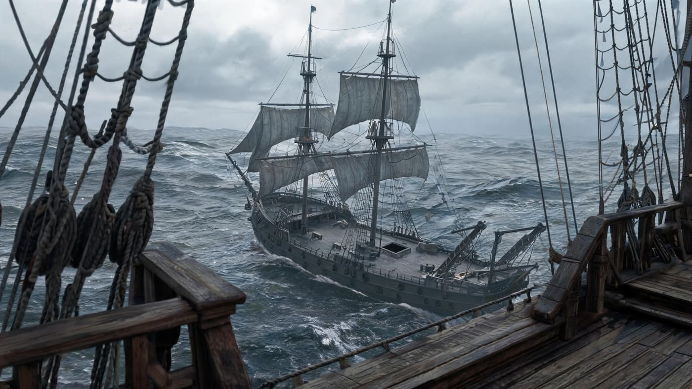
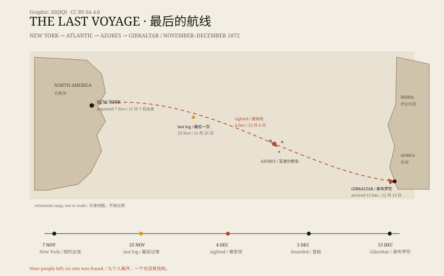

## 1. A ship on the water

December 5, 1872. The Atlantic, west of the Azores.

Captain David Morehouse of the Canadian brigantine Dei Gratia stood on deck and saw a two-masted ship ahead. She was drifting, sails still set, course unsteady, like someone walking with their eyes closed.

He brought his ship closer. He shouted. No answer. He sent his first mate and a small party across.

There was no one on deck. The hatches were open, the pumps unattended. In the captain's cabin the table and chairs were still in place, and the logbook lay open. The last entry was dated November 25. In the galley there was food half-cooked. The crew's pipes, boots, and clothes were still aboard. In the hold were 1,701 barrels of industrial alcohol, most of them intact.

Two things were missing: a lifeboat, and every person on the ship.

The boarding party later described the deck: ropes left loose, hatches open, no one at the pumps. A rope hung over the stern, its end frayed as if it had snapped. The lifeboat's place was empty, and its fastenings had been released.

The ship had not sunk, and the sails were not fully furled. She looked like someone who had stopped halfway, then been left behind.

*Reconstruction: the Mary Celeste drifting unmanned in December 1872, her lifeboat gone. Not a historical photograph. Oddity Archive, CC BY-SA 4.0.*

The ship was the Mary Celeste.

## 2. Who was aboard

The Mary Celeste was a 100-foot brigantine. Her captain was Benjamin Briggs. She carried a crew of seven, plus the captain's wife, Sarah, and their two-year-old daughter, Sophia.

She had left New York for Genoa, Italy, with a cargo of industrial alcohol. The cargo was volatile. If it leaked, flammable vapour could build up below deck.

On December 4, the Dei Gratia sighted her near the Azores. The next day, Morehouse sent men aboard. What they found made no sense. The ship was not sinking. Her masts and sails were largely intact. The cargo had not been touched. Valuables were still there.

If pirates had come, why was nothing taken? If there had been a mutiny, where were the signs of a fight? If the crew had abandoned ship, why was the lifeboat gone while the ship itself was still seaworthy?

## 3. The inquiry at Gibraltar

Morehouse brought the Mary Celeste to Gibraltar. A vice-admiralty court opened an inquiry.

At first, the investigators suspected the Dei Gratia's men of murder and robbery. But there was no blood, no bullet holes, no signs of a struggle, and the cargo and valuables were still aboard. The suspicion collapsed.

No one was convicted. The Mary Celeste was treated as a derelict, her cargo was sold, and the insurers paid.

The records left a few key facts. The compass had been moved. There was minor damage at the bow. One alcohol barrel was empty, and others may have been leaking. The lifeboat's fastenings had been released, as if someone had deliberately lowered it.

Those details never added up to a complete story.

*Diagram: the route from New York to the Azores and Gibraltar, with the dates of the last log entry, the sighting, and the boarding. Original graphic, CC BY-SA 4.0.*

## 4. The most popular explanations

Over the years, people have proposed many explanations.

**Pirates**: pirates boarded, killed the crew, and took the valuables. But the valuables were still there, and there were no bodies.

**Mutiny**: the crew killed the captain and escaped in the lifeboat. But there were no signs of violence, and the captain's wife and daughter were gone too. Why would mutineers take them?

**Waterspout**: a waterspout struck the ship and swept the crew away. But the ship was not badly damaged, and the cargo was largely intact.

**Alcohol vapour**: this is one of the more persuasive theories. The captain may have discovered that alcohol was leaking, feared an explosion, and ordered everyone into the lifeboat, tethered to the ship, intending to return when the danger passed. The line broke, or the lifeboat capsized, and no one came back.

This explains why the ship was intact, why the lifeboat was gone, and why the crew left their belongings. It is still a guess. It does not explain every detail.

Some researchers have also suggested that the ship's compass was moved or damaged, causing the captain to misjudge his position. He may have thought the ship was farther from the Azores than she was, and decided to abandon her. This does not conflict with the alcohol theory: one bad judgment plus a small leak could be enough to take nine people off a ship that could still sail.

## 5. How the story grew

The Mary Celeste became famous in 1884, when the young Arthur Conan Doyle published a fictional story, “J. Habakuk Jephson's Statement,” in which the ship was cursed. The story was a hit, and many readers took its inventions for fact.

After that, the versions multiplied. The crew had seen a sea monster. The captain had gone mad. Something supernatural had happened. The actual inquiry records were far less exciting, and far less read.

## 6. The answer with no answer

The Mary Celeste endures not because it has a shocking ending, but because it has no ending.

The ship is there. The cargo is there. The log stops mid-voyage. The people are gone. Everyone can put their own fear into the gap: pirates, storms, mutiny, the supernatural. Each explanation fits part of the evidence. None fits all of it.

Perhaps the truth was ordinary: a captain made a bad judgment, a lifeboat was lost in bad weather, and nine people never came back. So ordinary that no one wants to make a film about it.

But the empty ship was real.

---

**Sources and licenses**: the factual sources are listed in the source ledger S1–S3 at the bottom of this entry. Text and reconstruction illustrations are licensed under CC BY-SA 4.0. Reconstruction illustrations are not historical photographs. Many popular versions of the Mary Celeste story come from fiction and the press, not from the inquiry record.
