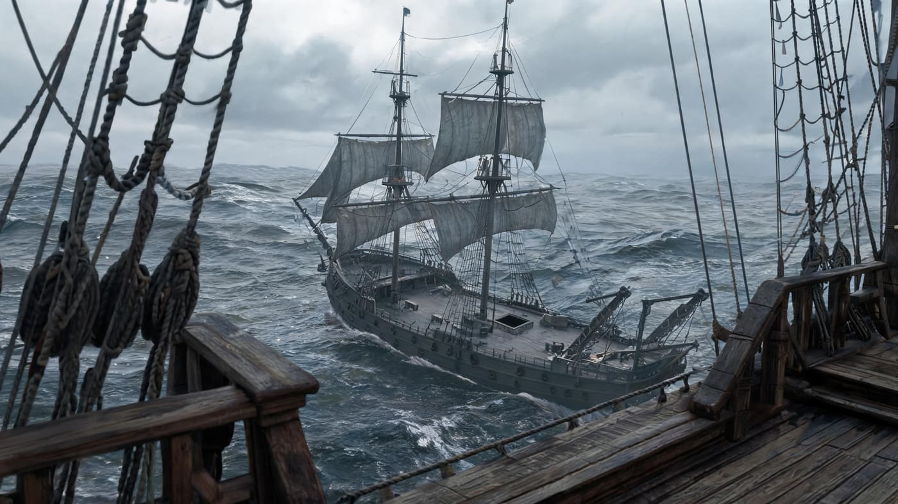
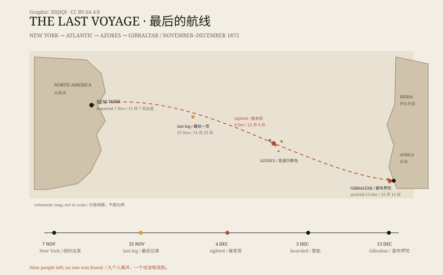

## 一、海面上的一艘船

1872 年 12 月 5 日，大西洋，亚速尔群岛以西。

加拿大船长戴维·莫尔豪斯站在“德格拉蒂亚号”的甲板上，看见前方有一艘双桅帆船。船在漂，帆没有收，方向不稳，像一个人闭着眼睛走路。

他让人靠近。喊了几声，没有人回答。他派大副带人上去。

甲板上没有人。舱口开着，水泵旁边没有人。船长室里的桌椅还在，航海日志摊在桌上，最后一页的日期是 11 月 25 日。厨房里有煮到一半的食物，船员的烟斗、靴子和衣服都在。货舱里装着 1,701 桶工业酒精，大部分完好。

少了两样东西：一艘救生艇，和船上所有的人。

登船的人后来回忆，甲板上的绳索散着，舱口敞着，水泵旁边没有人。船尾有一截绳子垂进海里，断口起毛，像是被拉断的。救生艇原来的位置空着，固定装置被解开。

船没有沉，帆也没有全收。它像一个人走到一半，突然停下，然后被留在原地。

*场景复原：1872 年 12 月，玛丽·塞莱斯特号在大西洋上无人漂流，救生艇已经不见。不是历史照片。稀奇奇编辑部，CC BY-SA 4.0。*

这艘船叫“玛丽·塞莱斯特号”。

## 二、船上原本有谁

玛丽·塞莱斯特号是一艘 100 英尺长的双桅帆船，船长是本杰明·布里格斯。船上有七名船员，还有船长的妻子莎拉和两岁的女儿索菲亚。

它从纽约出发，目的地是意大利热那亚。出发前，船上装了一批工业酒精。这种货物不稳定，如果泄漏，舱内可能积聚易燃气体。

12 月 4 日，德格拉蒂亚号在亚速尔群岛附近遇到它。第二天，莫尔豪斯派人登船。玛丽·塞莱斯特号的状况让所有人困惑：船没有进水，桅杆和帆基本完好，货物没有被动过，值钱的东西也没有少。

如果遇到海盗，为什么东西还在？如果发生叛变，为什么没有打斗痕迹？如果弃船，为什么救生艇不见了，而船本身还能航行？

## 三、直布罗陀的调查

莫尔豪斯把玛丽·塞莱斯特号带到了直布罗陀。海事法庭开始调查。

一开始，调查人员怀疑德格拉蒂亚号的人谋财害命。但船上没有血迹，没有弹孔，没有打斗痕迹，货物和财物都在。这个怀疑站不住脚。

法庭最终没有认定任何人有罪。玛丽·塞莱斯特号被当作弃船处理，货物被拍卖，保险公司支付了赔偿。

调查记录里留下了几个关键事实：船上的罗盘被移动过；船首有一些轻微的损伤；货舱里的酒精桶有一只空了，另外几只可能有渗漏；救生艇的固定装置被解开，像是有人主动放下去的。

这些细节没有拼成一个完整的故事。

*图解：从纽约到亚速尔群岛附近，再到直布罗陀的航线，以及最后日志、发现和登船的日期。原创图解，CC BY-SA 4.0。*

## 四、最流行的几种解释

一百多年来，人们提出了很多解释。

**海盗说**：海盗登船，杀了船员，抢走财物。但船上值钱的东西还在，也没有尸体。

**叛变说**：船员杀死船长，乘救生艇逃走。但没有打斗痕迹，船长的妻子和女儿也不见了，叛变者为什么要带走她们？

**海龙卷说**：水龙卷袭击船只，把船员卷走。但船本身没有严重损坏，货物也基本完好。

**酒精泄漏说**：这是目前比较有说服力的一种。船长可能发现货舱里的酒精泄漏，担心气体爆炸，于是下令全员上救生艇，先用一根绳子把救生艇系在船尾，等危险过去再回来。但绳子断了，或者救生艇被风浪打翻，船上的人再也没有回来。

这个解释能说明为什么船是完整的、救生艇不见了、船员没有带行李。但它仍然只是推测，不能解释所有细节。

也有研究者提出，船上的罗盘可能被移动或损坏，导致船长误判船的位置。他把亚速尔群岛附近的海面当成了更远的地方，于是决定弃船。这个解释和酒精泄漏说并不冲突：一个错误的判断，加上一点泄漏，就足够让九个人离开一艘还能航行的船。

## 五、故事是怎么变大的

玛丽·塞莱斯特号真正出名，是在 1884 年。

那一年，年轻的阿瑟·柯南·道尔发表了一篇虚构故事《J. 哈巴库克·杰弗逊的陈述》，把玛丽·塞莱斯特号写成一艘被诅咒的船。故事很受欢迎，后来很多人把小说情节当成了真实事件。

于是，版本越来越多：有人说船员发现了海怪，有人说船长被自己的航海日志逼疯，有人说船上发生了超自然事件。真实的调查记录反而没人看。

## 六、没有答案的答案

玛丽·塞莱斯特号的故事之所以留得住，不是因为它有一个惊人的结局，而是因为它没有结局。

船还在，货物还在，日志写到一半，人却不见了。每个人都可以把自己的恐惧放进去：海盗、风暴、叛乱、超自然力量。每一种解释都能说通一部分，却都不能说通全部。

也许事情的真相很普通：一个船长判断失误，一艘救生艇在风浪里失踪，九个人再也没有回来。普通到没有人愿意把它拍成电影。

但海面上那艘空船，确实存在过。

---

**来源与许可**：本文的事实来源见条目底部来源台账 S1–S3。文字与场景复原插图采用 CC BY-SA 4.0；场景复原插图不是历史照片。关于玛丽·塞莱斯特号的许多流行版本来自小说和媒体，不作为事实陈述。
