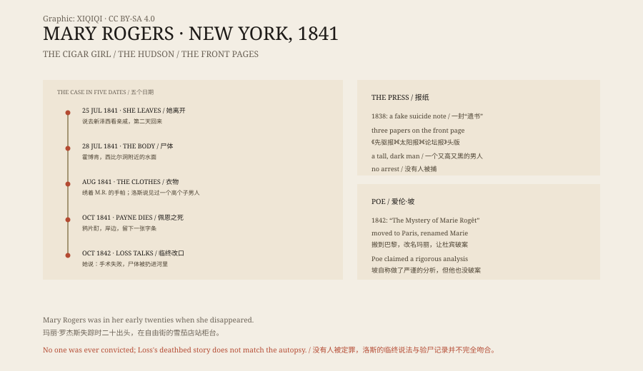

## 1. Behind the counter

A few steps from Broadway, on Liberty Street, there was a cigar shop run by a man named John Anderson.

It was often crowded with reporters and writers. They came for cigars, and they came to look at the girl behind the counter. Her name was Mary Rogers, she was in her early twenties, and her mother kept a boarding house. Her face had appeared in the papers, and someone had written a poem about it.

James Fenimore Cooper and Washington Irving came too. They smoked, and they talked to her.

## 2. 1838

In 1838, Mary disappeared for a few days.

Her mother found a letter in her room that looked like a suicide note. The New York Sun reported that the coroner had read it and concluded that the author had a “fixed and unalterable determination to destroy herself.” A few days later Mary came home. She had been visiting a friend in Brooklyn.

Three years earlier, the Sun had invented a series of reports about bat-men on the moon. This time, people suspected that it was inventing a story again. Anderson's shop was busier than ever.

## 3. 25 July 1841

In 1841, Mary was engaged to Daniel Payne. He was a cork-cutter, and he also lived in her mother's boarding house.

Sunday, 25 July, was the day she said she would visit relatives in New Jersey and come back the next day. That night a severe storm hit New York.

On Monday she did not return. On Tuesday her mother placed a small advertisement in the Sun, asking anyone who had seen her to send word, because “it is supposed some accident has befallen her.”

## 4. Sybil's Cave

On 28 July, some men were walking by the river in Hoboken. Near Sybil's Cave, something was bobbing in the water.

They rowed out and pulled a young woman's body to shore. Within hours, a former suitor of Mary's identified her.

The coroner said her hat and dress were torn, and that her body showed signs of a beating. She had not drowned. The coroner also took care to note that she was not pregnant and “had evidently been a person of chastity and correct habits.”

## 5. The front page

The Herald, the Sun and the Tribune all put Mary on the front page.

Some suspected Payne. He had an alibi, but the papers still printed the detail that he had spent two or three days looking for his fiancée, and then, when he was told her body had been found, did not go to see it.

Others said a street gang had killed her. In August, two boys gathering sassafras in the woods found a pile of women's clothing, mildewed, and a handkerchief embroidered with the initials M.R.

Frederica Loss, who ran a tavern nearby, said that on the evening of 25 July she had seen Mary drinking lemonade with a tall, dark man. Later that night she heard a scream in the woods and assumed it was an animal.

In October, Payne spent a night drinking in Hoboken. He bought a small vial of laudanum, walked down to the shore where Mary's body had been brought in, sat on a bench, and died. His note read, “To the World — Here I am on the very spot. May God forgive me for my misspent life.”

*Original schematic: the cigar shop, the Hoboken shore, the newspaper front pages, and the timeline of the case. Not a historical photograph. Oddity Archive, CC BY-SA 4.0.*

## 6. Poe

In 1842, Edgar Allan Poe serialised “The Mystery of Marie Rogêt” in Snowden's Ladies' Companion.

He moved the story to Paris, turned Mary into a shop girl in a perfume shop, and let his detective Dupin solve the case. In a letter to an editor he said he was not writing fiction but conducting “a very rigorous analysis of the real tragedy in New York.”

He did not solve it either.

## 7. A deathbed story

In October 1842, Loss was accidentally shot by one of her sons. On her deathbed, she changed her account.

The tall, dark man, she said, was not a stranger. He was a young physician. Mary had come to her house for a “premature delivery” — a euphemism for an abortion. The procedure went wrong and Mary died. One of Loss's sons threw the body into the Hudson and scattered the clothes in the woods.

The story did not fit the autopsy in every detail. Mary's body showed signs of a struggle. But the Tribune was satisfied, and wrote that the mystery which had struck fear into so many hearts had at last been explained.

## 8. No answer

The case was never officially closed.

Mary Rogers's name survived in a story by Poe. The cause of her death survived in the newspapers of 1841. Both outlived her.

---

**Sources and licenses**: the factual sources are listed in the source ledger S1–S3 at the bottom of this entry. Text and original diagrams are licensed under CC BY-SA 4.0. This article separates the disappearance, the discovery of the body, the press coverage, Payne's death, and Loss's deathbed account; no one was ever convicted, Loss's account does not match the autopsy in every detail, and the death of Mary Rogers has no legal conclusion. The illustration is a scene reconstruction, not a historical photograph.
