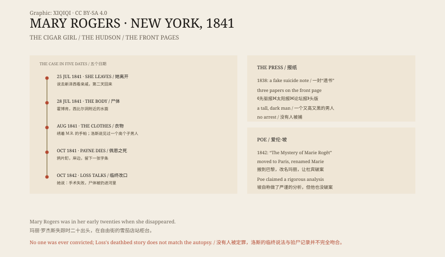

## 一、柜台后面

百老汇旁边有一条自由街。街上有家雪茄店，老板叫约翰·安德森。

店里常挤满记者和作家。他们来买雪茄，也来看柜台后面的姑娘。她叫玛丽·罗杰斯，二十出头，母亲开寄宿公寓。她的脸被印上过报纸，还有人给她写诗。

詹姆斯·费尼莫尔·库珀和华盛顿·欧文也来过。他们抽着烟，和她说话。

## 二、1838 年

1838 年，玛丽失踪了几天。

她母亲在房间里找到一封信，看起来像遗书。《纽约太阳报》说，验尸官看过信，认为她“决心自杀”。几天后，玛丽回来了。她只是去布鲁克林看朋友。

《太阳报》三年前编造过“月球上有蝙蝠人”的系列报道。这一次，人们怀疑它又在编故事。安德森的店却因此更挤了。

## 三、1841 年 7 月 25 日

1841 年，玛丽和丹尼尔·佩恩订婚。佩恩是个做软木塞的工匠，也住在玛丽母亲的寄宿公寓里。

7 月 25 日是星期天。玛丽说要去新泽西看亲戚，第二天回来。当晚，纽约下了一场大暴雨。

星期一，她没有回来。星期二，母亲在《太阳报》上登了一则小广告，请见过她的人捎个信，说“恐怕出了什么事”。

## 四、西比尔洞

7 月 28 日，几个男人在霍博肯的河边散步。西比尔洞附近的水面上，有东西在起伏。

他们划船过去，捞起一具女尸。几个小时后，玛丽以前的追求者认出是她。

验尸官说，她的帽子和裙子都撕破了，身上有被殴打的痕迹。她不是淹死的。验尸官还特意写明：她没有怀孕，“显然是个贞洁、行为端正的人”。

## 五、头版

《先驱报》《太阳报》《论坛报》都把玛丽放上头版。

有人怀疑佩恩。他有不在场证明，但报纸还是写：他找了未婚妻两三天，听说尸体找到了，却没有去看一眼。

也有人说，她是被街上的帮派害死的。8 月，两个男孩在树林里捡黄樟木，发现一堆女式衣服，都发了霉，还有一块绣着 M.R. 的手帕。

酒馆老板娘弗雷德里卡·洛斯说，7 月 25 日晚上，她看见玛丽和一个又高又黑的男人在她店里喝柠檬水。后来她听到树林里有尖叫，以为是动物。

10 月，佩恩在霍博肯喝了一整晚。他买了一小瓶鸦片酊，走到发现玛丽尸体的岸边，坐在长椅上死了。留下的字条写着：“我就在这个地方。愿上帝原谅我虚度的一生。”

*原创示意图：雪茄店、霍博肯河岸、报纸头条与案件时间线。不是历史照片。稀奇奇编辑部，CC BY-SA 4.0。*

## 六、爱伦·坡

1842 年，爱伦·坡在《淑女伴侣》上连载《玛丽·罗杰之谜》。

他把故事搬到巴黎，把玛丽改成一个香水店店员，让侦探杜宾来破案。他在给编辑的信里说，自己不是写小说，而是在“对纽约那桩真实的悲剧做严谨的分析”。

但他也没有破案。

## 七、临终的话

1842 年 10 月，洛斯被一个儿子意外开枪打中。临死前，她改了口。

她说，那个“又高又黑的男人”不是陌生人，是一个年轻医生。玛丽来找他做“提前分娩”——那个年代的委婉说法，就是堕胎。手术出了事，玛丽死了。她的儿子把尸体扔进哈德逊河，又把衣服丢进树林。

这个说法和验尸记录并不完全吻合。玛丽的尸体上有挣扎的痕迹。但《论坛报》很满意，写道：这个让许多人恐惧的谜，终于被解开了。

## 八、没有答案

官方从来没有结案。

玛丽·罗杰斯的名字留在了爱伦·坡的小说里。她的死因留在了 1841 年的报纸上。两者都比她本人活得久。

---

**来源与许可**：本文的事实来源见条目底部来源台账 S1–S3。文字与原创示意图采用 CC BY-SA 4.0。文中把失踪、尸体发现、报纸报道、佩恩之死与洛斯的临终供述分开叙述；此案没有正式定罪，洛斯供述与验尸记录并不完全一致，玛丽·罗杰斯之死至今没有法律结论。插图是场景复原，不是历史照片。
