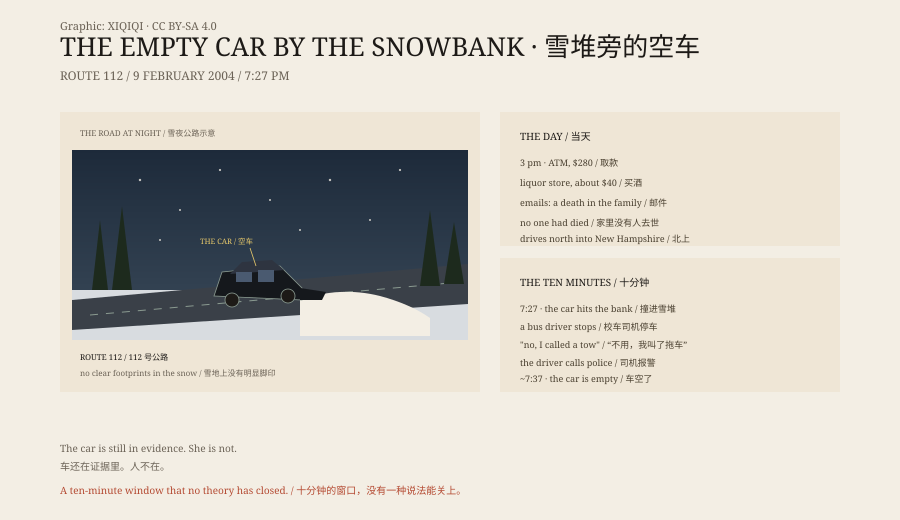

## 1. 9 February 2004

Classes at the University of Massachusetts Amherst were cancelled that day because of snow.

Maura Murray was 21, a nursing student and a former West Point cadet. She packed clothes, toiletries and textbooks into her black 1996 Saturn.

At a little after 3 p.m. she withdrew $280 from an ATM and bought about $40 worth of alcohol.

According to investigation material later made public, she emailed several professors to say there had been a death in the family and she would be away for a few days. No one in her family had died.

Then she drove north into New Hampshire.

## 2. 7.27 p.m.

At about 7.27 p.m., on Route 112 near Woodsville, her car went into a snowbank on a sharp curve. The front end was buried. The airbags had deployed, and the windscreen was cracked.

A school bus driver, Butch Atwood, came along. He stopped and asked if she needed help. She said she had already called a tow truck and did not need anything.

Atwood drove home and called the police.

## 3. Ten Minutes

By the time Sergeant Cecil Smith arrived, about ten minutes had passed.

The car was still there. It was locked. The airbags were out. A rag was stuffed into the exhaust pipe.

Maura was not there.

There were no clear footprints in the snow. She had not taken her phone charger or much of anything. Her phone and bank account showed no activity afterwards.

## 4. The Search

Haverhill police, New Hampshire Fish and Game, the State Police and a helicopter all came.

Search dogs lost the scent at the roadside. Searchers went into the woods and checked empty houses, barns and the riverbank along the route.

They did not find her.

## 5. The Explanations

In twenty-two years, several explanations have been offered.

She may have walked into the woods, become lost and died of exposure somewhere that was never found. But the area was searched, and no body was found.

She may have got a lift and left to start another life. But her family, friends, bank account and social security records show no trace of her since.

She may have been the victim of a crime. But there were no signs of a struggle at the scene and no suspect.

She may have taken her own life. But the police press release only described her as "endangered and possibly suicidal"; that is not a conclusion.

Every explanation has to account for the same thing: how a person can disappear in ten minutes from a road with a car, a witness and a police officer on the way.

## 6. The Empty Car

The case became one of the best-known disappearances of the internet age. Podcasts, documentaries, forums and amateur detectives have produced their own versions.

Her father, Fred Murray, has kept looking. In the New Hampshire missing persons report of January 2026, her name is still there, with her age given as 43.

The car is still in evidence. She is not.

*Original schematic: the 9 February 2004 timeline, the crash site and the ten-minute window. Not a photograph of the site. Oddity Archive, CC BY-SA 4.0.*

---

**Sources and licenses**: the factual sources are listed in the source ledger S1–S4 at the bottom of this entry. Text and original diagrams are licensed under CC BY-SA 4.0. This article separates police records, family accounts and online speculation; no evidence establishes where she went. The illustration is a scene reconstruction, not a photograph of the site.
