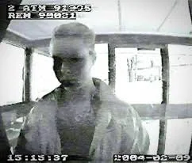
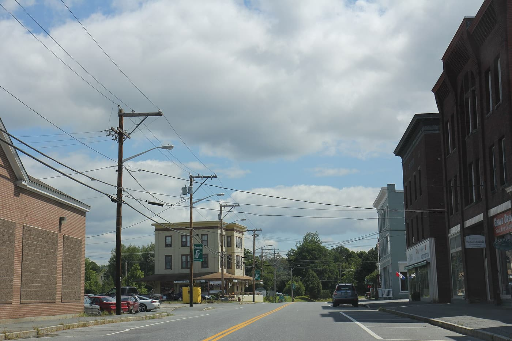
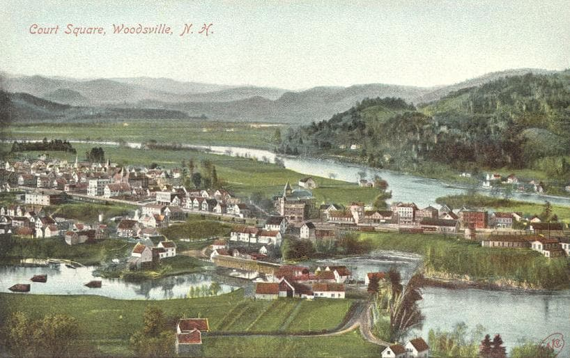
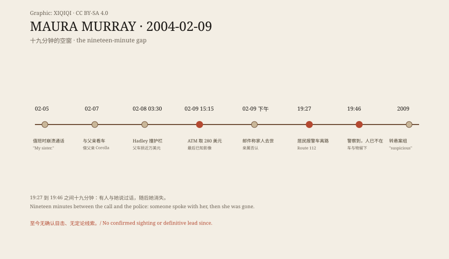

## 一、15:15:37

监控截图的左上角是摄像头编号，左下角是时间：15:15:37，右下角是日期：2004-02-09。画面里是一个年轻女人站在 ATM 前，分辨率很低，脸几乎糊成一片。她取了 280 美元。这是莫拉·默里最后的已知影像。

她 21 岁，马萨诸塞大学阿默斯特分校护理系学生，曾在西点军校读化学工程三个学期后转学。当天下午早些时候，她给教授和工作主管发邮件，说因家人去世要离开一周——亲属后来说，家里没有人去世。她开车离开校园向北，理由至今不明。她带走了部分行李与个人物品，却把车和更多物品留在弯道："准备离开"与"突然消失"两种读法，共用同一组物证。监控时间戳的意义也在这里：数字时间第一次成为一桩失踪案的"最后肖像"。

*监控影像：2004-02-09 15:15:37，ATM 摄像头，公有领域（Wikimedia Commons）。莫拉·默里失踪前最后的已知影像；画面含时间戳。*

## 二、19:27 与 19:46

新罕布什尔州黑弗里尔镇伍兹维尔村附近，112 号公路（Wild Ammonoosuc 路）一段弯道。19:27，一名当地居民报警：一辆车冲出路基，停在她家附近。

一名路过司机停下车，与车里的人短暂交谈。对方拒绝帮助，说自己已经叫了救援。19:46，警察到达：车还在，随身物品还在，人不见了。

从报警到警察到场，十九分钟。这十九分钟里，一个活人从记录中走了出去。没有确认的目击，没有监控，没有第二辆车的确证。弯道附近住户稀少、夜里没有路灯；报警居民与路过司机是仅有的两个"最后接触者"，两人的陈述构成这十九分钟的全部外部证据。

*现场照片：2014-08-18，Royalbroil，CC BY-SA 4.0（Wikimedia Commons）。伍兹维尔主街；失踪地点在镇外 112 号公路弯道。*

## 三、之前的四天

把时间往回拨四天，能看到一个逐渐失稳的人。

2 月 5 日夜，她在校园保安值班岗位上与姐姐凯瑟琳通电话，谈姐姐与未婚夫的关系问题；约 22:30 她在岗位上崩溃哭泣。主管赶到时她"完全放空、毫无反应"。被问怎么了，她只说两个词："我姐姐。"2017 年凯瑟琳公开解释：那晚她刚出院、未婚夫带她去了酒铺，导致戒酒复发。

2 月 7 日，父亲弗雷德到校，两人下午去看车，晚上与她朋友吃饭；她把父亲送回汽车旅馆，借了他的丰田 Corolla 回校参加宿舍派对。2 月 8 日凌晨 2:30 离开派对，3:30 在哈德利撞上 9 号公路护栏，父亲的车损失近一万美元；出警记录里没有现场清醒测试的记载。4:49，父亲的手机拨出一通给她男友的电话，内容与通话人至今不明。

再往前，2003 年 11 月，她承认用偷来的信用卡号在几家餐厅订餐；指控被延期，三个月表现良好后撤销。在西点，她曾被指控在 PX 商店偷窃；姐姐朱莉说此事被提交荣誉委员会，而莫拉在委员会开会前自行选择了离开军校。这些片段不构成解释，但它们构成背景：失踪前四天，她的睡眠、情绪与判断都在下坡。而"下坡"本身不是失踪的原因——它只是让"自愿离开"与"遭遇不测"两种假设都显得说得通的背景噪音。

## 四、一个小镇的两张脸

伍兹维尔是一个河谷小镇：康涅狄格河从镇边流过，对面是佛蒙特州。1908 年的手工上色明信片从山上俯拍"法院广场"：红顶房屋、河湾、远山，一片新英格兰的安静。

*历史明信片：1908 年，"Court Square, Woodsville, N.H."，公有领域（Wikimedia Commons）。手工上色的河谷小镇全景。*

今天的伍兹维尔主街是砖房、电线、停在路边的车。失踪地点不在镇上，而在镇外一段没有路灯的弯道。搜索队多年里反复搜过周边的树林、河谷与废弃建筑；地形本身就是一种解释的候选：一个人若走进二月的林海，可能永远不被找到。一个普通到不会被写进旅游指南的地方，成了美国最著名的悬案之一的坐标。

## 五、悬案与网络

警方最初考虑"自愿离开"的可能：她有未告知他人的出行准备，现场没有立即的犯罪证据。2009 年案件转入新罕布什尔悬案组，按"可疑"失踪案处理。多年里有多次搜索、公开呼吁与案件复核，但没有确认的目击或定论线索。家属持续发声：父亲弗雷德多年自费组织搜索与宣传，妹妹朱莉维护信息站并公开澄清误传。

案件上了《20/20》《Disappeared》；2017 年 Oxygen 的纪录片系列（首集标题就叫"Everyone Has a Theory"）把它描述为"社交媒体早期时代第一批重大犯罪谜案之一"：论坛、博客与业余侦探把每一帧监控、每一通电话记录放大检视。家属维护着 mauramurraymissing.org。网络给了案件前所未有的注意力，也给了它前所未有的噪音：阴谋论、冒充者、收费的"线索"，与真正的证据混在同一条时间线里。

*原创示意图：失踪前四天与 2 月 9 日各固定时刻，以及 19:27–19:46 的十九分钟空窗。稀奇奇编辑部，CC BY-SA 4.0。*

## 六、十九分钟

这案子里最硬的东西是几个时间戳：15:15:37 的 ATM、19:27 的报警、19:46 的到场。它们像三枚钉子，把一天钉在记录上；而钉子与钉子之间，是空的。

有人在那十九分钟里与她说过话。那个人听到的最后一句话是"我已经叫了救援"。之后她走出画面、走出记录、走出所有搜索的范围。112 号公路那段弯道还在，车曾停的位置还在；只有人，没有留下任何可以被钉住的东西。悬案的意义也许就在这里：它不提供答案，只提供一组永远对不上的时间戳，和一群不肯停止核对的人。

---

**来源与许可**：事实来源见台账 S1–S5。文字与原创示意图 CC BY-SA 4.0。ATM 监控为公有领域；伍兹维尔照片与明信片为 Wikimedia Commons 署名/公有领域作品，许可见台账。失踪原因无定论；"自愿离开"与"可疑"均为警方不同阶段的定性，本文并列呈现而不裁定。