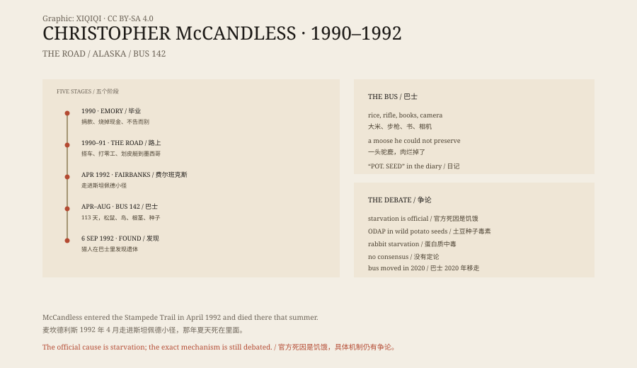

## 1. Graduation

Christopher McCandless was born in California in 1968.

In 1990 he graduated from Emory University, where he studied history and anthropology. After graduating he gave his savings of twenty-four thousand dollars to charity, burned the cash he had left, told no one in his family, and drove away.

He gave himself a new name: Alexander Supertramp.

## 2. On the road

For the next two years he travelled through the American West and Mexico.

He hitchhiked, walked, kayaked, took odd jobs and lived in a tent. He worked at a hamburger restaurant in a small town in South Dakota and on farms in California and Arizona. He read Tolstoy, Jack London and Thoreau, and wrote notes in the margins.

He did not want his old life back. He wanted “real experience”, not comfort.

## 3. Alaska

In April 1992 he hitchhiked to Fairbanks, Alaska.

He carried a bag of rice, a rifle, some books and a camera, and walked onto the Stampede Trail. The trail lies north of Denali National Park; in winter it is a snowmobile route, and in summer it is swamp and river.

On the trail he found an abandoned bus. It was Bus 142, originally used by road workers and later by hunters and hikers as a shelter.

He moved in.

## 4. The bus

The bus had a stove, a bunk and a broken table.

He found food nearby: squirrels, ptarmigan, bird eggs, berries and roots. He shot a moose but did not know how to preserve the meat. It rotted, and he watched it go bad.

He kept a diary of what he ate and how he felt. At first he was excited. He wrote that he was happy, that he was finally free.

## 5. Death

Summer passed and food became scarce.

The words “POT. SEED” appear in his diary. He grew weak, found it hard to walk, and in the end did not have the strength to hunt.

He taped a note to the door of the bus:

“S.O.S. I need your help. I am injured, near death, and too weak to hike out of here. I am all alone, this is no joke. In the name of God, please remain to save me.”

On 6 September 1992 two moose hunters found his body in the bus. He was twenty-four.

## 6. The cause of death

The official cause of death was starvation.

Why he starved has been argued about ever since. In 2013 the writer Jon Krakauer proposed in The New Yorker that McCandless had eaten the seeds of a wild potato, Hedysarum alpinum, which contain a neurotoxin called ODAP. The poison, he argued, paralysed McCandless and left him unable to move.

A 2015 study supported the idea. Other researchers argue that he died of starvation itself, or of protein poisoning — eating only rabbit meat, with no fat, makes you hungrier the more you eat.

There is no consensus. But most people agree that he did not commit suicide and was not killed by a bear. He was killed by the wilderness, hunger and a series of bad decisions.

## 7. After the bus

In 1996 Krakauer published Into the Wild. In 2007 Sean Penn made it into a film.

Bus 142 became a pilgrimage site. Every year hikers walked in; some got lost, some were injured, some had to be rescued. The state of Alaska repeatedly warned that the trail is swamp and fast river in summer, not a tourist route.

In 2020 Alaska lifted the bus out of the wilderness and moved it to the Museum of the North in Fairbanks. It is no longer a place of pilgrimage. It is an exhibit.

## 8. Now

What attracts people to McCandless is not how badly he died, but why he went.

He had money, an education and a family. He could have chosen an easy path. He chose the hardest one.

Some call him brave, some call him foolish, some call him a young man ruined by books. In his own diary he wrote that he wanted a life with nothing extra in it.

*Original schematic: five stages from graduation to the discovery of the body, Bus 142 and the debate over the cause of death. Not a photograph of the site. Oddity Archive, CC BY-SA 4.0.*

---

**Sources and licenses**: the factual sources are listed in the source ledger S1–S3 at the bottom of this entry. Text and original diagrams are licensed under CC BY-SA 4.0. This article separates the known biography, the diary, the official cause of death and the debate over the cause; starvation is the official conclusion, and the ODAP hypothesis is still discussed. The illustration is a scene reconstruction, not a photograph of the site.
