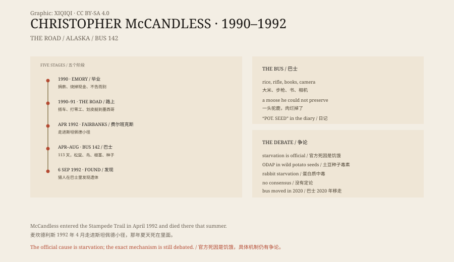

## 一、毕业

克里斯托弗·麦坎德利斯 1968 年出生在加州。

1990 年，他从埃默里大学毕业，学的是历史和人类学。毕业后，他把账户里的两万四千美元捐给了慈善机构，烧掉了剩下的现金，没有告诉家人，开车离开了。

他给自己起了一个名字：亚历山大·超级流浪者。

## 二、上路

接下来的两年，他在美国西部和墨西哥旅行。

他搭车、徒步、划皮艇，打零工，住帐篷。他在南达科他州的一个小镇做过汉堡店员工，在加州和亚利桑那的农场干过活。他读托尔斯泰、杰克·伦敦和梭罗，在书页边上写笔记。

他不想回到原来的生活。他要的是“真实的体验”，不是舒适。

## 三、阿拉斯加

1992 年 4 月，他搭车到了阿拉斯加的费尔班克斯。

他带着一袋米、一支步枪、一些书和一台相机，走上了斯坦佩德小径。这条小径在德纳里国家公园的北边，冬天是雪地车路线，夏天是一片沼泽和河流。

他在小径上找到了一辆废弃的巴士。那是 142 号巴士，原本是给修路工人用的，后来成了猎人和徒步者的临时庇护所。

他住了进去。

## 四、巴士

巴士里有炉子、床铺和一张破桌子。

他在附近找东西吃：松鼠、松鸡、鸟蛋、野果、根茎。他开枪打死了一头驼鹿，但不会保存肉，肉很快腐烂，他只能看着它坏掉。

他在日记里记下每天的食物和心情。开始的时候，他很兴奋。他写“我在这里很快乐”，写“我终于自由了”。

## 五、死亡

夏天过去，食物越来越少。

他的日记里出现了“POT. SEED”（土豆种子）。他开始虚弱，走路困难，最后连打猎的力气都没有。

他在巴士的门上贴了一张纸条：

“S.O.S. 我需要帮助。我受了伤，接近死亡，太虚弱了，走不出去。我一个人，这不是开玩笑。看在上帝的份上，请留下来救我。”

1992 年 9 月 6 日，几名猎人在巴士里发现了他的遗体。他二十四岁。

## 六、死因

官方死因是饥饿。

但为什么会饿死，一直有争论。2013 年，作家乔恩·克拉考尔在《纽约客》上提出，麦坎德利斯吃了野生的土豆种子，种子里含有一种神经毒素 ODAP，导致他瘫痪、无法行动。

2015 年，一项研究支持了这个说法。也有研究者认为，他是死于饥饿本身，或者是蛋白质中毒——只吃兔子肉，没有脂肪，会让人越吃越饿。

没有定论。但大多数人都同意：他不是“自杀”，也不是“被熊吃掉”。他是被荒野、饥饿和一连串错误的判断杀死的。

## 七、巴士之后

1996 年，克拉考尔出版了《荒野生存》。2007 年，西恩·潘把它拍成电影。

巴士 142 成了圣地。每年都有徒步者走进去，有人迷路，有人受伤，有人被救出来。阿拉斯加州政府多次警告，那条小径夏天是沼泽和急流，不是旅游路线。

2020 年，阿拉斯加州把巴士从荒野里吊出来，运到费尔班克斯的北方博物馆。它不再是一个可以朝圣的地方，成了一件展品。

## 八、现在

麦坎德利斯的故事，吸引人的地方不是他死得多惨，而是他为什么去。

他有钱，有学历，有家庭。他可以选择一条舒服的路。他偏偏选了最难的。

有人说他勇敢，有人说他愚蠢，有人说他只是一个被书害了的年轻人。他自己在日记里写：“我想要的，是一种没有多余东西的生活。”

*原创示意图：从埃默里大学毕业到在 142 号巴士被发现，五个阶段的时间线；右侧为巴士与死因争论。不是现场照片。稀奇奇编辑部，CC BY-SA 4.0。*

---

**来源与许可**：本文的事实来源见条目底部来源台账 S1–S3。文字与原创示意图采用 CC BY-SA 4.0。文中把已知的生平、日记、官方死因与死因争论分开叙述；饥饿是官方结论，ODAP 假说仍有讨论。插图是场景复原，不是现场照片。
