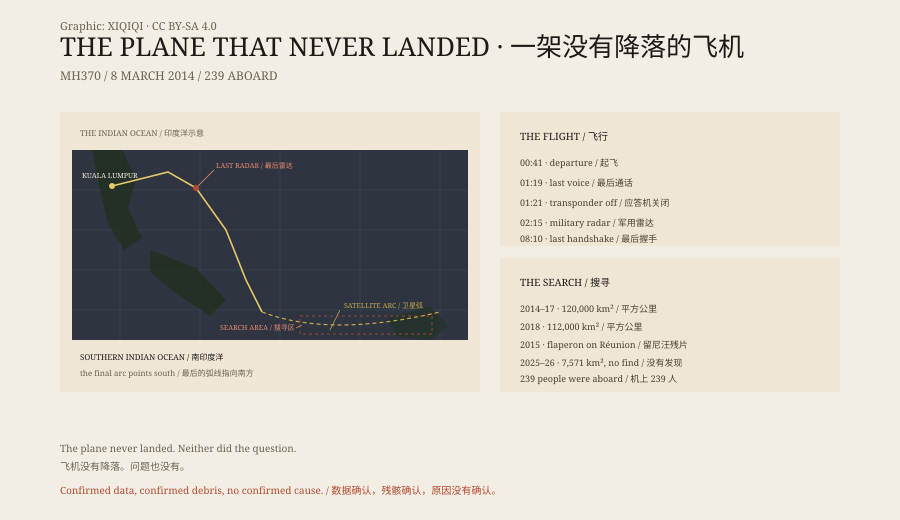

## 1. 8 March 2014

At 00.41, Malaysia Airlines flight MH370 took off from Kuala Lumpur International Airport for Beijing.

The aircraft was a Boeing 777-200ER. There were 239 people aboard: 227 passengers and 12 crew. Among the passengers were 154 Chinese citizens.

At 01.19 the crew made their last radio contact with the ground. The captain is recorded saying, "Good night, Malaysia three seven zero."

At 01.21 the transponder stopped transmitting.

## 2. The Turn

The aircraft did not continue to Beijing.

Military radar showed it turning west, crossing the Malay Peninsula, entering the Andaman Sea and then turning south.

There was no distress call. There was no unusual radio traffic. The ACARS data link stopped after 01.07.

The 2018 investigation report said the turn "likely resulted from manual inputs". It did not exclude intervention by a third party, and it did not place the blame on the captain or the first officer.

## 3. The Satellites

After the aircraft disappeared, the Inmarsat satellites continued to receive an hourly handshake from it.

The signal carried no position. Investigators used its delay and Doppler shift to calculate a possible arc in the southern Indian Ocean.

The last handshake came at about 08.10.

The arc ran south. There were no airports, no islands, only ocean.

## 4. The Search

From 2014 to 2017, Australia, China and Malaysia searched about 120,000 square kilometres of seabed in the southern Indian Ocean.

They did not find the aircraft.

In 2018, Ocean Infinity searched another 112,000 square kilometres.

They did not find it either.

On 29 July 2015, a wing flaperon washed ashore on Réunion. Days later it was confirmed as part of MH370. More than twenty suspected pieces were later found on the East African coast and Indian Ocean islands; only a few were formally confirmed.

## 5. 2026

On 25 March 2025, the Malaysian government signed an agreement with Ocean Infinity to search a new area of about 15,000 square kilometres in the southern Indian Ocean, on a "no find, no fee" basis.

The search ran in two phases and was interrupted by weather and sea conditions.

On 8 March 2026, the Malaysian Ministry of Transport announced that the search had ended with "no findings". The two phases covered about 7,571 square kilometres of seabed.

## 6. The Report

On 30 July 2018, Malaysia published the *MH370 Safety Investigation Report*. Its main body runs to 495 pages.

The report said the cause of the disappearance could not be determined.

It recorded what was known: the turn was manual, the transponder was switched off, the satellite signals pointed south. It also recorded what was not known: who was flying, why, and where the aircraft is now.

Twelve years on, the plane has not landed. Neither has the question.

*Original schematic: the 8 March 2014 timeline, the satellite handshake arc and the main search areas. Not a photograph of a site. Oddity Archive, CC BY-SA 4.0.*

---

**Sources and licenses**: the factual sources are listed in the source ledger S1–S4 at the bottom of this entry. Text and original diagrams are licensed under CC BY-SA 4.0. This article separates confirmed flight data, satellite analysis, confirmed debris and unproven speculation; no evidence establishes the cause of the loss. The illustration is a scene reconstruction, not a photograph of a site.
