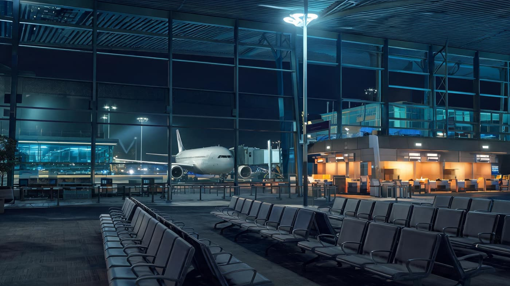

## 1. 8 March 2014

At 00.41, Malaysia Airlines flight MH370 took off from Kuala Lumpur International Airport for Beijing.

The gate was lit at night. The aircraft stood outside the glass, the jet bridge still attached. The passengers had boarded, and the rows of seats were empty.

The aircraft was a Boeing 777-200ER. There were 239 people aboard: 227 passengers and 12 crew. Among the passengers were 154 Chinese citizens.

*Reconstruction: the night departure gate at Kuala Lumpur International Airport in 2014. Not a photograph of the site. XIQIQI Editorial, CC BY-SA 4.0.*

At 01.19 the crew made their last radio contact with the ground. The captain is recorded saying, "Good night, Malaysia three seven zero."

At 01.21 the transponder stopped transmitting.

On the screen, the symbol representing the aircraft was still there. It had simply stopped answering.

## 2. The Turn

The aircraft did not continue to Beijing.

Military radar showed it turning west, crossing the Malay Peninsula, entering the Andaman Sea and then turning south.

There was no distress call. There was no unusual radio traffic. The ACARS data link stopped after 01.07.

The 2018 investigation report said the turn "likely resulted from manual inputs". It did not exclude intervention by a third party, and it did not place the blame on the captain or the first officer.

## 3. The Satellites

After the aircraft disappeared, the Inmarsat satellites continued to receive an hourly handshake from it.

The signal carried no position. Investigators used its delay and Doppler shift to calculate a possible arc in the southern Indian Ocean.

The last handshake came at about 08.10.

The arc ran south. There were no airports, no islands, only ocean.

The ocean was vast, and the arc was thin. The searchers had to follow an invisible line to find an aircraft that had stopped speaking.

## 4. The Search

From 2014 to 2017, Australia, China and Malaysia searched about 120,000 square kilometres of seabed in the southern Indian Ocean.

They did not find the aircraft.

In 2018, Ocean Infinity searched another 112,000 square kilometres.

They did not find it either.

On 29 July 2015, a wing flaperon washed ashore on Réunion. Days later it was confirmed as part of MH370. More than twenty suspected pieces were later found on the East African coast and Indian Ocean islands; only a few were formally confirmed.

## 5. 2026

On 25 March 2025, the Malaysian government signed an agreement with Ocean Infinity to search a new area of about 15,000 square kilometres in the southern Indian Ocean, on a "no find, no fee" basis.

The search ran in two phases and was interrupted by weather and sea conditions.

On 8 March 2026, the Malaysian Ministry of Transport announced that the search had ended with "no findings". The two phases covered about 7,571 square kilometres of seabed.

## 6. The Report

On 30 July 2018, Malaysia published the *MH370 Safety Investigation Report*. Its main body runs to 495 pages.

The report said the cause of the disappearance could not be determined.

It recorded what was known: the turn was manual, the transponder was switched off, the satellite signals pointed south. It also recorded what was not known: who was flying, why, and where the aircraft is now.

Twelve years on, the plane has not landed. Neither has the question.

*Original schematic: the 8 March 2014 timeline, the satellite handshake arc and the main search areas. Not a photograph of a site. XIQIQI Editorial, CC BY-SA 4.0.*

## 2014

On March 8, 2014, Malaysia Airlines MH370 took off from Kuala Lumpur bound for Beijing.

There were 239 people on board. Shortly after takeoff, the plane lost contact with the ground.

## Turn

Radar showed the plane was not flying on course.

It turns west across the Malay Peninsula and into the Indian Ocean. After that, the radar also lost it.

## Satellite

Records from satellite company Inmarsat show that the plane still had a "handshake" signal with the satellite after it lost contact.

The signal lasted for several hours. Last call, pointing to the southern Indian Ocean.

Inmarsat's satellite is more than 30,000 kilometers away from the earth.

The aircraft's "handshake" signal is transmitted to the satellite and then to the ground. The signal is weak, but it gives an arc.

Inmarsat satellites recorded the aircraft's "handshake" signal.

The signal is weak, but it gives an arc. The arc points to the southern Indian Ocean.

## The Search
The search lasted several years.

Australia, China, Malaysia and other countries participated in the search. The search area is large and the seabed terrain is complex. The seabed is very deep and the terrain is complex.

## Wreckage

Several pieces of wreckage have been found on the east coast of Africa and on islands in the Indian Ocean.

They were confirmed to belong to MH370. But the main body of the plane was not found.

## 2026

In 2026, the search continues.

New company, new equipment, new area. The seabed is deep and the search is slow.

## Report

The official report did not give a definite cause.

It lists possible causes: human operation, mechanical failure, lack of oxygen. There's no evidence for either.

Official reports did not give a definite cause.

It lists possible causes: human operation, mechanical failure, lack of oxygen.

## The Answer
The answer to MH370 is still in the sea.

239 people, 239 families, waiting for an answer that never came.

The answer lies in the sea.

## Indian Ocean

The southern Indian Ocean is one of the most remote sea areas in the world.

The water is several kilometers deep, the wind and waves are strong, and the seabed topography is complex. The search requires ships, planes, satellites and submersibles.

## The Search
The search area is expanded along an arc.

First search, near Malaysia and Vietnam. The second time, in the southern Indian Ocean. The third time, further south.

The search area is huge.

## Family Members

239 families, a long wait.

Some people accept the reality, and some people continue to search. Every year on March 8, people gather and pray.

239 families, a long wait.

## Airplane

MH370 is a Boeing 777.

It's big and can fly very far. There were 239 people on board, including passengers and crew.

## Further Notes
The search for MH370 is one of the most expensive aviation searches in modern history.

Satellites, airplanes, ships, and submersibles are all used. Still no subject found.

What the family wants is not a conspiracy, but a position.

## At Last

The search for MH370 continues.

239 people, still waiting for an answer.

The sea is big and the answer is small.

## Remember Again

The search for MH370 was one of the longest in modern aviation history.

Satellites, ships, airplanes, and submersibles are all used. Still no subject found. What the family wants is not a conspiracy, but a position.

The sea is big and the answer is small. 239 people, still waiting.

The plane didn't come back, and the questions didn't come back. The sea is still there and the waiting is still there.

## File

On March 8, 2014, MH370 was flying from Kuala Lumpur to Beijing and lost contact shortly after takeoff. There were 239 people on board.

---

**Sources and licenses**: the factual sources are listed in the source ledger S1–S4 at the bottom of this entry. Text and original diagrams are licensed under CC BY-SA 4.0. This article separates confirmed flight data, satellite analysis, confirmed debris and unproven speculation; no evidence establishes the cause of the loss. The illustration is a scene reconstruction, not a photograph of a site.
