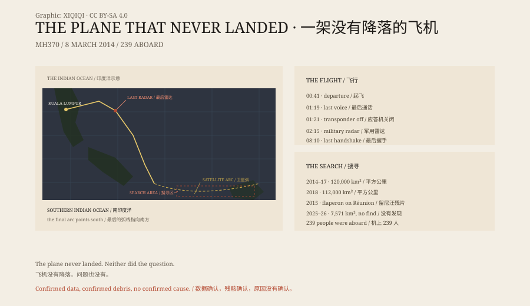

## 1. 8 March 2014

At 00.41, Malaysia Airlines flight MH370 took off from Kuala Lumpur International Airport for Beijing.

The gate was lit at night. The aircraft stood outside the glass, the jet bridge still attached. The passengers had boarded, and the rows of seats were empty.

The aircraft was a Boeing 777-200ER. There were 239 people aboard: 227 passengers and 12 crew. Among the passengers were 154 Chinese citizens.

*Reconstruction: the night departure gate at Kuala Lumpur International Airport in 2014. Not a photograph of the site. Oddity Archive, CC BY-SA 4.0.*

At 01.19 the crew made their last radio contact with the ground. The captain is recorded saying, "Good night, Malaysia three seven zero."

At 01.21 the transponder stopped transmitting.

On the screen, the symbol representing the aircraft was still there. It had simply stopped answering.

## 2. The Turn

The aircraft did not continue to Beijing.

Military radar showed it turning west, crossing the Malay Peninsula, entering the Andaman Sea and then turning south.

There was no distress call. There was no unusual radio traffic. The ACARS data link stopped after 01.07.

The 2018 investigation report said the turn "likely resulted from manual inputs". It did not exclude intervention by a third party, and it did not place the blame on the captain or the first officer.

## 3. The Satellites

After the aircraft disappeared, the Inmarsat satellites continued to receive an hourly handshake from it.

The signal carried no position. Investigators used its delay and Doppler shift to calculate a possible arc in the southern Indian Ocean.

The last handshake came at about 08.10.

The arc ran south. There were no airports, no islands, only ocean.

The ocean was vast, and the arc was thin. The searchers had to follow an invisible line to find an aircraft that had stopped speaking.

## 4. The Search

From 2014 to 2017, Australia, China and Malaysia searched about 120,000 square kilometres of seabed in the southern Indian Ocean.

They did not find the aircraft.

In 2018, Ocean Infinity searched another 112,000 square kilometres.

They did not find it either.

On 29 July 2015, a wing flaperon washed ashore on Réunion. Days later it was confirmed as part of MH370. More than twenty suspected pieces were later found on the East African coast and Indian Ocean islands; only a few were formally confirmed.

## 5. 2026

On 25 March 2025, the Malaysian government signed an agreement with Ocean Infinity to search a new area of about 15,000 square kilometres in the southern Indian Ocean, on a "no find, no fee" basis.

The search ran in two phases and was interrupted by weather and sea conditions.

On 8 March 2026, the Malaysian Ministry of Transport announced that the search had ended with "no findings". The two phases covered about 7,571 square kilometres of seabed.

## 6. The Report

On 30 July 2018, Malaysia published the *MH370 Safety Investigation Report*. Its main body runs to 495 pages.

The report said the cause of the disappearance could not be determined.

It recorded what was known: the turn was manual, the transponder was switched off, the satellite signals pointed south. It also recorded what was not known: who was flying, why, and where the aircraft is now.

Twelve years on, the plane has not landed. Neither has the question.

*Original schematic: the 8 March 2014 timeline, the satellite handshake arc and the main search areas. Not a photograph of a site. Oddity Archive, CC BY-SA 4.0.*

## Year 2014

On March 8, 2014, Malaysian Airlines MH370 took off from Kuala Lumpur and flew to Beijing.

The plane has 239 people on board. Soon after take-off, the plane lost contact with the ground.

## Turn around

Radar indicates that the aircraft did not follow the route.

It turned west, crossed the Malay Peninsula, entered the Indian Ocean, and then the radar lost it.

## Satellite

Satellite company Inmarsat records indicate that the aircraft still have a “handhak” signal with the satellite after being lost.

The signal lasted a few hours. The last one, pointing to the South Indian Ocean.

Inmarsat's satellite, more than 30,000 km from Earth.

The plane's handshake signal, passed on to the satellite, then to the ground. The signal is weak, but it gives an arc.

Inmarsat's satellite recorded the aircraft's handshake signal.

Signals are weak, but they give you an arc. The arc points to the South Indian Ocean.

## Search

The search lasted several years.

Australia, China, Malaysia and other countries are involved in the search. The search area is large and the seabed topography is complex.

## The wreckage

On the eastern coast of Africa and on the islands of the Indian Ocean, a few pieces of debris were found.

They were identified as belonging to MH370, but the main body of the aircraft was not found.

## 2026

In 2026, the search continued.

New companies, new equipment, new areas. Deep under the sea, slow search.

## Report

The official report did not give any reasons for that.

It lists the possible causes: man-made operations, mechanical failures, lack of oxygen. There is no evidence of which.

The official report does not give any reasons for this.

It lists possible causes: man-made operations, mechanical failures, oxygen deficiency.

## Answer

The MH370 answer is still in the sea.

239 individuals, 239 families, waiting for an answer that doesn't appear.

The answer is still in the sea.

## Indian Ocean

The South Indian Ocean is one of the most remote seas in the world.

The depth of the water is thousands of metres, the waves are huge, and the topography of the sea floor is complex. Searching requires ships, aircraft, satellites and submersibles.

## Search

Search the area and follow the arc line.

First search, near Malaysia and Viet Nam. Second, in the South Indian Ocean. Third, in the south.

Search the area, big.

Australia, China, Malaysia and other countries are involved in the search. The sea floor is deep and the terrain is complex.

## Family

239 families, long waiting.

On March 8th of every year, people meet and pray.

239 families, long waiting.

On March 8th of every year, people meet.

## Aircraft

MH370 is a Boeing 777.

It's big, it can fly very far. It's got 239 people on board, including passengers and crew.

## Memory

MH370 is one of the most expensive aerial searches in modern history.

Satellites, planes, boats, submersibles are all in use. Still no body.

The family does not want a conspiracy, it is a place.

## And finally

MH370 search continues.

239 individuals, still waiting for an answer.

The sea is big, the answer is small.

## Remember

MH370 is one of the longest searches in modern aviation history.

Satellites, ships, planes, submersibles are all in use. Still no subjects are found. Families want a location, not a conspiracy.

The sea is big, the answer is small. 239 people, still waiting.

The plane didn't come back, the question was not answered. The sea was still there, waiting.

## Archives

On March 8, 2014, MH370 was flown from Kuala Lumpur to Beijing, and lost contact shortly after taking off. 239 people were on board.

---

**Sources and licenses**: the factual sources are listed in the source ledger S1–S4 at the bottom of this entry. Text and original diagrams are licensed under CC BY-SA 4.0. This article separates confirmed flight data, satellite analysis, confirmed debris and unproven speculation; no evidence establishes the cause of the loss. The illustration is a scene reconstruction, not a photograph of a site.
