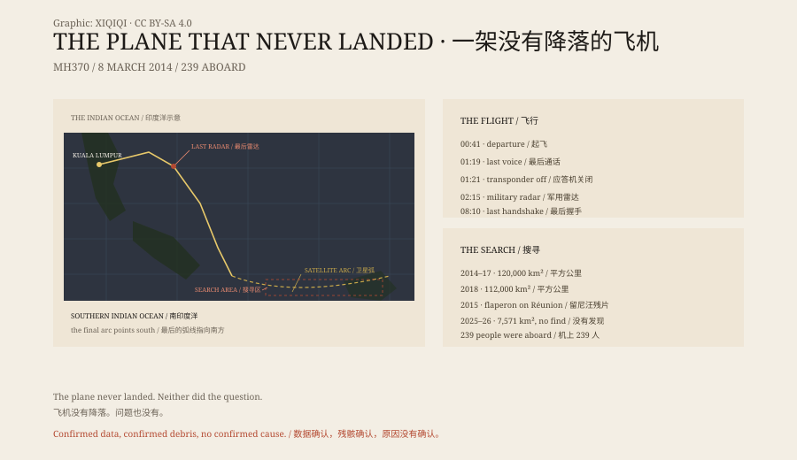

## 一、2014 年 3 月 8 日

凌晨 0 点 41 分，马来西亚航空 MH370 从吉隆坡国际机场起飞，目的地北京。

登机口在夜里亮着。飞机停在玻璃外面，廊桥还连着。乘客已经上完，座位一排排空着。

机型是波音 777-200ER。机上有 239 人：227 名乘客，12 名机组。乘客里有 154 名中国公民。

*场景复原：2014 年吉隆坡国际机场的夜间登机口。不是现场照片。稀奇奇编辑部，CC BY-SA 4.0。*

1 点 19 分，机组与地面最后一次通话。据记录，机长说：“晚安，马来西亚三七零。”

1 点 21 分，应答机停止发送信号。

屏幕上，那个代表飞机的符号还在。它只是不再回答。

## 二、转向

飞机没有继续飞向北京。

军用雷达显示，它掉头向西，越过马来半岛，进入安达曼海，然后转向南。

没有求救信号。没有异常通话。ACARS 数据链在 1 点 07 分之后停止。

2018 年的调查报告说，这次转向“很可能来自人工输入”。报告没有排除第三方干预，也没有把原因归到机长或副驾驶身上。

## 三、卫星

飞机失联后，国际海事卫星组织的卫星仍然每小时收到一次来自飞机的握手信号。

信号本身不含位置。调查者用信号的延迟和多普勒频移，算出飞机可能在南印度洋上的一条弧线上。

最后一次握手在早上 8 点 10 分左右。

弧线向南。那里没有机场，没有岛屿，只有海。

海很大，弧线很细。搜寻的人要在一条看不见的线上，找一架不再说话的飞机。

## 四、搜寻

2014 到 2017 年，澳大利亚、中国和马来西亚在南印度洋搜索了约 12 万平方公里的海床。

没有找到飞机。

2018 年，海洋无限公司又搜了约 11.2 万平方公里。

还是没有找到。

2015 年 7 月 29 日，留尼汪岛的海岸冲上一块飞机襟翼。几天后，它被确认属于 MH370。此后，非洲东海岸和印度洋岛屿上又陆续发现二十多块疑似残骸，只有少数被正式确认。

## 五、2026 年

2025 年 3 月 25 日，马来西亚政府与海洋无限公司签约，在南部印度洋一片约 1.5 万平方公里的新区域继续搜寻，采用“找不到不收费”的方式。

搜寻分两个阶段，受天气和海况影响中断过。

2026 年 3 月 8 日，马来西亚交通部发表声明：搜寻结束，“没有任何发现”。两阶段累计覆盖约 7,571 平方公里的海床。

## 六、报告

2018 年 7 月 30 日，马来西亚公布《MH370 安全调查报告》，主体 495 页。

报告说，无法确定飞机失联的真正原因。

它记录了已知的事实：转向是人工的，应答机是关闭的，卫星信号指向南方。它也记录了不知道的部分：谁在驾驶，为什么，飞机现在在哪里。

十二年过去，飞机没有降落。问题也没有。

*原创示意图：2014 年 3 月 8 日的时间线、卫星握手弧与主要搜寻区域。不是现场照片。稀奇奇编辑部，CC BY-SA 4.0。*

## 2014 年

2014 年 3 月 8 日，马来西亚航空 MH370 从吉隆坡起飞，飞往北京。

机上载有 239 人。起飞后不久，飞机与地面失去联系。

## 转向

雷达显示，飞机没有按航线飞行。

它转向西，穿过马来半岛，进入印度洋。之后，雷达也失去了它。

## 卫星

卫星公司 Inmarsat 的记录显示，飞机在失联后，仍然与卫星有“握手”信号。

信号持续了几个小时。最后一通，指向南印度洋。

Inmarsat 的卫星，距离地球三万多公里。

飞机的“握手”信号，传到卫星，再传到地面。信号很弱，但能给出一个弧线。

Inmarsat 的卫星，记录了飞机的“握手”信号。

信号很弱，但能给出一个弧线。弧线指向南印度洋。

## 搜寻

搜索持续了几年。

澳大利亚、中国、马来西亚和其他国家，参与了搜索。搜索区域很大，海底地形复杂。

## 残骸

在非洲东岸和印度洋岛屿上，找到了几块残骸。

它们被确认属于 MH370。但飞机的主体，没有找到。

## 2026 年

2026 年，搜索仍在继续。

新的公司、新的设备、新的区域。海底很深，搜索很慢。

## 报告

官方报告没有给出确定原因。

它列出了可能的原因：人为操作、机械故障、缺氧。没有证据能证明哪一种。

官方报告，没有给出确定原因。

它列出了可能的原因：人为操作、机械故障、缺氧。

## 答案

MH370 的答案，还在海里。

239 个人，239 个家庭，等待一个没有出现的答案。

答案还在海里。

## 印度洋

南印度洋，是世界上最偏远的海域之一。

水深几千米，风浪大，海底地形复杂。搜索需要船、飞机、卫星和潜水器。

## 搜索

搜索区域，沿着弧线展开。

第一次搜索，在马来西亚和越南附近。第二次，在南印度洋。第三次，在更南的地方。

搜索区域，很大。

澳大利亚、中国、马来西亚和其他国家，参与了搜索。海底很深，地形复杂。

## 家属

239 个家庭，等了很久。

有人接受现实，有人继续寻找。每年 3 月 8 日，有人集会、祈祷。

239 个家庭，等了很久。

有人接受现实，有人继续寻找。每年 3 月 8 日，有人集会。

## 飞机

MH370 是一架波音 777。

它很大，能飞很远。机上载有 239 人，包括乘客和机组。

## 余记

MH370 的搜索，是现代史上最贵的航空搜索之一。

卫星、飞机、船、潜水器，都用上了。还是没有找到主体。

家属要的不是阴谋，是一个位置。

## 最后

MH370 的搜索，还在继续。

239 个人，还在等一个答案。

海很大，答案很小。

## 又记

MH370 的搜索，是现代航空史上最长的搜索之一。

卫星、船、飞机、潜水器，都用上了。还是没有找到主体。家属要的不是阴谋，是一个位置。

海很大，答案很小。239 个人，还在等。

飞机没有回来，问题没有答案。海还在，等待还在。

## 档案

2014 年 3 月 8 日，MH370 从吉隆坡飞往北京，起飞后不久失联。机上有 239 人。

---

**来源与许可**：本文的事实来源见条目底部来源台账 S1–S4。文字与原创示意图采用 CC BY-SA 4.0。文中把已确认的飞行数据、卫星分析、残骸确认与未证实的推测分开叙述；没有证据能确认飞机失事的原因。插图是场景复原，不是现场照片。
