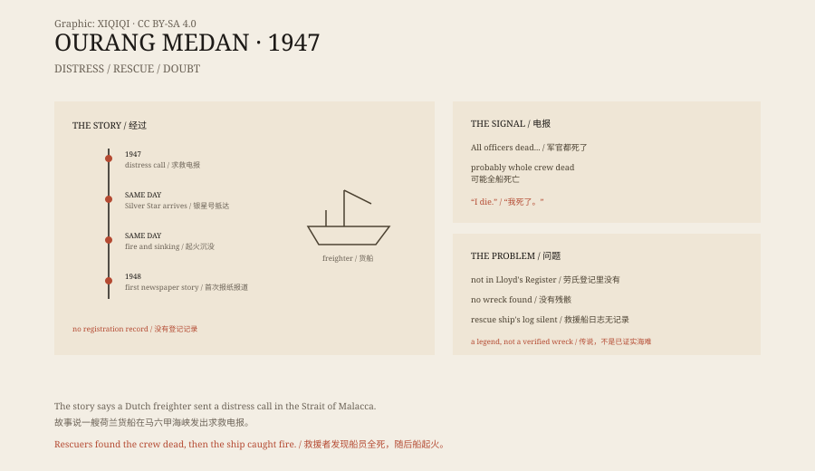

## 1. The signal

June 1947, the Strait of Malacca.

Several ships picked up the same Morse code message. It came from a Dutch freighter called the Ourang Medan.

The message was broken. It said, roughly, that the captain and all the officers were lying dead in the chartroom and on the bridge, and that probably the whole crew was dead. Then came a stretch of confused signals, ending with:

“I die.”

One of the ships that heard it was the Silver Star. It changed course and headed for the position.

## 2. The rescue

When the Silver Star found the Ourang Medan, the sea was calm.

The freighter was drifting. There was no fire, no damage, no distress flag. The Silver Star lowered a boat, and a few men climbed aboard.

They found a ship full of dead people.

The crew lay on the deck, in the corridors, on the bridge, with no obvious wounds. Their faces were turned in the same direction, eyes open, mouths open, as if they had seen something. Even the ship's dog was dead, in the same posture.

Before the Silver Star's men could take the ship in tow, smoke came from the cargo hold. Then the ship exploded and quickly sank.

## 3. The problem

The story is famous, but it has a large problem.

There is no record that the Ourang Medan ever existed.

There is no such ship in Lloyd's Register. There is no registration in the Dutch, British, or American records. The Silver Star's log has no entry for the rescue. Even the name of the rescue ship is given differently in different versions.

The story first appeared in a Dutch-Indonesian newspaper in 1948 and was later repeated in books about ghost ships. Each retelling added detail: the faces of the dead, the dog, the final “I die.”

*Original schematic: the signal, the rescue, the explosion, and the objection that there is no registration record. Not a historical photograph. Oddity Archive, CC BY-SA 4.0.*

## 4. What it might have been

If the ship did exist, there are several explanations.

One is gas or carbon monoxide poisoning. Coal or cargo in the hold released gas, the crew suffocated in a closed space, and before death they may have had hallucinations and terrified expressions.

Another is methane. Organic matter in the seabed or the cargo decomposed and released methane, causing oxygen loss.

A third is mass food poisoning.

But the most likely explanation is that the story itself is the problem. A ship with no registration, no wreck, and no rescue record is hard to prove existed. It may have been invented by a journalist, garbled by sailors, or assembled from several different stories.

## 5. Why it spread

People have always liked ghost ship stories.

An empty ship drifting at sea is scarier than an ordinary shipwreck. It leaves a space for the imagination. The signal, the faces of the dead, and the final explosion are all good narrative material.

The Second World War had just ended, and the Strait of Malacca was full of derelict ships, wrecks, and uncleared mines. Real chaos provided the background for the legend.

## 6. Now

Today the Ourang Medan still appears on lists of ghost ships.

No one has found its wreck, and no one has found its registration. The story is still told, but it is closer to an urban legend than to a maritime disaster.

It is a reminder that a story repeated often enough begins to look like fact. But check the register, and it may be nothing more than a name.

---

**Sources and licenses**: the factual sources are listed in the source ledger S1–S3 at the bottom of this entry. Text and original diagrams are licensed under CC BY-SA 4.0. This article separates the signal story, the rescue narrative, the missing records, and the possible explanations; there is no reliable registration or wreck record for the Ourang Medan, and the truth of the story remains in doubt.
