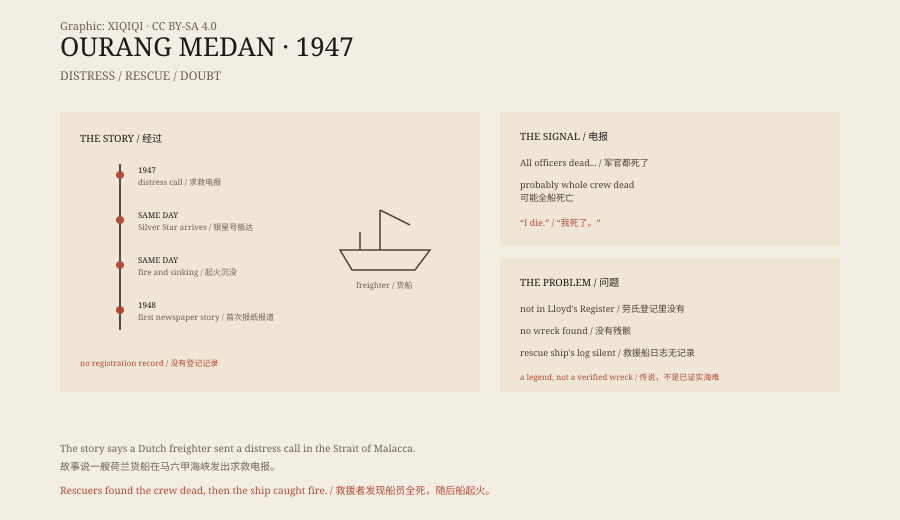

## 1. The signal

June 1947, the Strait of Malacca.

Several ships picked up the same Morse code message. It came from a Dutch freighter called the Ourang Medan.

The message was broken. It said, roughly, that the captain and all the officers were lying dead in the chartroom and on the bridge, and that probably the whole crew was dead. Then came a stretch of confused signals, ending with:

“I die.”

One of the ships that heard it was the Silver Star. It changed course and headed for the position.

## 2. The rescue

When the Silver Star found the Ourang Medan, the sea was calm.

The freighter was drifting. There was no fire, no damage, no distress flag. The Silver Star lowered a boat, and a few men climbed aboard.

They found a ship full of dead people.

The crew lay on the deck, in the corridors, on the bridge, with no obvious wounds. Their faces were turned in the same direction, eyes open, mouths open, as if they had seen something. Even the ship's dog was dead, in the same posture.

Before the Silver Star's men could take the ship in tow, smoke came from the cargo hold. Then the ship exploded and quickly sank.

## 3. The problem

The story is famous, but it has a large problem.

There is no record that the Ourang Medan ever existed.

There is no such ship in Lloyd's Register. There is no registration in the Dutch, British, or American records. The Silver Star's log has no entry for the rescue. Even the name of the rescue ship is given differently in different versions.

The story first appeared in a Dutch-Indonesian newspaper in 1948 and was later repeated in books about ghost ships. Each retelling added detail: the faces of the dead, the dog, the final “I die.”

*Original schematic: the signal, the rescue, the explosion, and the objection that there is no registration record. Not a historical photograph. Oddity Archive, CC BY-SA 4.0.*

## 4. What it might have been

If the ship did exist, there are several explanations.

One is gas or carbon monoxide poisoning. Coal or cargo in the hold released gas, the crew suffocated in a closed space, and before death they may have had hallucinations and terrified expressions.

Another is methane. Organic matter in the seabed or the cargo decomposed and released methane, causing oxygen loss.

A third is mass food poisoning.

But the most likely explanation is that the story itself is the problem. A ship with no registration, no wreck, and no rescue record is hard to prove existed. It may have been invented by a journalist, garbled by sailors, or assembled from several different stories.

## 5. Why it spread

People have always liked ghost ship stories.

An empty ship drifting at sea is scarier than an ordinary shipwreck. It leaves a space for the imagination. The signal, the faces of the dead, and the final explosion are all good narrative material.

The Second World War had just ended, and the Strait of Malacca was full of derelict ships, wrecks, and uncleared mines. Real chaos provided the background for the legend.

## 6. Now

Today the Ourang Medan still appears on lists of ghost ships.

No one has found its wreck, and no one has found its registration. The story is still told, but it is closer to an urban legend than to a maritime disaster.

It is a reminder that a story repeated often enough begins to look like fact. But check the register, and it may be nothing more than a name.

## Boat

The Orange Medan is a Dutch cargo vessel.

It started in 1947 in Kantakasi, Indonesia, and passed through the Strait of Malacca to Ambon, Indonesia.

The ship floats at sea, and no one knows where it comes from or where it goes.

It doesn't have a name. It's just a number.

## Telegraph

In June 1947, an American ship received its distress signal.

The signal said, "All the crew, including the captain, are dead. Me, the radioman, are dying." Then the signal was out.

The contents of the telegram are quoted repeatedly.

Different versions, different words. The most popular is: “All the crew, including the captain, are dead.”

## Rescue

The American ship arrived at the scene.

They saw the Orange Medan. The ship was still on deck, the body was on deck, in the rudder room, the body was on the radio. No one was alive.

When the American ship received the distress signal, it arrived at the scene.

They saw the boat floating, bodies on deck, bodies on deck. No one alive.

## Problem

The body on the boat. Who is it?

Some say it's a pirate; others say it's a poison gas; others say it's a fire. The dog on the boat is dead.

## Radio

Who's the radio player?

No one knows. He could have sent the signal or someone else. The radio on the boat was removed.

Radio, that's the only link on the ship and shore.

At sea, no cell phones, no Internet. The signal breaks and the ship disappears.

## The story

The story of the Orange Medan became a classic of the Ghost Boat.

It has no answer, but only one boat, several bodies and a telegram.

The Orange Medan, which is the classic of the Ghost Boat.

It's the story, no answer.

## Ma's six

The Strait of Malacca is one of the busiest shipping routes in the world.

There are many ships, pirates, bad weather. In 1947, the area had no modern radar and satellites.

## Cargo vessel

The Orange Medan, an old cargo ship.

It transports rubber, tin and daily goods. There are dozens of crew members on board, mostly Indonesians and Dutch.

## The body

The body is who, no one knows.

Some say it was a pirate; others say it was a gas; others say it was a fire. No autopsy report.

The body was filmed and published in the newspaper.

The pictures are vague and the face is not clear. Some say they are pirates; others say they are crewmen.

No autopsy, no name.

## Supplementary Notes

The story of the Orange Medan, the worst part of which is not the body, but the radio.

A voice, coming from a ship without a living person. It says everyone is dead.

## Remember that

The Strait of Malacca is one of the busiest shipping routes in the world.

A ship disappears, probably just without a signal.

## Final

The Orange Medan is a ship.

It has no answer, but only one boat, several bodies and a telegram.

## Last

The body of the ship, which was soaked by seawater.

The rescue ship has arrived, but it's empty.

The telegram from the Orange Medan finally became a mystery.

The last word of the telegram, no one can read it. The ship is still there, and the story has no answer.

---

**Sources and licenses**: the factual sources are listed in the source ledger S1–S3 at the bottom of this entry. Text and original diagrams are licensed under CC BY-SA 4.0. This article separates the signal story, the rescue narrative, the missing records, and the possible explanations; there is no reliable registration or wreck record for the Ourang Medan, and the truth of the story remains in doubt.
