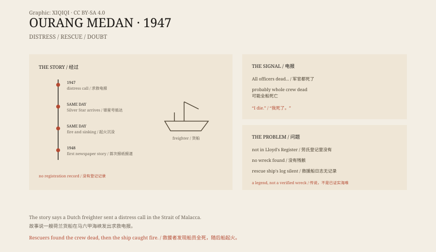

## 一、电报

1947 年 6 月，马六甲海峡。

几艘船收到了同一段摩尔斯电码。发报的是一艘荷兰货船，叫“乌兰·梅丹号”。

电文断断续续，大意是：船长和所有军官都倒在海图室和舰桥上，可能全船的人都死了。接着是一段混乱的信号，最后一句是：

“我死了。”

收到电报的船里，有一艘叫“银星号”。它改变了航向，前往电报发出的位置。

## 二、救援

银星号找到乌兰·梅丹号时，海面很平静。

货船漂着，没有起火，没有破损，也没有求救的旗帜。银星号放下小艇，几个人爬上甲板。

他们看到的是一船死人。

船员倒在甲板上、走廊里、舰桥上，没有明显外伤。死者的脸朝着同一个方向，眼睛睁着，嘴巴张开，像是看到了什么。连船上的狗也死了，姿势一样。

银星号的人还没来得及把船拖走，乌兰·梅丹号的货舱冒出了烟。紧接着，船身爆炸，很快沉进海里。

## 三、问题

这个故事很有名，但它有一个大问题。

没有记录证明“乌兰·梅丹号”存在过。

劳氏船级社的登记里没有这艘船。荷兰、英国、美国的船舶登记里也没有。银星号的航海日志里，没有这次救援的记录。连“银星号”这个船名，也有不同的说法。

故事最早出现在 1948 年的一本荷兰-印尼报纸上，后来被收进各种幽灵船的书里。每转述一次，细节就多一点：死者的表情、船上的狗、最后那句“我死了”。

*原创示意图：电报、救援、爆炸的时间线与“没有登记记录”的质疑。不是历史照片。稀奇奇编辑部，CC BY-SA 4.0。*

## 四、可能是什么

如果船真的存在，有几种解释。

一是煤气或一氧化碳中毒。货舱里的煤或货物释放气体，船员在封闭空间里窒息，死前可能出现幻觉和恐惧的表情。

二是甲烷。海底或货舱里的有机物分解，释放甲烷，导致缺氧。

三是集体中毒或食物中毒。

但最可能的解释，是故事本身有问题。一艘没有登记、没有残骸、没有救援记录的船，很难证明它真的存在。它可能是记者编的，可能是船员传错的，也可能是几段不同的故事拼在一起的。

## 五、为什么流传

幽灵船的故事，一直有人爱听。

一艘空船漂在海上，比一场普通的海难更吓人。它留下了一个空间，让人想象船上发生了什么。电报、死者的表情、最后的爆炸，都是很好的叙事材料。

二战刚结束，马六甲海峡有很多废弃的船、沉船和未清理的水雷。真实的混乱，给传说提供了背景。

## 六、现在

今天，“乌兰·梅丹号”仍然出现在幽灵船的名单里。

没有人找到它的残骸，也没有人找到它的登记。故事还在流传，但它更像一个都市传说，而不是一桩海难。

它提醒我们：一个故事被重复得足够多，就会看起来像事实。但只要去查一下登记记录，它就可能只剩下一个名字。

---

**来源与许可**：本文的事实来源见条目底部来源台账 S1–S3。文字与原创示意图采用 CC BY-SA 4.0。文中把电报故事、救援叙述、记录缺失与可能解释分开叙述；“乌兰·梅丹号”没有可靠的船舶登记或残骸记录，故事的真实性仍然存疑。
