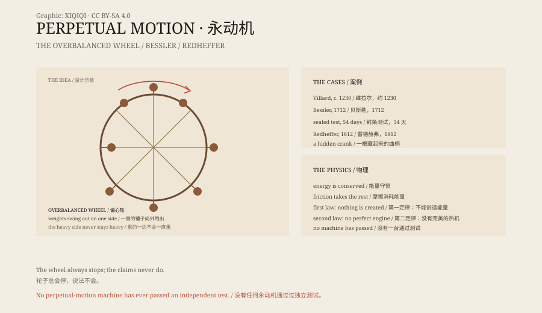

## 1. The Wheel

In the thirteenth century the French craftsman Villard de Honnecourt drew a wheel in his notebook.

Hinged arms around the rim carried weights. As the wheel turned, the weights on one side swung outward and the weights on the other folded inward. The designer believed the heavier side would keep pulling the wheel around.

An earlier version appears in twelfth-century India. The mathematician Bhaskara II drew a similar wheel and argued that it could turn by itself.

It is one of the earliest perpetual-motion sketches. Similar drawings appear in Arabic and European manuscripts.

None of them turned.

## 2. Why Not

The idea is simple: no coal, no water, no wind. A machine that turns by itself and can drive a mill or a pump.

Physics does not allow it. Energy is not created from nothing. A turning wheel loses energy to its axle and to the air. Without a supply, it can only slow down.

Medieval craftsmen did not know thermodynamics, but they could see the wheel stop. So they improved the hinges, added weights, reduced friction, and tried again.

## 3. Bessler

In 1712 the German Johann Bessler, who called himself Orffyreus, built a "self-moving wheel".

He covered the mechanism with canvas and let the public see only the outside. The wheel could lift weights and drive pumps. He toured, demonstrated, and became famous.

In 1717, at Weissenstein Castle in Kassel, one of his wheels was locked in a room and the doors and windows were sealed. Fifty-four days later the seals were intact and the wheel was still turning, at twenty-six revolutions per minute.

The examiners signed a certificate: no fraud had been found.

Bessler refused to reveal the mechanism. He asked a high price, hoping to sell it to a prince. Later a maid accused him of fraud; he destroyed the machine and died in poverty.

How he did it is unknown. Some said he hid a clockwork spring in the axle, some said he exploited a slope the audience could not see, and some said he was simply a very good showman.

## 4. Redheffer

In 1812 the American Charles Redheffer exhibited a machine in Philadelphia and charged admission.

It turned smoothly, and the crowds grew. Redheffer asked the government for money, and officials sent experts to inspect it.

The engineer Robert Fulton noticed that the speed was slightly uneven, as if someone were turning a crank by hand.

He removed the boards behind the machine, found a catgut cord, and followed it to a room upstairs. An old man was sitting there, turning a hand crank.

The crowd rushed in and smashed the machine.

## 5. Energy

In the nineteenth century Joule, Kelvin, Helmholtz and others established the conservation of energy and the laws of thermodynamics.

A perpetual motion machine of the first kind violates conservation of energy: it outputs more energy than it takes in.

A machine of the second kind does not violate conservation, but violates the second law of thermodynamics: it tries to turn ambient heat entirely into useful work, with no other change.

Today patent offices generally refuse perpetual-motion applications. Not because they distrust inventors, but because no such machine has ever passed an independent test.

## 6. Why It Persists

The story has not ended.

Videos about "free energy", "magnetic generators" and "zero-consumption" machines keep appearing online. Some are frauds, some are misunderstandings, some are measurement errors.

They are not fundamentally different from Bessler's wheel or Redheffer's machine: something that appears to defy common sense, plus an audience willing to believe it.

The wheel stops. Physics does not.

*Original schematic: the overbalanced wheel, the Bessler and Redheffer cases, and a thermodynamics timeline. Not a historical drawing. Oddity Archive, CC BY-SA 4.0.*

## Wheels

A permanent motive is a machine that can function forever without energy.

It violates the first and second laws of thermodynamics. Energy cannot be produced in empty space, nor can it never be lost.

## Bessler

John Bessler, an 18th-century German.

And he created many things of a “perpetuity motive”, some with wheels and some with ropes; and he said, “They can turn themselves.”

## Red Heffer

Charles Redhoff, a nineteenth-century American.

He's putting out a machine in New York, saying it can generate infinite energy. Then, someone reveals it, and there's a man underneath it.

## Energy

Never a motive.

Friction, air resistance, heat all consume energy. Machines need external energy.

## Why are you still here?

The story of eternal motives is still circulating.

Because it fulfils a wish: free energy, forever sports.

## Thermodynamics

Thermodynamics must be the first rule: energy cannot be produced from empty space.

Law number two: Energy will change from available to non-usable.

The eternal motive violates both laws.

## Machine

There are many kinds of machines that have a permanent motive.

Wheels, ropes, magnets, mercury. They look like they can turn themselves, and they need external energy.

## Liar

A lot of eternal motives are frauds.

The machine hides people under it, or with hidden batteries.

## Supplementary Notes

The eternal motive is an old dream.

It's always moving without energy.

Thermodynamics, impossible.

## Last

The second law of thermodynamics says that the entropy of the isolation system increases. The constant motive is to reverse the process, so it's impossible.

The eternally motivated dream never materialized. It only proved one thing: energy is not free.

The machine will stop, the dream won't. The story of a permanent motive will continue.

The story's still there.

Energy is not free, but dreams are.

## Archives

In the 12th century, the Indian mathematician Ben Shighara described an "automatic wheel." He didn't mean that it really could move forever, but that it was used to talk about sports. The eternally motivated dream never came true. It only proved that energy was not free.

The wheels of Bashcharo, by weight and swing. It looks like forever, but it stops.

Physics says friction and gravity stop the wheel.

In the 18th century, European craftsmen made a lot of “perpetuity wheels”. They tricked the audience with hidden hairlines or hammers.

And these wheels were then torn apart. They were hidden in them with gear and hammers. And the wheels of Bashcharo were drawn on paper. It had no substance, but a description.

The patent office usually refuses it directly.

Most of these applications have no background.

The wheel finally stopped, the dream didn't.

Ever-motivated dream, still.

---

**Sources and licenses**: the factual sources are listed in the source ledger S1–S3 at the bottom of this entry. Text and original diagrams are licensed under CC BY-SA 4.0. This article separates the historical designs, the Bessler and Redheffer cases and the thermodynamic explanation; perpetual motion violates conservation of energy or the second law, and no machine has passed an independent test. The illustration is a scene reconstruction, not a historical drawing.
